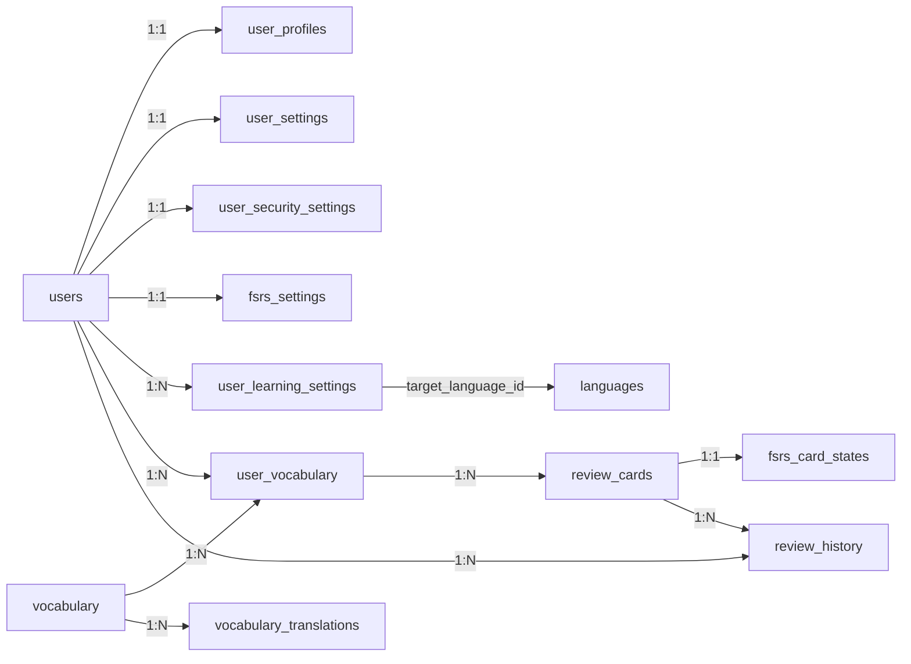
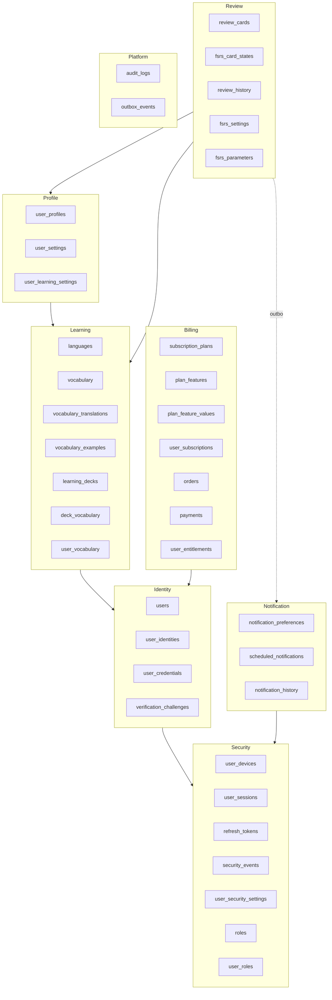

# کاتالوگ دیتابیس Lurnian

| Field | Value |
| --- | --- |
| **Status** | مرجع عملیاتی — هم‌خوان با مدل‌های کد |
| **Date** | 2026-11-10 |
| **Scope** | ۳۸ جدول، ۸ دامنه، روابط، قیدها و الگوهای استفاده |
| **منبع حقیقت** | `src/lurnian/modules/*/models.py` + `alembic/versions/0001_initial_schema.py` |
| **سند طراحی** | [`database-design.md`](database-design.md) |

این کاتالوگ «چی هست» را می‌گوید و سند طراحی «چرا این‌طور است». اگر بین این دو اختلاف دیدید، **کد** درست است؛ فقط همین کاتالوگ را به‌روز کنید.

---

## ۰. سه لایه‌ای که باید بدانید

| لایه | سؤال | کجای این فایل |
| --- | --- | --- |
| **نقشه** | چه جدول‌هایی داریم و چطور به هم وصل‌اند؟ | بخش ۱ و ۲ |
| **جزئیات** | هر جدول چه ستون‌ها، قیدها و ایندکس‌هایی دارد؟ | بخش ۳ (D1 تا D8) |
| **استفاده** | برای هر کار واقعی چه کوئری/سرویسی صدا بزنم؟ | بخش ۴ (دستور پخت‌ها) و ۵ (دام‌ها) |

**ساختار هر جدول:** مشخصات ← جدول ستون‌ها (هر ستون یک پارامتر و معنایش) ← «دقیقاً چه می‌کند» (چرخه عمر و نقش پارامترهای مهم) ← «مثال کاربردی» (SQL واقعی با نتیجه).

## ۱. تصویر کلی

- **۳۸ جدول** در ۸ دامنه.
- **۳۱ نوع ENUM** (همه در `core/enums.py`، مشترک بین مدل و migration).
- **۴ الگوی شناسه:** `uuid` (UUIDv7 در اپ) برای موجودیت‌های عمومی، `bigint identity` برای دفترهای پرنوشت، `smallint identity` برای کاتالوگ‌ها، و کلیدهای ترکیبی برای جدول‌های واسط.
- **۳ قاعده که همه چیز را می‌سازد:**
  1. **مالکیت در سطح DB:** هر جدول کاربرمحور `user_id` دارد و جاهایی که امکان اشتباه بود، FK ترکیبی هم دارد.
  2. **دفتر کل از وضعیت جدا است:** `review_history` هرگز UPDATE نمی‌شود؛ وضعیت جاری در `fsrs_card_states` است.
  3. **محتوا از پیشرفت جدا است:** `vocabulary` هیچ داده‌ای از یادگیری کاربر ندارد؛ `user_vocabulary` نقطه ورود به برنامه یادگیری است.

### توزیع جداول

| دامنه | تعداد | جدول‌ها |
| --- | --- | --- |
| D1 Identity | ۴ | `users`, `user_identities`, `user_credentials`, `verification_challenges` |
| D2 Security | ۷ | `user_devices`, `user_sessions`, `refresh_tokens`, `security_events`, `user_security_settings`, `roles`, `user_roles` |
| D3 Profile | ۳ | `user_profiles`, `user_settings`, `user_learning_settings` |
| D4 Billing | ۷ | `subscription_plans`, `plan_features`, `plan_feature_values`, `user_subscriptions`, `orders`, `payments`, `user_entitlements` |
| D5 Learning | ۷ | `languages`, `vocabulary`, `vocabulary_translations`, `vocabulary_examples`, `learning_decks`, `deck_vocabulary`, `user_vocabulary` |
| D6 Review | ۵ | `review_cards`, `fsrs_card_states`, `review_history`, `fsrs_settings`, `fsrs_parameters` |
| D7 Notification | ۳ | `notification_preferences`, `scheduled_notifications`, `notification_history` |
| D8 Platform | ۲ | `audit_logs`, `outbox_events` |

## ۲. نقشه روابط

### ۲.۱ ستون فقرات کاربر (مسیری که ۹۰٪ کوئری‌ها طی می‌کنند)



### ۲.۲ مرز دامنه‌ها



**قاعده جهت:** Identity به هیچ دامنه‌ای وابسته نیست. Review می‌خواند (Learning، Profile) اما نوشتن در آن‌ها ممنوع است. Notification فقط مصرف‌کننده رویداد است.

### ۲.۳ رفتار حذف (خیلی مهم)

| وقتی حذف می‌شود | چه اتفاقی می‌افتد |
| --- | --- |
| `users` (فیزیکی، عملاً هرگز نمی‌شود) | `CASCADE` روی پروفایل/تنظیمات/نشست‌ها/واژگان کاربر/کارت‌ها؛ `RESTRICT` روی پرداخت، سفارش، تاریخچه مرور، لاگ‌ها، اشتراک |
| `user_vocabulary` | کارت‌ها و وضعیت FSRS حذف می‌شوند؛ `review_history` می‌ماند و `card_id` آن `NULL` می‌شود |
| `review_cards` | `fsrs_card_states` حذف؛ `review_history.card_id` → `NULL`؛ یادآورهای همان کارت حذف |
| `review_history` | **هرگز** — نه API دارد، نه CASCADE. فقط retention دستی در آینده |
| `learning_decks` | حذف نرم (`deleted_at`)؛ عضویت‌ها و کارت‌ها دست‌نخورده |
| `vocabulary` | `RESTRICT` از سمت `user_vocabulary`؛ فقط `is_active=false` |
| `fsrs_parameters` | `RESTRICT`؛ وزن‌های مرجع حذف نمی‌شوند |

---

## ۳. جداول، دامنه به دامنه

راهنمای ستون‌ها: `NULL` یعنی آیا مقدار خالی مجاز است. نوع‌ها نوع واقعی PostgreSQL هستند.

### D1 — Identity & SSO

#### ۱. `users` — ریشه هویت

**کارش:** تنها جدولی که «کاربر وجود دارد» را تعریف می‌کند. وضعیت حساب، ایمیل و موبایل.

| ستون | نوع | NULL | پیش‌فرض | معنا |
| --- | --- | --- | --- | --- |
| `id` | `uuid` | نه | — | UUIDv7 در اپ |
| `email` | `text` | بله | `NULL` | شناسه ورود؛ یکتایی با `lower(email)` |
| `email_verified_at` | `timestamptz` | بله | `NULL` | اثبات مالکیت ایمیل |
| `phone_e164` | `text` | بله | `NULL` | `+98912…` |
| `phone_verified_at` | `timestamptz` | بله | `NULL` | تأیید OTP |
| `status` | `user_status` | نه | `'active'` | `active·pending·suspended·deactivated·pending_deletion` |
| `last_active_at` | `timestamptz` | بله | `NULL` | آخرین فعالیت معنادار |
| `created_at`,`updated_at` | `timestamptz` | نه | `now()` | ساعت دیتابیس |
| `deleted_at` | `timestamptz` | بله | `NULL` | حذف نرم |

**قیدهای مهم:** حداقل یکی از ایمیل/موبایل؛ قالب ایمیل و E.164؛ `pending_deletion` فقط با `deleted_at` پر.
**ایندکس‌ها:** `ix_users_email_lower` (unique, partial)، `ix_users_phone_e164` (unique, partial)، `ix_users_last_active_at` (partial `deleted_at IS NULL`).
**رابطه:** ۱:۱ با `user_profiles`/`user_settings`/`user_security_settings`/`fsrs_settings`؛ ۱:N با همه جداول کاربرمحور.

**دقیقاً چه می‌کند:** مالک حقیقت «این حساب وجود دارد». هر ردیف یک انسان قابل ورود است و بقیه جداول یا به آن FK دارند یا کلید ترکیبی با آن می‌سازند. `status` تصمیم ورود را می‌گیرد (فقط `active` اجازه ورود دارد)، `deleted_at` حذف نرم است و هر کوئری کاربرمحور باید `deleted_at IS NULL` بزند. `last_active_at` برای سیاست عدم‌فعال‌سازی است، نه برای هر درخواست؛ نوشتن آن در هر request یک hot row می‌سازد.

**مثال کاربردی** — ثبت‌نام و ورود:

```sql
-- ثبت‌نام: کاربر + پروفایل + تنظیمات در یک تراکنش
INSERT INTO users (id, email, status) VALUES ($1, 'sara@example.com', 'pending');
INSERT INTO user_profiles (user_id) VALUES ($1);
INSERT INTO user_settings (user_id) VALUES ($1);

-- ورود: فقط حساب فعال و حذف‌نشده
SELECT id, status FROM users
WHERE lower(email) = lower('Sara@Example.com') AND deleted_at IS NULL;
```

**نتیجه:** ایمیل با حروف بزرگ هم پیدا می‌شود (ایندکس روی `lower(email)` است)، اما اگر `status='suspended'` باشد رمز درست هم نباید نشست بسازد.

#### ۲. `user_identities` — هویت خارجی

**کارش:** اتصال حساب Google/Apple. هیچ توکن provider ذخیره نمی‌شود.

| ستون | نوع | NULL | پیش‌فرض | معنا |
| --- | --- | --- | --- | --- |
| `id` | `uuid` | نه | — | — |
| `user_id` | `uuid` | نه | — | FK → `users` `CASCADE` |
| `provider` | `identity_provider` | نه | — | `google·apple` |
| `subject` | `text` | نه | — | `sub` پایدار provider (≤۲۵۵) |
| `email_at_provider` | `text` | بله | `NULL` | برای تصمیم «پیوند یا حساب جدید» |
| `email_verified` | `boolean` | نه | `false` | claim provider |
| `linked_at` | `timestamptz` | نه | `now()` | — |
| `last_login_at` | `timestamptz` | بله | `NULL` | نمایش «روش‌های ورود» |

**قید کلیدی:** `UNIQUE (provider, subject)` — دو حساب برای یک هویت غیرممکن.

**دقیقاً چه می‌کند:** فقط «کدام هویت خارجی به کدام حساب وصل است». `provider` + `subject` جفت پایدارند و همان چیزی است که Google/Apple در هر ورود برمی‌گردانند؛ `email_at_provider` صرفاً برای تصمیم «پیوند بزن یا حساب جدید بساز» نگه داشته می‌شود و ممکن است بعداً عوض شود، پس هرگز کلید تشخیص نباشد. `last_login_at` برای نمایش «روش‌های ورود من» است.

**مثال کاربردی** — ورود با Google:

```sql
SELECT user_id FROM user_identities
WHERE provider = 'google' AND subject = '110169484474386276334';

-- اگر پیدا نشد: کاربر را با همان ایمیل پیدا کن یا بساز، سپس پیوند بزن
INSERT INTO user_identities (id, user_id, provider, subject, email_at_provider, email_verified, last_login_at)
VALUES ($1, $2, 'google', $3, $4, true, now())
ON CONFLICT (provider, subject) DO UPDATE SET last_login_at = now()
RETURNING user_id;
```

**نتیجه:** دوبار کلیک‌کردن روی دکمه ورود، دو حساب نمی‌سازد؛ `ON CONFLICT` همان ردیف را برمی‌گرداند.

#### ۳. `user_credentials` — فاکتورهای احراز هویت

**کارش:** رمز عبور، TOTP، کدهای بازیابی؛ همه در یک جدول با discriminator.

| ستون | نوع | NULL | پیش‌فرض | معنا |
| --- | --- | --- | --- | --- |
| `id` | `uuid` | نه | — | — |
| `user_id` | `uuid` | نه | — | FK `CASCADE` |
| `kind` | `credential_kind` | نه | — | `password·totp·recovery_codes` |
| `secret_hash` | `text` | بله | `NULL` | scrypt (رمز/کدهای بازیابی) |
| `secret_encrypted` | `bytea` | بله | `NULL` | TOTP secret (رمزنگاری‌شده) |
| `algorithm` | `text` | بله | `'SHA1'` | الگوریتم TOTP |
| `digits` | `smallint` | نه | `6` | ۶ تا ۸ |
| `period_seconds` | `smallint` | نه | `30` | ۱۵ تا ۱۲۰ |
| `confirmed_at` | `timestamptz` | بله | `NULL` | تأیید اولین کد |
| `last_used_at` | `timestamptz` | بله | `NULL` | — |
| `created_at`,`updated_at` | `timestamptz` | نه | `now()` | — |
| `revoked_at` | `timestamptz` | بله | `NULL` | غیرفعال‌سازی بدون حذف |

**قید کلیدی:** یک رمز فعال / یک TOTP فعال per user (unique جزئی روی `user_id` با شرط `revoked_at IS NULL`).

**دقیقاً چه می‌کند:** همه راه‌های اثبات هویت را با یک discriminator جمع می‌کند. `kind` می‌گوید کدام ستون معنا دارد: برای `password` و `recovery_codes` ستون `secret_hash` پر است (هش scrypt)، برای `totp` ستون `secret_encrypted` (چون برای تولید کد باید رمزگشایی شود) و `algorithm/digits/period_seconds` فقط برای TOTP معنا دارند. `revoked_at` جای حذف را می‌گیرد تا تاریخچه «۲FA را چه زمانی خاموش کرد» بماند.

**مثال کاربردی** — صفحه «امنیت حساب»:

```sql
SELECT kind, confirmed_at IS NOT NULL AS confirmed, last_used_at
FROM user_credentials
WHERE user_id = $1 AND revoked_at IS NULL;
```

**نتیجه:** نبود ردیف `password` یعنی حساب فقط با Google وارد می‌شود؛ نبود ردیف `totp` یعنی 2FA روشن نیست. دو رمز فعال هم‌زمان غیرممکن است چون unique جزئی روی `user_id ... kind='password' AND revoked_at IS NULL` است.

#### ۴. `verification_challenges` — OTP و لینک تأیید

**کارش:** کد یک‌بارمصرف، حتی قبل از ساخته‌شدن حساب. خود کد ذخیره نمی‌شود.

| ستون | نوع | NULL | پیش‌فرض | معنا |
| --- | --- | --- | --- | --- |
| `id` | `uuid` | نه | — | در لینک تأیید استفاده می‌شود |
| `user_id` | `uuid` | بله | `NULL` | برای ثبت‌نام خالی است |
| `channel` | `challenge_channel` | نه | — | `email·sms` |
| `destination` | `text` | نه | — | ایمیل lowercase یا E.164 |
| `purpose` | `challenge_purpose` | نه | — | `signup·login·identifier_verify·password_reset·identity_link·totp_reset` |
| `code_hash` | `bytea` | نه | — | HMAC-SHA256 با pepper |
| `attempts` | `smallint` | نه | `0` | ≤ `max_attempts` |
| `max_attempts` | `smallint` | نه | `5` | — |
| `created_at` | `timestamptz` | نه | `now()` | مبنای نرخ‌محدودی |
| `expires_at` | `timestamptz` | نه | — | باید > `created_at` |
| `consumed_at` | `timestamptz` | بله | `NULL` | یک‌بارمصرف |
| `invalidated_at` | `timestamptz` | بله | `NULL` | باطل‌سازی صریح |
| `request_ip` | `inet` | بله | `NULL` | تشخیص سوءاستفاده |

**دقیقاً چه می‌کند:** کد یک‌بارمصرف را نگه می‌دارد، نه خود کد را. `code_hash` هش HMAC است تا نشت دیتابیس کد را لو ندهد؛ `attempts/max_attempts` جلوی حدس‌زدن را می‌گیرد؛ `expires_at` عمر کوتاه (۵–۱۰ دقیقه)؛ سه ستون `consumed_at`، `invalidated_at` و `expires_at` سه راه مختلف مردن یک کد هستند و بررسی باید هر سه را ببیند. `destination` عمداً جدا از `users` نگه داشته می‌شود تا قبل از ساخته‌شدن حساب هم بتوان کد فرستاد.

**مثال کاربردی** — تأیید کد:

```sql
UPDATE verification_challenges
SET consumed_at = now()
WHERE id = $1
  AND consumed_at IS NULL
  AND invalidated_at IS NULL
  AND expires_at > now()
  AND attempts < max_attempts
RETURNING user_id, destination, purpose;
```

**نتیجه:** صفر ردیف برگشتی یعنی کد مرده است. چون مصرف در همان `UPDATE` انجام می‌شود، دو درخواست هم‌زمان با یک کد نمی‌توانند هر دو موفق شوند.

### D2 — Security & Authorization

#### ۵. `user_devices` — دستگاه و توکن Push

| ستون | نوع | NULL | پیش‌فرض | معنا |
| --- | --- | --- | --- | --- |
| `id` | `uuid` | نه | — | — |
| `user_id` | `uuid` | نه | — | FK `CASCADE` |
| `fingerprint_hash` | `text` | نه | — | SHA-256؛ خام دستگاه ذخیره نمی‌شود |
| `platform` | `device_platform` | نه | — | `ios·android·web` |
| `display_name` | `text` | بله | `NULL` | «iPhone 15 — سارا» |
| `app_version` | `text` | بله | `NULL` | تشخیص نسخه معیوب |
| `push_token` | `text` | بله | `NULL` | یک capability: در لاگ ننویسید |
| `push_provider` | `push_provider` | بله | `NULL` | `apns·fcm·web_push` |
| `push_token_updated_at` | `timestamptz` | بله | `NULL` | توکن‌ها rotate می‌شوند |
| `first_seen_at`,`last_seen_at` | `timestamptz` | نه | `now()` | — |
| `trusted_at` | `timestamptz` | بله | `NULL` | «این دستگاه را به خاطر بسپار» |
| `revoked_at` | `timestamptz` | بله | `NULL` | دستگاه حذف نمی‌شود |

**قید:** `UNIQUE (user_id, fingerprint_hash)`؛ `push_token` بدون `push_provider` مجاز نیست.

**دقیقاً چه می‌کند:** هر دستگاه فیزیکی را یک‌بار ثبت می‌کند تا (۱) نشست‌ها را بتوان در صفحه «دستگاه‌های من» نشان داد و (۲) برای همان دستگاه Push بفرستیم. `fingerprint_hash` اثر انگشت دستگاه است، نه شناسه سخت‌افزاری خام — حریم خصوصی. `trusted_at` یعنی «این دستگاه را به خاطر بسپار» و `revoked_at` یعنی کاربر آن را حذف کرده، اما ردیف می‌ماند تا نشست‌های تاریخی‌اش گم نشوند.

**مثال کاربردی** — باز شدن اپ:

```sql
INSERT INTO user_devices (id, user_id, fingerprint_hash, platform, display_name, push_token, push_provider)
VALUES ($1, $2, $3, 'ios', 'iPhone 15', $4, 'apns')
ON CONFLICT (user_id, fingerprint_hash) DO UPDATE
SET last_seen_at = now(),
    push_token = COALESCE(EXCLUDED.push_token, user_devices.push_token),
    push_token_updated_at = CASE WHEN EXCLUDED.push_token IS NULL THEN user_devices.push_token_updated_at ELSE now() END
RETURNING id;
```

**نتیجه:** یک دستگاه = یک ردیف، حتی اگر بارها اپ باز شود؛ توکن Push با هر نصب عوض می‌شود ولی ردیف و تاریخچه‌اش ثابت می‌ماند.

#### ۶. `user_sessions` — نشست ورود

**کارش:** هر ورود موفق = یک نشست؛ واحد فوری ابطال دسترسی. `id` همان `sid` در access token است.

| ستون | نوع | NULL | پیش‌فرض | معنا |
| --- | --- | --- | --- | --- |
| `id` | `uuid` | نه | — | `sid` |
| `user_id` | `uuid` | نه | — | FK `CASCADE` |
| `device_id` | `uuid` | بله | `NULL` | FK → `user_devices` `SET NULL` |
| `auth_method` | `auth_method` | نه | — | `password·google·apple·sms_otp·email_otp` |
| `ip` | `inet` | بله | `NULL` | نمایش در «نشست‌های فعال» |
| `user_agent` | `text` | بله | `NULL` | بریده‌شده |
| `created_at` | `timestamptz` | نه | `now()` | — |
| `last_seen_at` | `timestamptz` | بله | `NULL` | با هر refresh، نه هر request |
| `absolute_expires_at` | `timestamptz` | نه | — | سقف مطلق عمر (۳۰ روز) |
| `revoked_at` | `timestamptz` | بله | `NULL` | ابطال فوری |
| `revoked_reason` | `session_revoked_reason` | بله | `NULL` | `logout·logout_all·reuse_detected·password_change·admin·expired` |

**دقیقاً چه می‌کند:** واحد «ورود». هر ورود موفق یک ردیف می‌سازد و `id` همان `sid` داخل access token است؛ بنابراین ابطال یک نشست، فوراً همه توکن‌های آن را بی‌اثر می‌کند بدون اینکه به لیست سیاه توکن نیاز باشد. `absolute_expires_at` سقف مطلق عمر است (مثلاً ۳۰ روز) و با refresh تمدید نمی‌شود؛ `last_seen_at` فقط هنگام refresh به‌روز می‌شود تا هر درخواست یک نوشتن نداشته باشد. `revoked_reason` برای پشتیبانی حیاتی است: «خودم خارج شدم» با «توکن دزدی شده» یکی نیست.

**مثال کاربردی** — «از همه دستگاه‌ها خارج شو»:

```sql
UPDATE user_sessions
SET revoked_at = now(), revoked_reason = 'logout_all'
WHERE user_id = $1 AND revoked_at IS NULL;

-- اعتبارسنجی هر درخواست
SELECT 1 FROM user_sessions
WHERE id = $1 AND revoked_at IS NULL AND absolute_expires_at > now();
```

**نتیجه:** از همان لحظه، access tokenهای باقی‌مانده (که هنوز منقضی نشده‌اند) رد می‌شوند؛ کوئری روی PK است، پس هزینه‌اش ناچیز است.

#### ۷. `refresh_tokens` — توکن چرخشی

| ستون | نوع | NULL | پیش‌فرض | معنا |
| --- | --- | --- | --- | --- |
| `id` | `uuid` | نه | — | — |
| `session_id` | `uuid` | نه | — | FK `CASCADE` |
| `token_hash` | `bytea` | نه | — | SHA-256؛ یکتا |
| `family_id` | `uuid` | نه | — | شناسه اولین توکن زنجیره |
| `parent_id` | `uuid` | بله | `NULL` | توکنی که جایگزینش شد |
| `issued_at` | `timestamptz` | نه | `now()` | — |
| `expires_at` | `timestamptz` | نه | — | باید > `issued_at` |
| `used_at` | `timestamptz` | بله | `NULL` | زمان مصرف (چرخش) |
| `revoked_at` | `timestamptz` | بله | `NULL` | — |
| `revoked_reason` | `session_revoked_reason` | بله | `NULL` | — |

**قید:** یک توکن فعال per session (unique جزئی)؛ مصرف دوباره ⇒ ابطال کل `family_id` + نشست.

**دقیقاً چه می‌کند:** هر بار که access token تمدید می‌شود، توکن قبلی می‌میرد و یکی جدید با همان `family_id` متولد می‌شود. `family_id` «خط نسب» است: زنجیره‌ای از توکن‌ها که همه از یک ورود آمده‌اند. `parent_id` توکن قبلی را نشان می‌دهد (درخت قابل ردیابی) و `used_at` مهم‌ترین ستون است: اگر توکنی که `used_at` دارد دوباره بیاید، یعنی کسی کپی آن را در دست دارد ⇒ کل خانواده و نشست باید باطل شود. خود توکن هرگز ذخیره نمی‌شود، فقط `token_hash`.

**مثال کاربردی** — چرخش و تشخیص سرقت:

```sql
-- ۱) مصرف توکن و ساخت جانشین در یک تراکنش
UPDATE refresh_tokens SET used_at = now()
WHERE token_hash = $1 AND used_at IS NULL AND revoked_at IS NULL AND expires_at > now()
RETURNING id, session_id, family_id;

-- ۲) اگر used_at پر بود (استفاده مجدد):
UPDATE refresh_tokens SET revoked_at = now(), revoked_reason = 'reuse_detected'
WHERE family_id = $2 AND revoked_at IS NULL;
UPDATE user_sessions SET revoked_at = now(), revoked_reason = 'reuse_detected'
WHERE id = $3;
```

**نتیجه:** مهاجم و کاربر هر دو بیرون می‌افتند و کاربر باید دوباره وارد شود — بهای امنیت، یک بار ورود مجدد. تنها یک توکن فعال در هر نشست وجود دارد (unique جزئی).

#### ۸. `security_events` — ردپای امنیتی

| ستون | نوع | NULL | پیش‌فرض | معنا |
| --- | --- | --- | --- | --- |
| `id` | `bigint` identity | نه | — | پرنوشت |
| `user_id` | `uuid` | بله | `NULL` | برای رویداد پیش از احراز هویت |
| `event_type` | `text` | نه | — | `login_failed`, `refresh_reuse_detected`, … (رشدپذیر) |
| `severity` | `security_severity` | نه | `'info'` | `info·warning·critical` |
| `ip` | `inet` | بله | `NULL` | — |
| `user_agent` | `text` | بله | `NULL` | بریده‌شده |
| `request_id` | `text` | بله | `NULL` | اتصال به لاگ |
| `context` | `jsonb` | بله | `NULL` | جزئیات؛ بدون PII/secret |
| `created_at` | `timestamptz` | نه | `now()` | — |

**نکته:** append-only. FK به `users` با `RESTRICT` (ردپا ناپدید نمی‌شود).

**دقیقاً چه می‌کند:** دفتر فقط-افزودنیِ اتفاقات امنیتی. `event_type` متن آزاد است (نه ENUM) تا رویداد جدید بدون migration اضافه شود؛ `severity` برای فیلتر هشدار؛ `context` جزئیات ساخت‌یافته (مثلاً `{"reason": "expired_code"}`) و هرگز نباید رمز/توکن در آن باشد. `user_id` می‌تواند خالی باشد، چون «تلاش ورود با ایمیل ناموجود» هم رویداد است. FK با `RESTRICT` است تا ردپا با حذف کاربر ناپدید نشود.

**مثال کاربردی** — محدودسازی تلاش ورود:

```sql
INSERT INTO security_events (user_id, event_type, severity, ip, request_id, context)
VALUES ($1, 'login_failed', 'warning', $2, $3, '{"identifier": "email"}'::jsonb);

SELECT count(*) AS failures FROM security_events
WHERE event_type = 'login_failed' AND ip = $2 AND created_at > now() - interval '15 minutes';
```

**نتیجه:** با عبور از آستانه، ورود موقتاً قفل می‌شود. ایندکس جزئی روی `created_at` برای `severity='critical'` نگه داشته می‌شود تا صفحه هشدار سریع بماند.

#### ۹. `user_security_settings` — سیاست امنیتی کاربر

| ستون | نوع | NULL | پیش‌فرض | معنا |
| --- | --- | --- | --- | --- |
| `user_id` | `uuid` | نه | — | PK/FK `CASCADE` |
| `two_factor_required` | `boolean` | نه | `false` | الزام TOTP |
| `login_alerts_enabled` | `boolean` | نه | `true` | هشدار ورود جدید |
| `session_idle_timeout_minutes` | `smallint` | بله | `NULL` | ۵ تا ۴۳۲۰۰؛ `NULL` = پیش‌فرض پلتفرم |
| `created_at`,`updated_at` | `timestamptz` | نه | `now()` | — |

**نکته:** «آیا TOTP فعال است؟» این‌جا نیست؛ منبع حقیقت `user_credentials` است.

**دقیقاً چه می‌کند:** سیاست امنیتی *کاربر* را از *واقعیت* جدا می‌کند. این‌جا فقط می‌گوید «۲FA الزامی است؟» و «آیا TOTP فعال است؟» را باید از `user_credentials` پرسید — دو منبع مختلف برای دو سؤال مختلف، تا هیچ‌وقت ادعای «۲FA روشن است» بدون راز واقعی وجود نداشته باشد. `session_idle_timeout_minutes` تهی یعنی از پیش‌فرض پلتفرم استفاده کن.

**مثال کاربردی** — تصمیم هنگام ورود:

```sql
SELECT s.two_factor_required,
       EXISTS (
         SELECT 1 FROM user_credentials c
         WHERE c.user_id = s.user_id AND c.kind = 'totp'
           AND c.confirmed_at IS NOT NULL AND c.revoked_at IS NULL
       ) AS totp_ready
FROM user_security_settings s WHERE s.user_id = $1;
```

**نتیجه:** اگر `two_factor_required` روشن باشد و `totp_ready` نه، ورود باید به مسیر «راه‌اندازی 2FA» برود، نه اینکه فقط رد شود.

#### ۱۰. `roles` — نقش کارمندی

| ستون | نوع | NULL | پیش‌فرض | معنا |
| --- | --- | --- | --- | --- |
| `id` | `smallint` identity | نه | — | — |
| `code` | `text` | نه | — | `support·content_editor·admin` (regex: `^[a-z][a-z0-9_]{1,31}$`) |
| `name` | `text` | نه | — | نام نمایشی |
| `description` | `text` | بله | `NULL` | — |
| `is_system` | `boolean` | نه | `true` | نقش سیستمی حذف نمی‌شود |
| `created_at` | `timestamptz` | نه | `now()` | — |

**نکته:** کاربر عادی **هیچ ردیفی** در این جدول و در `user_roles` ندارد.

**دقیقاً چه می‌کند:** فهرست نقش‌های *کارمندی* (پشتیبانی، ویرایشگر محتوا، ادمین) — نه نقش کاربر عادی. `code` شناسه پایدار برای کد است و `name` فقط نمایشی؛ منطق برنامه باید همیشه با `code` مقایسه کند نه `name`. `is_system` جلوی حذف نقش‌هایی را می‌گیرد که کد به آن‌ها تکیه کرده است. دیکشنری permission این‌جا نیست؛ در `core/permissions.py` نگاشت `role → permission` است (تصمیم D-21).

**مثال کاربردی** — seed اولیه:

```sql
INSERT INTO roles (code, name, description) VALUES
  ('support', 'پشتیبانی', 'دیدن حساب و ابطال نشست'),
  ('content_editor', 'ویرایشگر محتوا', 'مدیریت واژه و مجموعه رسمی'),
  ('admin', 'مدیر', 'دسترسی کامل')
ON CONFLICT (code) DO NOTHING;
```

**نتیجه:** اجرای دوباره migration/seed خطا نمی‌دهد و نقش‌های موجود دست‌نخورده می‌مانند.

#### ۱۱. `user_roles` — انتساب نقش

| ستون | نوع | NULL | پیش‌فرض | معنا |
| --- | --- | --- | --- | --- |
| `user_id` | `uuid` | نه | — | PK، FK `CASCADE` |
| `role_id` | `smallint` | نه | — | PK، FK `RESTRICT` |
| `granted_by` | `uuid` | بله | `NULL` | FK `SET NULL` |
| `granted_at` | `timestamptz` | نه | `now()` | — |
| `expires_at` | `timestamptz` | بله | `NULL` | دسترسی موقت پشتیبانی |
| `revoked_at` | `timestamptz` | بله | `NULL` | لغو با حفظ تاریخچه |

**Permission کجاست؟** در کد: `Enum` + نقشه `ROLE_PERMISSIONS`. هیچ جدول `permissions` وجود ندارد (تصمیم D-21).

**دقیقاً چه می‌کند:** انتساب نقش به کاربر، با امکان انقضا و لغو. نبودن ردیف یعنی «کاربر عادی» — این مهم‌ترین نکته: مجوز پیش‌فرض صفر است، نه یک. `expires_at` برای دسترسی موقت پشتیبانی است (مثلاً ۸ ساعت) و `revoked_at` برای لغو دستی با حفظ سابقه؛ `granted_by` می‌گوید چه کسی داده، که خودش باید در `audit_logs` هم ثبت شود.

**مثال کاربردی** — دسترسی موقت پشتیبانی:

```sql
INSERT INTO user_roles (user_id, role_id, granted_by, expires_at)
VALUES ($1, (SELECT id FROM roles WHERE code = 'support'), $2, now() + interval '8 hours')
ON CONFLICT (user_id, role_id) DO UPDATE
SET revoked_at = NULL, expires_at = EXCLUDED.expires_at;

SELECT r.code FROM user_roles ur JOIN roles r ON r.id = ur.role_id
WHERE ur.user_id = $1 AND ur.revoked_at IS NULL
  AND (ur.expires_at IS NULL OR ur.expires_at > now());
```

**نتیجه:** بعد از ۸ ساعت، نقش خودبه‌خود از پاسخ حذف می‌شود؛ نیازی به job پاک‌سازی نیست چون فیلتر در خواندن است.

### D3 — Profile & Preferences

#### ۱۲. `user_profiles` — هویت عمومی

| ستون | نوع | NULL | پیش‌فرض | معنا |
| --- | --- | --- | --- | --- |
| `user_id` | `uuid` | نه | — | PK/FK `CASCADE` |
| `username` | `text` | بله | `NULL` | یکتا (case-insensitive)، regex `^[a-z0-9_]{3,32}$` |
| `display_name` | `text` | بله | `NULL` | ۱ تا ۶۴ کاراکتر |
| `avatar_object_key` | `text` | بله | `NULL` | کلید شیء در R2، نه URL |
| `bio` | `text` | بله | `NULL` | ≤ ۵۰۰ |
| `country_code` | `char(2)` | بله | `NULL` | ISO 3166-1 alpha-2 |
| `is_public` | `boolean` | نه | `false` | پروفایل عمومی |
| `created_at`,`updated_at` | `timestamptz` | نه | `now()` | — |

**نکته:** ساخت کاربر و ساخت پروفایل در یک تراکنش؛ هیچ کاربری بدون ردیف پروفایل نیست.

**دقیقاً چه می‌کند:** اطلاعات نمایشی کاربر را از هویت (ایمیل/موبایل) جدا می‌کند تا بتوان پروفایل را عمومی کرد بدون لو دادن شناسه ورود. یک‌به‌یک با `users` است و در همان تراکنش ثبت‌نام ساخته می‌شود، پس کد می‌تواند همیشه فرض کند ردیف وجود دارد. `username` اختیاری و یکتا با `lower(username)` است؛ `avatar_object_key` کلید شیء در R2 است نه URL، تا با تغییر دامنه/CDN داده خراب نشود.

**مثال کاربردی** — انتخاب نام کاربری:

```sql
UPDATE user_profiles SET username = 'sara_v', display_name = 'سارا'
WHERE user_id = $1
RETURNING user_id;
```

**نتیجه:** اگر نام تکراری باشد، unique violation می‌دهد و API باید `409` برگرداند؛ به کاربر «آزاد است» نگویید تا وقتی `INSERT/UPDATE` موفق شده است.

#### ۱۳. `user_settings` — تنظیمات نمایش

| ستون | نوع | NULL | پیش‌فرض | معنا |
| --- | --- | --- | --- | --- |
| `user_id` | `uuid` | نه | — | PK/FK `CASCADE` |
| `locale` | `text` | نه | `'fa-IR'` | زبان UI |
| `timezone` | `text` | نه | `'Asia/Tehran'` | منطقه زمانی IANA؛ پایه «امروز» |
| `theme` | `theme_preference` | نه | `'system'` | `light·dark·system` |
| `daily_study_goal_minutes` | `smallint` | بله | `NULL` | ۵ تا ۲۴۰ |
| `created_at`,`updated_at` | `timestamptz` | نه | `now()` | — |

**نکته:** `timezone` تنها منبع محاسبه `reviewed_on` و streak است؛ stub مرور نباید timezone سرور را جانشین کند.

**دقیقاً چه می‌کند:** تنظیمات نمایشی و — مهم‌تر — `timezone` که پایه محاسبه «امروز» است. `review_history.reviewed_on` و streak با همین منطقه زمانی حساب می‌شوند، نه با ساعت سرور؛ این تفاوت باعث می‌شود کاربری در تهران نیمه‌شب مرور کند و مرورش به فردا نرود. `locale` زبان پیام‌ها و `theme` ظاهر را تعیین می‌کند؛ `daily_study_goal_minutes` فقط هدف است و در سهمیه‌ها دخالت ندارد.

**مثال کاربردی** — «امروزِ کاربر» برای صف مرور:

```sql
SELECT (now() AT TIME ZONE s.timezone)::date AS user_today, s.timezone
FROM user_settings s WHERE s.user_id = $1;
```

**نتیجه:** اگر کاربر در `Asia/Tehran` باشد و UTC هنوز دیروز است، صف و آمار بر اساس تاریخ محلی او ساخته می‌شود، نه تاریخ سرور.

#### ۱۴. `user_learning_settings` — زبان‌ها و سهمیه روز

| ستون | نوع | NULL | پیش‌فرض | معنا |
| --- | --- | --- | --- | --- |
| `id` | `uuid` | نه | — | — |
| `user_id` | `uuid` | نه | — | FK `CASCADE` |
| `source_language_id` | `smallint` | نه | — | FK → `languages` `RESTRICT` (زبان رابط) |
| `target_language_id` | `smallint` | نه | — | FK `RESTRICT` (زبان در حال یادگیری) |
| `daily_new_cards` | `smallint` | نه | `10` | ۰ تا ۲۰۰ |
| `daily_review_limit` | `smallint` | نه | `200` | ۰ تا ۲۰۰۰ |
| `card_modes` | `review_card_mode[]` | نه | `'{word_to_fa,fa_to_word}'` | حالت‌های فعال؛ حداقل یک عضو |
| `audio_autoplay` | `boolean` | نه | `true` | — |
| `is_active` | `boolean` | نه | `true` | یک ردیف فعال per user |
| `created_at`,`updated_at` | `timestamptz` | نه | `now()` | — |

**قید کلیدی:** unique جزئی `(user_id) WHERE is_active` ⇒ با فعال‌کردن تنظیمات جدید، قبلی را در **همان تراکنش** `is_active=false` کنید، وگرنه خطای unique می‌گیرید. `source_language_id <> target_language_id`.

**دقیقاً چه می‌کند:** می‌گوید کاربر چه زبانی را از چه زبانی یاد می‌گیرد و روزانه چند کارت جدید/مرور قبول می‌کند. `card_modes` تعیین می‌کند هنگام ورود یک واژه، چه کارت‌هایی ساخته شود — تنها جای این تصمیم است. `is_active` با unique جزئی محافظت می‌شود: فقط یک تنظیمات فعال در هر لحظه، ولی تاریخچه تغییر زبان حفظ می‌شود.

**مثال کاربردی** — تغییر زبان هدف (دو دستور، یک تراکنش):

```sql
UPDATE user_learning_settings SET is_active = false
WHERE user_id = $1 AND is_active;

INSERT INTO user_learning_settings
  (id, user_id, source_language_id, target_language_id, daily_new_cards, daily_review_limit, card_modes, is_active)
VALUES ($2, $1, 1, 3, 15, 150, '{word_to_fa,fa_to_word,audio}', true);
```

**نتیجه:** اگر ترتیب را برعکس کنید، unique violation می‌گیرید چون دو ردیف فعال هم‌زمان وجود دارد.

### D4 — Billing & Entitlements

#### ۱۵. `subscription_plans` — کاتالوگ پلن

| ستون | نوع | NULL | پیش‌فرض | معنا |
| --- | --- | --- | --- | --- |
| `id` | `smallint` identity | نه | — | — |
| `code` | `text` | نه | — | `free·pro_monthly·pro_yearly`؛ یکتا |
| `name`,`description` | `text` | نه/بله | — | متن نمایشی |
| `tier` | `plan_tier` | نه | — | `free·pro·premium` |
| `billing_period` | `billing_period` | نه | — | `none·monthly·yearly` |
| `price_minor` | `bigint` | نه | — | ≥ ۰؛ به واحد پول خرد |
| `currency` | `char(3)` | نه | — | `IRR·USD·EUR` |
| `trial_days` | `smallint` | نه | `0` | ۰ تا ۹۰ |
| `is_active` | `boolean` | نه | `true` | پلن بازنشسته حذف نمی‌شود |
| `sort_order` | `smallint` | نه | `0` | ترتیب صفحه پرداخت |
| `created_at`,`updated_at` | `timestamptz` | نه | `now()` | — |

**قید:** پلن `free` باید `billing_period='none'` و `price_minor=0` باشد؛ پلن پولی باید قیمت > ۰ داشته باشد.

**دقیقاً چه می‌کند:** کاتالوگ پلن‌ها؛ فقط تعریف، نه وضعیت هیچ کاربری. `price_minor` به واحد خرد ذخیره می‌شود (ریال/سنت) تا محاسبات مالی هیچ‌وقت اعشاری نشوند. `code` کلید منطقی است و کد به آن تکیه می‌کند (`free`, `pro_monthly`)؛ `id` فقط برای FK داخلی است. پلن بازنشسته حذف نمی‌شود، `is_active=false` می‌گیرد تا سفارش‌های قدیمی بتوانند به آن ارجاع بدهند.

**مثال کاربردی** — صفحه پرداخت:

```sql
SELECT code, name, tier, billing_period, price_minor, currency, trial_days
FROM subscription_plans
WHERE is_active
ORDER BY sort_order, price_minor;
```

**نتیجه:** خروجی مستقیماً قابل نمایش است؛ قیمت را در کد ضرب/تقسیم نکنید، همان `price_minor` را با `currency` به کلاینت بدهید.

#### ۱۶. `plan_features` — دیکشنری قابلیت‌ها

| ستون | نوع | NULL | پیش‌فرض | معنا |
| --- | --- | --- | --- | --- |
| `id` | `smallint` identity | نه | — | — |
| `code` | `text` | نه | — | `ai_explanations`, `offline_review`, `max_decks` …؛ یکتا و ثابت |
| `name`,`description` | `text` | نه/بله | — | — |
| `value_type` | `feature_value_type` | نه | — | `boolean·quota·tier` |
| `unit` | `text` | بله | `NULL` | `per_day·per_month` |
| `is_active` | `boolean` | نه | `true` | ویژگی حذف‌شده معنا ندارد |
| `created_at` | `timestamptz` | نه | `now()` | — |

**دقیقاً چه می‌کند:** دیکشنری قابلیت‌ها؛ یک ردیف per قابلیت، مستقل از پلن. `code` قرارداد بین کد و داده است (`ai_explanations`, `offline_review`, `max_decks`) و باید ثابت بماند. `value_type` می‌گوید مقدار در `plan_feature_values` چطور تفسیر شود: `boolean` (فقط روشن/خاموش)، `quota` (سهمیه عددی)، `tier` (سطح). `unit` واحد سهمیه را می‌گوید (`per_day`, `per_month`).

**مثال کاربردی** — افزودن قابلیت جدید بدون تغییر جدول‌ها:

```sql
INSERT INTO plan_features (code, name, value_type, unit)
VALUES ('max_decks', 'حداکثر مجموعه', 'quota', 'total');

INSERT INTO plan_feature_values (plan_id, feature_id, is_enabled, limit_value)
SELECT p.id, f.id, true, 5
FROM subscription_plans p, plan_features f
WHERE p.code = 'pro_monthly' AND f.code = 'max_decks';
```

**نتیجه:** کد فقط `code` را می‌شناسد؛ اضافه‌کردن یک قابلیت تجاری، migration نمی‌خواهد.

#### ۱۷. `plan_feature_values` — مقدار هر قابلیت در هر پلن

| ستون | نوع | NULL | پیش‌فرض | معنا |
| --- | --- | --- | --- | --- |
| `plan_id` | `smallint` | نه | — | PK، FK `CASCADE` |
| `feature_id` | `smallint` | نه | — | PK، FK `CASCADE` |
| `is_enabled` | `boolean` | نه | `false` | کلید روشن/خاموش |
| `limit_value` | `integer` | بله | `NULL` | سهمیه؛ `NULL` = نامحدود |

**قید:** اگر `value_type='quota'` ⇒ `limit_value` الزامی؛ `boolean` ⇒ `limit_value` ممنوع.

**دقیقاً چه می‌کند:** ماتریس «هر پلن، هر قابلیت، چه مقداری». `is_enabled` کلید اصلی تصمیم است و `limit_value` فقط وقتی معنا دارد که `value_type='quota'` باشد (`NULL` = نامحدود). چون PK ترکیبی `(plan_id, feature_id)` است، یک پلن نمی‌تواند دو مقدار متناقض برای یک قابلیت داشته باشد.

**مثال کاربردی** — همه قابلیت‌های یک پلن برای مقایسه در UI:

```sql
SELECT f.code, f.value_type, v.is_enabled, v.limit_value, f.unit
FROM plan_feature_values v
JOIN plan_features f ON f.id = v.feature_id
WHERE v.plan_id = (SELECT id FROM subscription_plans WHERE code = 'pro_monthly');
```

**نتیجه:** قابلیتی که ردیف ندارد «وجود ندارد»، نه «خاموش» — UI باید هر دو حالت را نشان دهد تا کاربر گیج نشود.

#### ۱۸. `user_subscriptions` — اشتراک جاری/تاریخی

| ستون | نوع | NULL | پیش‌فرض | معنا |
| --- | --- | --- | --- | --- |
| `id` | `uuid` | نه | — | — |
| `user_id` | `uuid` | نه | — | FK `CASCADE` |
| `plan_id` | `smallint` | نه | — | FK `RESTRICT` |
| `status` | `subscription_status` | نه | `'active'` | `trialing·active·past_due·canceled·expired` |
| `current_period_start`,`current_period_end` | `timestamptz` | نه | — | `end > start` |
| `cancel_at_period_end` | `boolean` | نه | `false` | لغو در پایان دوره |
| `canceled_at`,`ended_at`,`trial_ends_at` | `timestamptz` | بله | `NULL` | — |
| `provider` | `payment_provider` | بله | `NULL` | `NULL` = پرداخت دستی |
| `provider_subscription_id` | `text` | بله | `NULL` | شناسه در درگاه |
| `created_at`,`updated_at` | `timestamptz` | نه | `now()` | — |

**قید کلیدی:** حداکثر یک اشتراک `trialing`/`active`/`past_due` per user (unique جزئی). `provider` و `provider_subscription_id` یا هر دو پر یا هر دو خالی.

**دقیقاً چه می‌کند:** دوره اشتراک کاربر. `current_period_end` مرز دسترسی است: تا وقتی این تاریخ نگذشته و `status` در `trialing/active/past_due` است، پلن معتبر است. `cancel_at_period_end` یعنی «لغو کن، ولی تا آخر دوره استفاده کن» — تفاوت مهم با `canceled_at` که لحظه درخواست لغو است. `ended_at` پایان واقعی. unique جزئی تضمین می‌کند یک کاربر دو اشتراک فعال هم‌زمان نداشته باشد.

**مثال کاربردی** — پلن مؤثر همین حالا:

```sql
SELECT p.code, p.tier, s.status, s.current_period_end
FROM user_subscriptions s
JOIN subscription_plans p ON p.id = s.plan_id
WHERE s.user_id = $1
  AND s.status IN ('trialing', 'active', 'past_due')
  AND s.current_period_end > now();
```

**نتیجه:** خروجی خالی ⇒ کاربر روی پلن `free` است (پلن free اشتراک نمی‌سازد).

#### ۱۹. `orders` — سفارش خرید

| ستون | نوع | NULL | پیش‌فرض | معنا |
| --- | --- | --- | --- | --- |
| `id` | `uuid` | نه | — | — |
| `user_id` | `uuid` | نه | — | FK `RESTRICT` (سابقه مالی) |
| `plan_id` | `smallint` | نه | — | FK `RESTRICT` |
| `status` | `order_status` | نه | `'pending'` | `pending·paid·failed·canceled·refunded` |
| `subtotal_minor`,`discount_minor`,`amount_minor` | `bigint` | نه | `0`* | `amount = subtotal − discount` |
| `currency` | `char(3)` | نه | — | — |
| `idempotency_key` | `text` | نه | — | تکرار درخواست = همان سفارش |
| `placed_at` | `timestamptz` | نه | `now()` | — |
| `expires_at` | `timestamptz` | بله | `NULL` | انقضای رزرو |
| `paid_at`,`canceled_at` | `timestamptz` | بله | `NULL` | — |
| `created_at`,`updated_at` | `timestamptz` | نه | `now()` | — |

\* `subtotal_minor` پیش‌فرض ندارد؛ `discount_minor` صفر است.
**قید:** یکتایی `(user_id, idempotency_key)` بدون شرط جزئی (پس کلید برای هر سفارش الزامی است)؛ مبالغ غیرمنفی و `subtotal_minor >= amount_minor`.

**دقیقاً چه می‌کند:** نیت خرید را قبل از پرداخت ثبت می‌کند و مبلغ را قفل می‌کند، تا اگر قیمت پلن فردا عوض شد، سفارش امروز همان مبلغ قبلی را داشته باشد. `subtotal_minor - discount_minor = amount_minor` با CHECK تضمین می‌شود. `idempotency_key` از کلاینت می‌آید و با `(user_id, ...)` یکتاست، پس دوبار کلیک‌کردن روی «پرداخت» دو سفارش نمی‌سازد. `expires_at` رزرو را آزاد می‌کند.

**مثال کاربردی** — ساخت سفارش تکرارپذیر:

```sql
INSERT INTO orders
  (id, user_id, plan_id, status, subtotal_minor, discount_minor, amount_minor, currency, idempotency_key)
VALUES ($1, $2, (SELECT id FROM subscription_plans WHERE code = 'pro_monthly'),
        'pending', 499000, 0, 499000, 'IRR', $3)
ON CONFLICT (user_id, idempotency_key) DO NOTHING
RETURNING id;
```

**نتیجه:** اگر `RETURNING` خالی بود، سفارش قبلی را با همان کلید بخوانید و همان `id` را بدهید — کاربر به درگاه تکراری نمی‌رود.

#### ۲۰. `payments` — تراکنش درگاه

| ستون | نوع | NULL | پیش‌فرض | معنا |
| --- | --- | --- | --- | --- |
| `id` | `uuid` | نه | — | — |
| `order_id` | `uuid` | نه | — | FK `RESTRICT` |
| `user_id` | `uuid` | نه | — | FK `RESTRICT` (کوئری مستقیم بدون join) |
| `provider` | `payment_provider` | نه | — | `zarinpal·idpay·stripe·apple·google` |
| `provider_payment_id` | `text` | بله | `NULL` | یکتا per provider |
| `status` | `payment_status` | نه | `'initiated'` | `initiated·authorized·captured·failed·refunded·partially_refunded` |
| `amount_minor` | `bigint` | نه | — | باید با سفارش بخواند |
| `currency` | `char(3)` | نه | — | — |
| `method` | `payment_method` | بله | `NULL` | `card·wallet·apple_pay·google_pay` |
| `failure_code`,`failure_message` | `text` | بله | `NULL` | برای پشتیبانی |
| `created_at` | `timestamptz` | نه | `now()` | — |
| `authorized_at`,`captured_at`,`failed_at`,`refunded_at` | `timestamptz` | بله | `NULL` | — |

**قید:** یکتایی جزئی `(provider, provider_payment_id)` وقتی `provider_payment_id IS NOT NULL`؛ پرداخت `captured` باید `captured_at` داشته باشد.

**دقیقاً چه می‌کند:** هر تلاش پرداخت را جدا نگه می‌دارد چون یک سفارش می‌تواند چند تلاش داشته باشد. `provider_payment_id` شناسه درگاه است و unique جزئی جلوی ثبت دوباره webhook را می‌گیرد. `status` مسیر عمر را نشان می‌دهد و timestampهای `authorized/captured/failed/refunded` هر کدام لحظه یک گذارند. `amount_minor` این‌جاست چون ممکن است با سفارش تفاوت داشته باشد (تخفیف درگاه، ارز متفاوت) و باید همان چیزی باشد که درگاه گفته.

**مثال کاربردی** — پردازش callback درگاه:

```sql
UPDATE payments
SET status = 'captured', captured_at = now(), provider_payment_id = $2
WHERE id = $1 AND status IN ('initiated', 'authorized')
RETURNING order_id, amount_minor;
```

**نتیجه:** یک ردیف = این بار واقعاً ثبت شد؛ صفر ردیف = webhook تکراری یا پرداخت قبلاً نهایی شده — در هر دو حالت پاسخ `200` بدهید تا درگاه دوباره نفرستد.

#### ۲۱. `user_entitlements` — قابلیت مؤثر کاربر

**کارش:** پاسخ نهایی به «این کاربر چه چیزی می‌تواند بکند؟» — نتیجه اشتراک، خرید تک‌قابلیت یا هدیه.

| ستون | نوع | NULL | پیش‌فرض | معنا |
| --- | --- | --- | --- | --- |
| `id` | `uuid` | نه | — | — |
| `user_id` | `uuid` | نه | — | FK `CASCADE` |
| `feature_id` | `smallint` | نه | — | FK `RESTRICT` |
| `source_type` | `entitlement_source` | نه | — | `subscription·purchase·grant·trial` |
| `source_id` | `uuid` | بله | `NULL` | شناسه اشتراک/سفارش |
| `is_enabled` | `boolean` | نه | `false` | — |
| `limit_value` | `integer` | بله | `NULL` | سهمیه اختصاصی |
| `granted_at` | `timestamptz` | نه | `now()` | — |
| `expires_at` | `timestamptz` | بله | `NULL` | `NULL` = دائمی |
| `revoked_at` | `timestamptz` | بله | `NULL` | ابطال صریح |

**قید کلیدی:** `UNIQUE NULLS NOT DISTINCT (user_id, feature_id, source_type, source_id)` — همان معنای `COALESCE(source_id, '000…')`، بدون ستون ساختگی. یعنی یک کاربر نمی‌تواند دو ردیف هدیه برای یک قابلیت داشته باشد.

**دقیقاً چه می‌کند:** پاسخ نهایی به «این کاربر چه چیزی می‌تواند بکند؟» — نتیجه اشتراک، خرید تک‌قابلیت، trial یا هدیه. `source_type`/`source_id` می‌گوید این حق از کجا آمده تا وقتی اشتراک لغو شد بتوان فقط همان ردیف را بست، نه همه را. `expires_at` تهی = دائمی. `NULLS NOT DISTINCT` باعث می‌شود هدیه دستی (بدون `source_id`) هم دوبار ثبت نشود. `revoked_at` ابطال صریح است و در محاسبه نادیده گرفته می‌شود.

**مثال کاربردی** — فعال‌سازی پس از پرداخت موفق:

```sql
INSERT INTO user_entitlements (id, user_id, feature_id, source_type, source_id, is_enabled, expires_at)
VALUES ($1, $2, (SELECT id FROM plan_features WHERE code = 'ai_explanations'),
        'subscription', $3, true, $4)
ON CONFLICT (user_id, feature_id, source_type, source_id)
DO UPDATE SET is_enabled = true, revoked_at = NULL;
```

**نتیجه:** webhook تکراری همان ردیف را دوباره فعال می‌کند؛ دو ردیف موازی برای یک منبع ساخته نمی‌شود.

### D5 — Learning Content & Enrollment

#### ۲۲. `languages` — کاتالوگ زبان

| ستون | نوع | NULL | پیش‌فرض | معنا |
| --- | --- | --- | --- | --- |
| `id` | `smallint` identity | نه | — | — |
| `code` | `char(2)` | نه | — | ISO 639-1؛ یکتا |
| `bcp47` | `text` | نه | — | `fa-IR`, `en-US`؛ یکتا |
| `name_en`,`name_native` | `text` | نه | — | — |
| `direction` | `text_direction` | نه | — | `ltr·rtl` |
| `is_active` | `boolean` | نه | `true` | — |
| `sort_order` | `smallint` | نه | `0` | — |

**نکته:** seed است، نه داده کاربر. بدون timestamp چون تغییر نمی‌کند.

**دقیقاً چه می‌کند:** فقط کاتالوگ زبان‌ها با شناسه کوچک عددی، چون تقریباً همه جداول محتوایی به آن FK دارند و `smallint` ایندکس و join را سبک می‌کند. `code` برای منطق (`fa`, `en`) و `bcp47` برای نمایش/ICU (`fa-IR`). `direction` جهت متن را برای UI تعیین می‌کند. چون داده ثابت و seed است، timestamp ندارد.

**مثال کاربردی** — seed و resolve:

```sql
INSERT INTO languages (code, bcp47, name_en, name_native, direction) VALUES
  ('fa', 'fa-IR', 'Persian', 'فارسی', 'rtl'),
  ('en', 'en-US', 'English', 'English', 'ltr')
ON CONFLICT (code) DO NOTHING;

SELECT id FROM languages WHERE code = 'fa' AND is_active;
```

**نتیجه:** کد هرگز `id` را hardcode نمی‌کند؛ همیشه از `code` به `id` می‌رسد تا ترتیب seed مهم نباشد.

#### ۲۳. `vocabulary` — واژه (محتوا)

| ستون | نوع | NULL | پیش‌فرض | معنا |
| --- | --- | --- | --- | --- |
| `id` | `uuid` | نه | — | — |
| `target_language_id` | `smallint` | نه | — | FK `RESTRICT` |
| `lemma` | `text` | نه | — | شکل سر واژه |
| `normalized_lemma` | `text` | نه | — | برای یکتایی/جست‌وجو |
| `part_of_speech` | `part_of_speech` | نه | `'other'` | `noun·verb·adjective·…` |
| `cefr_level` | `cefr_level` | بله | `NULL` | `A1`…`C2` |
| `pronunciation_ipa` | `text` | بله | `NULL` | — |
| `audio_object_key` | `text` | بله | `NULL` | کلید R2 |
| `frequency_rank` | `integer` | بله | `NULL` | اولویت صف |
| `definition_text` | `text` | بله | `NULL` | — |
| `owner_user_id` | `uuid` | بله | `NULL` | واژه شخصی؛ FK `SET NULL` |
| `is_active` | `boolean` | نه | `true` | بازنشستگی بدون حذف |
| `created_at`,`updated_at` | `timestamptz` | نه | `now()` | — |

**قید:** یکتایی `(target_language_id, normalized_lemma, part_of_speech)` **جزئی** و دو بخشی: یک نسخه برای واژه‌های رسمی (`owner_user_id IS NULL`) و یک نسخه per سازنده برای واژه‌های شخصی. پس واژه شخصی کاربر با واژه رسمی تعارض ندارد.

**دقیقاً چه می‌کند:** خودِ واژه، مستقل از هر کاربر. `normalized_lemma` شکل نرمال‌شده برای یکتایی و جست‌وجو است و `lemma` شکل نمایشی. `part_of_speech` بخشی از کلید یکتایی است چون «book» اسم و فعل دو واژه‌اند. `owner_user_id` تهی یعنی واژه رسمی و پر یعنی واژه شخصی ساخته‌شده توسط کاربر — و یکتایی برای این دو گروه جداگانه است، پس واژه شخصی با واژه رسمی تعارض ندارد. `audio_object_key` و `frequency_rank` به‌ترتیب تلفظ و اولویت صف را می‌سازند. این جدول **هیچ** داده‌ای از پیشرفت یادگیری ندارد.

**مثال کاربردی** — نمایش واژه برای مرور:

```sql
SELECT v.lemma, v.pronunciation_ipa, t.translation
FROM vocabulary v
LEFT JOIN vocabulary_translations t
  ON t.vocabulary_id = v.id AND t.language_id = $2 AND t.sense_index = 1
WHERE v.id = $1 AND v.is_active;
```

**نتیجه:** یک کوئری، همه چیزی که صفحه مرور لازم دارد. اگر ترجمه نبود، `translation` تهی است و UI باید جایگزین نشان دهد، نه اینکه واژه را ناموجود بداند.

#### ۲۴. `vocabulary_translations` — معنی

| ستون | نوع | NULL | پیش‌فرض | معنا |
| --- | --- | --- | --- | --- |
| `id` | `bigint` identity | نه | — | — |
| `vocabulary_id` | `uuid` | نه | — | FK `CASCADE` |
| `language_id` | `smallint` | نه | — | FK `RESTRICT` |
| `translation` | `text` | نه | — | — |
| `normalized_translation` | `text` | نه | — | جست‌وجو |
| `sense_index` | `smallint` | نه | `1` | ترتیب معانی |
| `note` | `text` | بله | `NULL` | — |
| `created_at` | `timestamptz` | نه | `now()` | — |

**قید:** `UNIQUE (vocabulary_id, language_id, sense_index)`.

**دقیقاً چه می‌کند:** معنی واژه به یک زبان. یک واژه می‌تواند چند معنی داشته باشد؛ `sense_index` ترتیب و یکتایی را می‌سازد (۱ = معنی اصلی). `normalized_translation` برای جست‌وجوی معکوس (فارسی → واژه) است. `language_id` زبان *ترجمه* است، نه زبان واژه — این اشتباه رایج است.

**مثال کاربردی** — افزودن معنی دوم:

```sql
INSERT INTO vocabulary_translations
  (vocabulary_id, language_id, translation, normalized_translation, sense_index, note)
VALUES ($1, 1, 'دفتر', 'دفتر', 2, 'حساب بانکی')
ON CONFLICT (vocabulary_id, language_id, sense_index) DO NOTHING;
```

**نتیجه:** معنی دوم جای معنی اول را نمی‌گیرد و تکرار همان شماره معنی خطا نمی‌دهد.

#### ۲۵. `vocabulary_examples` — جمله نمونه

| ستون | نوع | NULL | پیش‌فرض | معنا |
| --- | --- | --- | --- | --- |
| `id` | `bigint` identity | نه | — | — |
| `vocabulary_id` | `uuid` | نه | — | FK `CASCADE` |
| `language_id` | `smallint` | نه | — | زبان جمله |
| `sentence` | `text` | نه | — | — |
| `translation` | `text` | بله | `NULL` | ترجمه جمله |
| `translation_language_id` | `smallint` | بله | `NULL` | FK `RESTRICT` |
| `source` | `example_source` | نه | `'curated'` | `curated·generated·user` |
| `position` | `smallint` | نه | `0` | — |
| `audio_object_key` | `text` | بله | `NULL` | — |
| `created_at` | `timestamptz` | نه | `now()` | — |

**دقیقاً چه می‌کند:** جمله نمونه برای واژه، با ترجمه اختیاری. `source` می‌گوید جمله از کجاست (`curated` دست‌نویس، `generated` تولیدشده، `user` ساخته کاربر) — برای اینکه بتوان بعداً محتوای تولیدشده را بازبینی یا پاک کرد. `position` ترتیب نمایش را تعیین می‌کند.

**مثال کاربردی** — یک جمله تصادفی برای کارت:

```sql
SELECT sentence, translation FROM vocabulary_examples
WHERE vocabulary_id = $1 AND language_id = $2
ORDER BY position, id
LIMIT 1;
```

**نتیجه:** کارت همیشه یک نمونه دارد؛ اگر چند جمله باشد، ثابت‌ترین (کمترین position) انتخاب می‌شود تا تجربه بین دستگاه‌ها یکی بماند.

#### ۲۶. `learning_decks` — مجموعه

| ستون | نوع | NULL | پیش‌فرض | معنا |
| --- | --- | --- | --- | --- |
| `id` | `uuid` | نه | — | — |
| `owner_user_id` | `uuid` | بله | `NULL` | `NULL` = مجموعه رسمی؛ FK `SET NULL` |
| `target_language_id`,`source_language_id` | `smallint` | نه | — | FK `RESTRICT` |
| `title` | `text` | نه | — | ≤ ۱۲۰ |
| `description` | `text` | بله | `NULL` | — |
| `visibility` | `deck_visibility` | نه | `'private'` | `private·unlisted·public` |
| `is_system` | `boolean` | نه | `false` | قابل ویرایش توسط کاربر نیست |
| `cover_object_key` | `text` | بله | `NULL` | — |
| `created_at`,`updated_at` | `timestamptz` | نه | `now()` | — |
| `deleted_at` | `timestamptz` | بله | `NULL` | حذف نرم |

**دقیقاً چه می‌کند:** مجموعه واژه؛ یا رسمی (`owner_user_id IS NULL`, `is_system=true`) یا ساخته کاربر. `visibility` تعیین می‌کند چه کسی ببیند: `private` فقط صاحب، `unlisted` با لینک، `public` در کاتالوگ. حذف نرم است چون کارت‌های ساخته‌شده از آن نباید بی‌صاحب شوند. یکتایی عنوان per owner و جزئی روی `deleted_at IS NULL` است، پس ساخت دوباره مجموعه با همان نام بعد از حذف مجاز است.

**مثال کاربردی** — مجموعه‌های قابل مشاهده:

```sql
SELECT id, title, visibility
FROM learning_decks
WHERE deleted_at IS NULL
  AND (owner_user_id = $1 OR visibility = 'public')
ORDER BY is_system DESC, title;
```

**نتیجه:** مجموعه‌های خصوصی دیگران هرگز برنمی‌گردند؛ این فیلتر باید در همه مسیرهای خواندن تکرار شود، چون DB به‌تنهایی آن را تضمین نمی‌کند.

#### ۲۷. `deck_vocabulary` — عضویت واژه در مجموعه

| ستون | نوع | NULL | پیش‌فرض | معنا |
| --- | --- | --- | --- | --- |
| `deck_id` | `uuid` | نه | — | PK، FK `CASCADE` |
| `vocabulary_id` | `uuid` | نه | — | PK، FK `CASCADE` |
| `position` | `smallint` | نه | `0` | ترتیب نمایش |
| `added_at` | `timestamptz` | نه | `now()` | — |

**دقیقاً چه می‌کند:** پیوند چند-به-چند واژه و مجموعه، با `position` برای ترتیب. PK ترکیبی یعنی یک واژه دوبار در یک مجموعه نیست. این جدول فقط «محتوا» است؛ عضویت کاربر در مجموعه چیزی به `user_vocabulary` اضافه نمی‌کند تا وقتی کاربر واقعاً شروع کند.

**مثال کاربردی** — افزودن واژه‌ها به مجموعه:

```sql
INSERT INTO deck_vocabulary (deck_id, vocabulary_id, position)
SELECT $1, v.id, row_number() OVER (ORDER BY v.frequency_rank NULLS LAST)
FROM vocabulary v
WHERE v.target_language_id = $2 AND v.id = ANY($3::uuid[])
ON CONFLICT (deck_id, vocabulary_id) DO NOTHING;
```

**نتیجه:** ترتیب بر اساس بسامد ساخته می‌شود، افزودن دوباره همان واژه نادیده گرفته می‌شود و `position` یکتا نمی‌خواهد — فقط ترتیب نمایش است.

#### ۲۸. `user_vocabulary` — ورود کاربر به یادگیری

**کارش:** پل بین محتوا و پیشرفت. هر چیزی که کاربر «یاد می‌گیرد» از این‌جا شروع می‌شود.

| ستون | نوع | NULL | پیش‌فرض | معنا |
| --- | --- | --- | --- | --- |
| `id` | `uuid` | نه | — | — |
| `user_id` | `uuid` | نه | — | FK `CASCADE` |
| `vocabulary_id` | `uuid` | نه | — | FK `RESTRICT` (محتوا حذف نمی‌شود) |
| `status` | `user_vocabulary_status` | نه | `'learning'` | `learning·mastered·suspended·ignored` |
| `source` | `enrollment_source` | نه | `'manual'` | `manual·deck·placement_test·import` |
| `notes` | `text` | بله | `NULL` | یادداشت شخصی |
| `added_at` | `timestamptz` | نه | `now()` | — |
| `last_interacted_at` | `timestamptz` | بله | `NULL` | — |

**قید کلیدی:** `UNIQUE (user_id, vocabulary_id)` — ثبت دوباره همان واژه = همان ردیف (idempotent).

**دقیقاً چه می‌کند:** لحظه‌ای که یک واژه وارد برنامه یادگیری *این* کاربر می‌شود. `status` وضعیت یادگیری است (`mastered` یعنی کاربر خودش علامت زده، نه اینکه FSRS گفته باشد)، `source` می‌گوید از کجا آمد (دستی، مجموعه، آزمون تعیین سطح، ایمپورت) و برای تحلیل قیف رشد لازم است. unique روی `(user_id, vocabulary_id)` یعنی ثبت دوباره همان واژه ردیف تازه نمی‌سازد. FK به `vocabulary` با `RESTRICT` است تا محتوا زیر پای پیشرفت حذف نشود.

**مثال کاربردی** — شروع یادگیری یک واژه (idempotent):

```sql
INSERT INTO user_vocabulary (id, user_id, vocabulary_id, status, source)
VALUES ($1, $2, $3, 'learning', 'deck')
ON CONFLICT (user_id, vocabulary_id) DO UPDATE
SET last_interacted_at = now()
RETURNING id;
```

**نتیجه:** صرف‌نظر از تعداد کلیک، یک ردیف داریم و همان `id` کلید ساخت کارت‌ها می‌شود.

### D6 — Review & Spaced Repetition

#### ۲۹. `review_cards` — کارت

**کارش:** یک جفت (واژه کاربر، حالت تمرین) که قابل مرور است.

| ستون | نوع | NULL | پیش‌فرض | معنا |
| --- | --- | --- | --- | --- |
| `id` | `uuid` | نه | — | — |
| `user_id` | `uuid` | نه | — | FK `CASCADE` |
| `user_vocabulary_id` | `uuid` | نه | — | FK **ترکیبی** `(user_vocabulary_id, user_id)` → `user_vocabulary(id, user_id)` `CASCADE` |
| `mode` | `review_card_mode` | نه | — | `word_to_fa·fa_to_word·audio·cloze` |
| `is_suspended` | `boolean` | نه | `false` | خارج از صف بدون حذف |
| `suspended_at` | `timestamptz` | بله | `NULL` | — |
| `created_at`,`updated_at` | `timestamptz` | نه | `now()` | — |

**قیدها:** `UNIQUE (user_vocabulary_id, mode)`؛ `UNIQUE (id, user_id)` به‌عنوان هدف FK ترکیبی؛ `CHECK is_suspended = (suspended_at IS NOT NULL)` تا وضعیت معلق و تاریخش هم‌یشه هم‌خوان بمانند.
| ایندکس | نقش |
| --- | --- |
| `ix_review_cards_active_user (user_id) WHERE NOT is_suspended` | شمارش کارت فعال per user |
| `ix_review_cards_user_vocabulary_id` | واکشی کارت‌های یک واژه |

**دقیقاً چه می‌کند:** یک کارت = یک حالت تمرین روی یک واژه کاربر. `mode` نوع پرسش است (`word_to_fa`، `fa_to_word`، `audio`، `cloze`) و با `user_vocabulary_id` یکتا است، پس هر واژه در هر حالت فقط یک کارت دارد. FK ترکیبی `(user_vocabulary_id, user_id)` تضمین می‌کند کارت هرگز به واژه کاربر دیگری وصل نشود — حتی اگر کد اشتباه کند. `is_suspended` کارت را از صف بیرون می‌برد بدون حذف تاریخچه‌اش.

**مثال کاربردی** — ساخت کارت‌ها بر اساس تنظیمات کاربر:

```sql
INSERT INTO review_cards (id, user_id, user_vocabulary_id, mode)
SELECT gen_random_uuid(), $2, $1, m
FROM unnest($3::review_card_mode[]) AS m
ON CONFLICT (user_vocabulary_id, mode) DO NOTHING
RETURNING id, mode;
```

**نتیجه:** حالت‌هایی که کاربر بعداً اضافه کند با یک اجرای دوباره ساخته می‌شوند و کارت‌های موجود دست‌نخورده می‌مانند.

#### ۳۰. `fsrs_card_states` — وضعیت زمان‌بندی

**کارش:** تنها منبع حقیقت «کِی مرور کنم». یک ردیف per کارت.

| ستون | نوع | NULL | پیش‌فرض | معنا |
| --- | --- | --- | --- | --- |
| `card_id` | `uuid` | نه | — | PK |
| `user_id` | `uuid` | نه | — | FK ترکیبی `(card_id, user_id)` → `review_cards(id, user_id)` `CASCADE` |
| `state` | `card_state` | نه | `'new'` | `new·learning·review·relearning` |
| `due_at` | `timestamptz` | نه | `now()` | کلید صف |
| `stability` | `double precision` | نه | `0` | روز |
| `difficulty` | `double precision` | نه | `0` | ۰ تا ۱۰؛ `0` = رتبه‌بندی‌نشده |
| `reps` | `integer` | نه | `0` | تعداد مرور |
| `lapses` | `integer` | نه | `0` | تعداد فراموشی |
| `learning_step` | `smallint` | نه | `0` | اندیس پله |
| `elapsed_days` | `integer` | نه | `0` | فاصله واقعی تا مرور قبل |
| `scheduled_days` | `integer` | نه | `0` | فاصله برنامه‌ریزی‌شده |
| `last_reviewed_at` | `timestamptz` | بله | `NULL` | — |
| `parameters_id` | `smallint` | بله | `NULL` | FK `RESTRICT`؛ `NULL` = پیش‌فرض |
| `algorithm_version` | `text` | نه | `'FSRS-5'` | نسخه‌ای که این اعداد را ساخت |
| `row_version` | `integer` | نه | `0` | کنترل همزمانی خوش‌بینانه |
| `created_at`,`updated_at` | `timestamptz` | نه | `now()` | — |

**ایندکس صف:** `ix_fsrs_card_states_due (user_id, due_at)`. کوئری صف فقط `WHERE user_id = :uid AND due_at <= :now AND state <> 'new'` می‌زند و کارت‌های معلق را از `review_cards` حذف می‌کند.

**نکته OCC:** هر آپدیت `WHERE card_id = :id AND row_version = :expected` می‌زند و `row_version = row_version + 1`. صفر ردیف ⇒ `409`.

**دقیقاً چه می‌کند:** قلب زمان‌بندی. یک ردیف per کارت که می‌گوید کِی مرور شود (`due_at`) و با چه اعدادی. `stability` (روز) و `difficulty` (۰–۱۰) خروجی FSRS هستند؛ `state` می‌گوید کارت در کدام فاز است و `learning_step` کدام پله؛ `reps/lapses` شمارنده‌های عمر کارت. `parameters_id` تهی یعنی وزن‌های پیش‌فرض و `algorithm_version` می‌گوید این اعداد با چه نسخه‌ای ساخته شده‌اند تا بعد از ارتقا قابل تفسیر بمانند. `row_version` قفل خوش‌بینانه است.

**مثال کاربردی** — به‌روزرسانی با کنترل همزمانی:

```sql
UPDATE fsrs_card_states
SET state = $2, due_at = $3, stability = $4, difficulty = $5,
    reps = reps + 1, last_reviewed_at = now(),
    row_version = row_version + 1, updated_at = now()
WHERE card_id = $1 AND row_version = $6
RETURNING row_version, due_at;
```

**نتیجه:** صفر ردیف یعنی کس دیگری زودتر جواب داده ⇒ `409`، نه بازنویسی کورکورانه. ایندکس `(user_id, due_at)` تضمین می‌کند صف حتی با میلیون‌ها کارت سریع بماند.

#### ۳۱. `review_history` — دفتر کل مرورها

**کارش:** تاریخ تغییرناپذیر. هیچ چیز این‌جا UPDATE نمی‌شود.

| ستون | نوع | NULL | پیش‌فرض | معنا |
| --- | --- | --- | --- | --- |
| `id` | `bigint` identity | نه | — | — |
| `user_id` | `uuid` | نه | — | FK `RESTRICT` (تاریخچه با حذف کاربر از بین نمی‌رود) |
| `card_id` | `uuid` | بله | `NULL` | FK `SET NULL` |
| `user_vocabulary_id`,`vocabulary_id` | `uuid` | بله | `NULL` | اسنپ‌شات با `SET NULL`؛ پس حذف کارت/واژه سابقه را پاک نمی‌کند |
| `card_mode` | `review_card_mode` | بله | `NULL` | `SET NULL`-پذیر تا حذف کارت، نوع تمرین را از بین نبرد |
| `rating` | `review_rating` | نه | — | `again·hard·good·easy` |
| `reviewed_at` | `timestamptz` | نه | `now()` | — |
| `reviewed_on` | `date` | نه | — | تاریخ محلی کاربر (پایه streak) |
| `state_before`,`state_after` | `card_state` | نه | — | — |
| `due_before`,`due_after` | `timestamptz` | نه | — | — |
| `stability_before`,`stability_after` | `double precision` | نه | — | — |
| `difficulty_before`,`difficulty_after` | `double precision` | نه | — | — |
| `elapsed_days`,`scheduled_days` | `integer` | نه | — | — |
| `duration_ms` | `integer` | بله | `NULL` | زمان فکر کردن |
| `algorithm_version` | `text` | نه | — | قابلیت بازپخش |
| `parameters_id` | `smallint` | بله | `NULL` | — |
| `idempotency_key` | `text` | بله | `NULL` | تکرار همان کلید = همان ردیف |
| `request_id` | `text` | بله | `NULL` | اتصال به لاگ |
| `created_at` | `timestamptz` | نه | `now()` | — |

**ایندکس‌ها:** `(user_id, reviewed_on)` برای آمار روزانه، `(card_id, reviewed_at DESC)` برای تاریخچه کارت.
**چرا `before/after`؟** چون با تغییر وزن‌های FSRS، پاسخ «چرا این کارت فردا است» باید قابل بازسازی باشد.

**دقیقاً چه می‌کند:** دفتر کل تغییرناپذیر هر پاسخ. هر ردیف می‌گوید قبل و بعد چه بود (`state_before/after`، `due_before/after`، `stability/difficulty` هر دو طرف) تا «چرا این کارت فردا است؟» همیشه قابل پاسخ باشد، حتی بعد از تغییر وزن‌ها. `reviewed_on` تاریخ *محلی* کاربر است و پایه streak؛ `reviewed_at` لحظه دقیق UTC. `card_id` با `SET NULL` است چون کارت ممکن است حذف شود ولی تاریخچه باید بماند — به همین دلیل `vocabulary_id` هم اسنپ‌شات می‌شود. `idempotency_key` با `user_id` یکتاست و جلوی ثبت دوباره پاسخ را می‌گیرد.

**مثال کاربردی** — ثبت پاسخ و خواندن آمار:

```sql
INSERT INTO review_history
  (user_id, card_id, user_vocabulary_id, vocabulary_id, card_mode, rating,
   reviewed_at, reviewed_on, state_before, state_after, due_before, due_after,
   stability_before, stability_after, difficulty_before, difficulty_after,
   elapsed_days, scheduled_days, algorithm_version, idempotency_key)
VALUES ($1, $2, $3, $4, 'word_to_fa', 3, now(), $5, 'review', 'review',
        $6, $7, $8, $9, $10, $11, 3, 7, 'FSRS-5', $12);

-- آمار هفته اخیر
SELECT reviewed_on, count(*) AS reviews, count(DISTINCT card_id) AS cards
FROM review_history
WHERE user_id = $1 AND reviewed_on >= current_date - 7
GROUP BY reviewed_on ORDER BY reviewed_on;
```

**نتیجه:** حتی اگر فردا کارت پاک شود، آمار و سابقه‌های FSRS باقی می‌مانند. هیچ‌جا `UPDATE review_history` نزنید؛ برای اصلاح، ردیف جدید بنویسید.

#### ۳۲. `fsrs_settings` — تنظیمات زمان‌بندی کاربر

| ستون | نوع | NULL | پیش‌فرض | معنا |
| --- | --- | --- | --- | --- |
| `user_id` | `uuid` | نه | — | PK/FK `CASCADE` |
| `desired_retention` | `numeric(4,3)` | نه | `0.900` | ۰.۷ تا ۰.۹۹ |
| `maximum_interval_days` | `integer` | نه | `36500` | سقف فاصله |
| `enable_fuzz` | `boolean` | نه | `true` | پخش تصادفی فاصله‌ها |
| `learning_steps` | `smallint[]` | نه | `'{1,10}'` | دقیقه |
| `relearning_steps` | `smallint[]` | نه | `'{10}'` | دقیقه |
| `parameters_id` | `smallint` | بله | `NULL` | وزن سفارشی |
| `created_at`,`updated_at` | `timestamptz` | نه | `now()` | — |

**دقیقاً چه می‌کند:** پارامترهای زمان‌بندی *این* کاربر. `desired_retention` می‌گوید کاربر می‌خواهد چند درصد مطالب را به یاد بیاورد (بالاتر = فاصله‌های کوتاه‌تر و مرور بیشتر)؛ `maximum_interval_days` سقف فاصله را می‌بندد؛ `enable_fuzz` فاصله‌ها را کمی تصادفی می‌کند تا همه کارت‌ها یک روز جمع نشوند؛ `learning_steps` و `relearning_steps` پله‌های دقیقه‌ای برای کارت نو و فراموش‌شده‌اند. `parameters_id` تهی یعنی وزن‌های پیش‌فرض اعمال شود.

**مثال کاربردی** — خواندن سیاست با پیش‌فرض امن:

```sql
SELECT desired_retention, maximum_interval_days, enable_fuzz,
       learning_steps, relearning_steps, parameters_id
FROM fsrs_settings WHERE user_id = $1;
```

**نتیجه:** اگر ردیف نبود، سرویس از `DEFAULT_DESIRED_RETENTION=0.9` و `DEFAULT_MAXIMUM_INTERVAL_DAYS` استفاده می‌کند — نبود تنظیمات نباید صف را خراب کند.

#### ۳۳. `fsrs_parameters` — وزن‌های الگوریتم

| ستون | نوع | NULL | پیش‌فرض | معنا |
| --- | --- | --- | --- | --- |
| `id` | `smallint` identity | نه | — | — |
| `algorithm_version` | `text` | نه | — | `FSRS-5` |
| `weights` | `double precision[]` | نه | — | ۱۹ عدد |
| `is_default` | `boolean` | نه | `false` | فقط یک پیش‌فرض per نسخه |
| `source` | `text` | نه | `'default'` | `default·user_fit` |
| `created_by_user_id` | `uuid` | بله | `NULL` | FK `SET NULL` |
| `created_at` | `timestamptz` | نه | `now()` | — |

**دقیقاً چه می‌کند:** وزن‌های عددی الگوریتم FSRS (۱۹ عدد برای FSRS-5). یک ردیف پیش‌فرض per نسخه وجود دارد و ردیف‌های `source='user_fit'` وزن‌های شخصی‌سازی‌شده‌اند. `algorithm_version` کلید تفسیر آرایه است: اعداد نسخه‌های مختلف قابل قیاس نیستند. `is_default` با unique جزئی محافظت می‌شود و `RESTRICT` جلوی حذف وزن‌هایی را می‌گیرد که کارتی به آن‌ها ارجاع دارد.

**مثال کاربردی** — وزن‌های مؤثر:

```sql
SELECT id, weights FROM fsrs_parameters
WHERE algorithm_version = 'FSRS-5' AND is_default AND created_by_user_id IS NULL;
```

**نتیجه:** همیشه یک ردیف برمی‌گردد؛ اگر ردیف سفارشی کاربر وجود داشته باشد، آن اولویت دارد و `fsrs_card_states.parameters_id` به آن اشاره می‌کند.

### D7 — Notification

#### ۳۴. `notification_preferences` — انتخاب کانال

| ستون | نوع | NULL | پیش‌فرض | معنا |
| --- | --- | --- | --- | --- |
| `user_id` | `uuid` | نه | — | PK، FK `CASCADE` |
| `category` | `notification_category` | نه | — | PK؛ `review_due·streak·marketing·security·billing` |
| `channel` | `notification_channel` | نه | — | PK؛ `push·email·sms·in_app` |
| `is_enabled` | `boolean` | نه | `true` | — |
| `quiet_hours_start`,`quiet_hours_end` | `time` | بله | `NULL` | هر دو پر یا هر دو خالی |
| `updated_at` | `timestamptz` | نه | `now()` | — |

**نکته:** `security` و `billing` قابل خاموش‌کردن کامل نیستند؛ این قاعده در کد اعمال می‌شود not در DB.

**دقیقاً چه می‌کند:** انتخاب کاربر درباره *چه چیزی* و *از چه کانالی* دریافت کند؛ PK ترکیبی `(user_id, category, channel)` است، پس هر ترکیب یک ردیف. نکته مهم: **نبودِ ردیف یعنی روشن** (پیش‌فرض opt-in برای ایمیل/ویژگی‌های اصلی)، پس خواندن باید با `COALESCE` باشد نه `INNER JOIN`. `quiet_hours_start/end` بازه‌ای است که ارسال باید به بعدش موکول شود، نه لغو.

**مثال کاربردی** — آیا یادآور Push بفرستم؟

```sql
SELECT COALESCE((
  SELECT is_enabled FROM notification_preferences
  WHERE user_id = $1 AND category = 'review_due' AND channel = 'push'
), true) AS allowed,
(SELECT quiet_hours_end FROM notification_preferences
 WHERE user_id = $1 AND category = 'review_due' AND channel = 'push') AS quiet_end;
```

**نتیجه:** کاربری که هرگز تنظیمات را باز نکرده، اعلان می‌گیرد؛ فقط خاموش‌کردن صریح جلوی ارسال را می‌گیرد.

#### ۳۵. `scheduled_notifications` — صف ارسال

| ستون | نوع | NULL | پیش‌فرض | معنا |
| --- | --- | --- | --- | --- |
| `id` | `uuid` | نه | — | — |
| `user_id` | `uuid` | نه | — | FK `CASCADE` |
| `category`,`channel` | enum | نه | — | — |
| `device_id` | `uuid` | بله | `NULL` | FK `SET NULL` |
| `review_card_id` | `uuid` | بله | `NULL` | FK `CASCADE`؛ با حذف کارت، یادآور بی‌معناست |
| `trigger_at` | `timestamptz` | نه | — | زمان مطلوب |
| `deliver_after` | `timestamptz` | نه | — | احترام به quiet hours |
| `status` | `notification_status` | نه | `'pending'` | `pending·sent·failed·canceled` |
| `attempts`,`max_attempts` | `smallint` | نه | `0` / `5` | — |
| `next_attempt_at` | `timestamptz` | بله | `NULL` | backoff |
| `last_error` | `text` | بله | `NULL` | — |
| `dedupe_key` | `text` | بله | `NULL` | جلوگیری از ارسال تکراری |
| `created_at`,`updated_at` | `timestamptz` | نه | `now()` | — |
| `sent_at`,`canceled_at` | `timestamptz` | بله | `NULL` | — |

**قید:** `deliver_after >= trigger_at`؛ ایندکس dispatch روی `(next_attempt_at, trigger_at) WHERE status='pending'`.

**دقیقاً چه می‌کند:** صف کارهای ارسال. `trigger_at` زمان مطلوب است و `deliver_after` زمانی که واقعاً اجازه ارسال داریم (بعد از quiet hours) — worker روی `deliver_after` کار می‌کند. `status/attempts/next_attempt_at` بازآزمایی با backoff را می‌سازند و `dedupe_key` جلوی دو یادآور یکسان در یک روز را می‌گیرد. `review_card_id` یعنی اگر کارت حذف شد، یادآورش هم بی‌معنا شود.

**مثال کاربردی** — ثبت یادآور روزانه (تکرارپذیر):

```sql
INSERT INTO scheduled_notifications
  (id, user_id, category, channel, trigger_at, deliver_after, dedupe_key)
VALUES ($1, $2, 'review_due', 'push', $3, GREATEST($3, $4), $5)
ON CONFLICT (dedupe_key) WHERE dedupe_key IS NOT NULL DO NOTHING
RETURNING id;
```

**نتیجه:** اجرای دوباره job همان روز، اعلان دوم نمی‌سازد؛ `dedupe_key` می‌تواند `review:<user_id>:<date>` باشد.

#### ۳۶. `notification_history` — نتیجه ارسال

| ستون | نوع | NULL | پیش‌فرض | معنا |
| --- | --- | --- | --- | --- |
| `id` | `bigint` identity | نه | — | — |
| `user_id` | `uuid` | نه | — | FK `CASCADE` |
| `scheduled_notification_id` | `uuid` | بله | `NULL` | FK `SET NULL` |
| `channel` | `notification_channel` | نه | — | — |
| `provider_message_id` | `text` | بله | `NULL` | شناسه در APNs/FCM/SMTP |
| `delivery_status` | `delivery_status` | نه | — | `queued·sent·delivered·bounced·failed` |
| `sent_at`,`delivered_at`,`seen_at`,`failed_at` | `timestamptz` | بله | `NULL` | — |
| `error_code`,`error_message` | `text` | بله | `NULL` | — |
| `created_at` | `timestamptz` | نه | `now()` | — |

**دقیقاً چه می‌کند:** نتیجه واقعی ارسال را ثبت می‌کند، جدا از صف. `delivery_status` مسیر `queued → sent → delivered` یا `failed` را نشان می‌دهد و `provider_message_id` کلید پیگیری در APNs/FCM/SMTP است. `seen_at` تنها جایی است که «کاربر واقعاً دید» معلوم می‌شود (از کلاینت). این جدول برای تحلیل نرخ تحویل و اشکال‌زدایی است، نه برای تصمیم ارسال.

**مثال کاربردی** — نرخ موفقیت ۲۴ ساعت اخیر:

```sql
SELECT channel,
       count(*) FILTER (WHERE delivery_status IN ('sent', 'delivered')) AS ok,
       count(*) FILTER (WHERE delivery_status = 'failed') AS failed
FROM notification_history
WHERE created_at > now() - interval '24 hours'
GROUP BY channel;
```

**نتیجه:** اگر نرخ `failed` برای یک کانال بالا رفت، اول `error_code` را ببینید (توکن باطل، کلید منقضی) نه اینکه ارسال را خاموش کنید.

### D8 — Platform

#### ۳۷. `audit_logs` — چه کسی چه کاری کرد

| ستون | نوع | NULL | پیش‌فرض | معنا |
| --- | --- | --- | --- | --- |
| `id` | `bigint` identity | نه | — | — |
| `actor_user_id` | `uuid` | بله | `NULL` | FK `RESTRICT`؛ برای سیستم `NULL` |
| `actor_type` | `actor_type` | نه | — | `user·admin·system` |
| `action` | `text` | نه | — | `role.grant`, `subscription.refund`, … |
| `entity_type` | `text` | نه | — | نام جدول/موجودیت |
| `entity_id` | `text` | بله | `NULL` | `text` چون چند نوع PK داریم |
| `before_data`,`after_data` | `jsonb` | بله | `NULL` | فقط فیلدهای تغییریافته |
| `ip`,`user_agent` | `inet`/`text` | بله | `NULL` | — |
| `request_id` | `text` | بله | `NULL` | — |
| `created_at` | `timestamptz` | نه | `now()` | — |

**نکته امنیتی:** قبل از نوشتن، فیلدهای حساس را حذف کنید. لاگ نباید کلید رمز شود.

**دقیقاً چه می‌کند:** ردپای تصمیم‌های حساس: چه کسی، چه زمانی، چه چیزی را از چه به چه تغییر داد. `before_data/after_data` فقط فیلدهای تغییریافته را نگه می‌دارد تا حجم کم بماند. `entity_type` + `entity_id` (متنی) چون چند نوع PK داریم. `actor_type='system'` برای کارهای خودکار. برخلاف `security_events` که رویداد امنیتی است، این‌جا تغییر *داده* ثبت می‌شود.

**مثال کاربردی** — ثبت تغییر نقش:

```sql
INSERT INTO audit_logs
  (actor_user_id, actor_type, action, entity_type, entity_id, before_data, after_data, request_id)
VALUES ($1, 'admin', 'role.grant', 'user_roles', $2,
        '{"roles": ["user"]}'::jsonb, '{"roles": ["user", "support"]}'::jsonb, $3);
```

**نتیجه:** هنگام بررسی «چه کسی به این حساب دسترسی داد»، پاسخ کامل است. قبل از نوشتن، فیلدهای حساس را حذف کنید؛ لاگ نباید جای رمز شود.

#### ۳۸. `outbox_events` — تراکنش امن رویداد

**کارش:** رویداد در همان تراکنش data نوشته می‌شود؛ یک worker جدا آن را می‌فرستد.

| ستون | نوع | NULL | پیش‌فرض | معنا |
| --- | --- | --- | --- | --- |
| `id` | `bigint` identity | نه | — | ترتیب صحیح |
| `aggregate_type` | `text` | نه | — | `review`, `subscription`, … |
| `aggregate_id` | `uuid` | نه | — | — |
| `event_type` | `text` | نه | — | `review.answered` |
| `payload` | `jsonb` | نه | — | — |
| `dedupe_key` | `text` | نه | — | یکتا؛ Idempotency consumer |
| `occurred_at` | `timestamptz` | نه | `now()` | — |
| `available_at` | `timestamptz` | نه | `now()` | backoff |
| `processed_at` | `timestamptz` | بله | `NULL` | `NULL` = در انتظار |
| `attempts` | `smallint` | نه | `0` | — |
| `last_error` | `text` | بله | `NULL` | — |

**ایندکس مصرف‌کننده:** `(available_at) WHERE processed_at IS NULL`.

---

**دقیقاً چه می‌کند:** الگوی Outbox: رویداد در **همان تراکنش** داده نوشته می‌شود، بعد یک worker جدا آن را به صف پیام/اعلان می‌رساند. این‌طور «داده ذخیره شد ولی رویداد گم شد» یا برعکس اتفاق نمی‌افتد. `id` ترتیب افزایشی می‌دهد، `available_at` زمان مجاز پردازش (backoff) و `processed_at` تهی یعنی در انتظار. `dedupe_key` یکتاست تا مصرف‌کننده نتواند یک رویداد را دوبار اثر بدهد.

**مثال کاربردی** — ثبت رویداد همراه با مرور و برداشتن دسته بعدی:

```sql
INSERT INTO outbox_events (aggregate_type, aggregate_id, event_type, payload, dedupe_key)
VALUES ('review', $1, 'review.answered', jsonb_build_object('card_id', $1, 'rating', $2), $3);

SELECT * FROM outbox_events
WHERE processed_at IS NULL AND available_at <= now()
ORDER BY id LIMIT 100
FOR UPDATE SKIP LOCKED;
```

**نتیجه:** دو worker هم‌زمان یک ردیف را برنمی‌دارند (`SKIP LOCKED`) و ترتیب رویدادها با `id` حفظ می‌شود.

## ۴. روش استفاده — دستور پخت‌ها

### ۴.۱ صف مرور امروز

```python
stmt = (
    select(ReviewCard, FsrsCardState, Vocabulary, UserVocabulary)
    .join(FsrsCardState, FsrsCardState.card_id == ReviewCard.id)
    .join(UserVocabulary, UserVocabulary.id == ReviewCard.user_vocabulary_id)
    .join(Vocabulary, Vocabulary.id == UserVocabulary.vocabulary_id)
    .where(
        ReviewCard.user_id == user_id,  # الزامی: همیشه
        ReviewCard.is_suspended.is_(False),
        FsrsCardState.due_at <= now,
    )
    .order_by(FsrsCardState.due_at)
    .limit(limit)
)
```
**چرا not `select` ساده:** رابطه‌ها `lazy="raise"` هستند؛ بدون join صریح خطا می‌گیرید — این عامدانه است تا N+1 پنهان نشود.

### ۴.۲ ثبت پاسخ مرور (همه در یک تراکنش)

1. `review_history` را با `(user_id, idempotency_key)` چک کنید؛ اگر هست، همان پاسخ قبلی را برگردانید (`200`، بدون تغییر وضعیت). این کلید در DB یکتاست، پس حتی دو درخواست همزمان هم نمی‌توانند دو ردیف بسازند.
2. `fsrs_card_states` را با `row_version` شرطی آپدیت کنید؛ صفر ردیف ⇒ `409 CONFLICT`.
3. `review_history` را INSERT کنید.
4. `outbox_events` را با `dedupe_key` INSERT کنید.
5. `COMMIT`. اگر هر مرحله شکست خورد، هیچ‌کدام نمی‌ماند.

**نکته:** `reviewed_on` را با timezone کاربر (`user_settings.timezone`) حساب کنید، نه UTC.

### ۴.۳ ساخت کارت به‌صورت تنبل

```text
user_vocabulary پیدا/ساخته شد
  → برای هر mode در user_learning_settings.card_modes
      → review_cards (ON CONFLICT (user_vocabulary_id, mode) DO NOTHING)
      → fsrs_card_states (state='new', due_at=now)
```
`daily_new_cards` سقف تعداد کارت `new` است؛ برای شمردن: `WHERE state='new' AND created_at::date = :today`.

### ۴.۴ اعتبارسنجی نشست در هر درخواست

```text
access token → (sub=user_id, sid=session_id, exp)
  → SELECT user_sessions WHERE id=sid AND revoked_at IS NULL AND absolute_expires_at > now()
  → SELECT users WHERE id=sub AND status='active' AND deleted_at IS NULL
```
دو کوئری، هر دو روی PK. نشست ابطال‌شده بلافاصله رد می‌شود حتی اگر توکن هنوز منقضی نشده باشد.

### ۴.۵ چرخش refresh و تشخیص استفاده مجدد

| وضعیت توکن دریافتی | واکنش |
| --- | --- |
| پیدا نشد | `401` |
| `used_at` پر | **reuse**: کل `family_id` و نشست را ابطال کن، `security_events` بنویس، بعد `401` |
| `revoked_at` پر یا `expires_at` گذشته | `401` |
| سالم | `used_at=now`، توکن فرزند با همان `family_id`، `last_seen_at` نشست |

### ۴.۶ «آیا این کاربر قابلیت X را دارد؟»

```sql
SELECT bool_or(e.is_enabled) AS enabled,
       max(e.limit_value)   AS limit
FROM user_entitlements e
WHERE e.user_id = :uid
  AND e.feature_id = :fid
  AND e.revoked_at IS NULL
  AND (e.expires_at IS NULL OR e.expires_at > now());
```
`enabled` تهی ⇒ بدون قابلیت. برای سهمیه ماهانه: `limit_value` منهای شمارش مصرف در بازه.

### ۴.۷ آمار روزانه و streak

```sql
SELECT reviewed_on, count(*) AS reviews, count(DISTINCT card_id) AS cards
FROM review_history
WHERE user_id = :uid AND reviewed_on >= :from
GROUP BY reviewed_on ORDER BY reviewed_on DESC;
```
از `review_history` بخوانید، نه از وضعیت کارت — تاریخچه تغییرناپذیر است.

### ۴.۸ مصرف outbox

```sql
SELECT * FROM outbox_events
WHERE processed_at IS NULL AND available_at <= now()
ORDER BY id LIMIT 100
FOR UPDATE SKIP LOCKED;
```
بعد از ارسال موفق `processed_at=now()`؛ در خطا `attempts += 1` و `available_at = now() + backoff`.

### ۴.۹ یادآور مرور

1. کاربران با کارت سررسید امروز را پیدا کن (`fsrs_card_states.due_at <= end_of_day`).
2. ترجیح `notification_preferences` برای `review_due` + کانال روشن را چک کن.
3. `deliver_after = max(trigger_at, پایان quiet_hours)`.
4. با `dedupe_key = user_id:date:review_due` در `scheduled_notifications` INSERT کن (تکرار = نادیده).

### ۴.۱۰ حذف حساب (نرم → سخت)

1. `users.status='pending_deletion'` + `deleted_at=now()` (نشست‌ها را ابطال کنید).
2. پس از دوره انتظار: `payments`/`orders`/`review_history`/`audit_logs` با `RESTRICT` جلوی حذف را می‌گیرند ⇒ **ناشناس‌سازی** (`SET NULL`/حذف PII) به‌جای `DELETE`.
3. `users` را حذف نکنید؛ رکورد مالی/حسابرسی باید بماند.

---

## ۵. دام‌ها و اشتباهات رایج

| # | دام | راه درست |
| --- | --- | --- |
| ۱ | نوشتن `user_id` از ورودی کاربر | `user_id` فقط از `CurrentPrincipal`؛ در URL/body نگیرید |
| ۲ | فراموش‌کردن `deleted_at IS NULL` | همه کوئری‌های `users`/`learning_decks` |
| ۳ | `ON CONFLICT` بدون target در unique جزئی | target کامل بدهید: `ON CONFLICT (user_id, idempotency_key) WHERE ...` |
| ۴ | دو ردیف `is_active=true` در `user_learning_settings` | در همان تراکنش قبلی را خاموش کنید |
| ۵ | UPDATE روی `review_history` | ممنوع؛ ردیف جدید بنویسید |
| ۶ | محاسبه «امروز» با `now()::date` | `due_at` مبنای UTC، `reviewed_on` مبنای timezone کاربر |
| ۷ | دست‌زدن به `stability`/`difficulty` بیرون از `fsrs.py` | زمان‌بند خالص است و تست دارد |
| ۸ | ساختن `user_sessions` در دامنه Identity | فقط `SessionService` |
| ۹ | ذخیره پول در `float` | `bigint` با واحد خرد + `currency` |
| ۱۰ | ذخیره URL کامل فایل | فقط `*_object_key` |
| ۱۱ | لاگ‌کردن `push_token`/`token_hash`/`secret_*` | هیچ‌وقت |
| ۱۲ | حذف `fsrs_parameters` مرجع | `RESTRICT` جلوی شما را می‌گیرد |
| ۱۳ | اضافه‌کردن مقدار ENUM داخل تراکنش طولانی | `ADD VALUE` قبل از استفاده، خارج از تراکنش کسب‌وکار |
| ۱۴ | فرض «کاربر نقش دارد» | نبود ردیف در `user_roles` = کاربر عادی |

---

## ۶. دیتابیس چه چیزی را تضمین می‌کند و چه چیزی را نه

**تضمین می‌کند**

- یکتایی ایمیل/موبایل، هویت provider، refresh token و یک رمز فعال per user.
- عدم امکان کارت برای واژه کاربر دیگر (FK ترکیبی).
- عدم امکان دو اشتراک فعال یا دو تنظیمات فعال.
- باقی‌ماندن تاریخچه مرور و سوابق مالی پس از حذف موجودیت‌های دیگر.
- پول و سهمیه با نوع درست؛ `amount = subtotal − discount`.

**تضمین نمی‌کند (کد مسئول است)**

- مجوز «کاربر می‌تواند این کارت را ببیند» → فیلتر `user_id` در کوئری.
- سیاست «TOTP اجباری است» → بررسی در سرویس ورود.
- ترتیب/اتمیسیته چرخش refresh → `SessionService`.
- صحت عددی FSRS → `fsrs.py` + تست.
- رعایت quiet hours → لایه Notification.
- پاک‌سازی PII در حذف حساب → سرویس حذف.

---

## ۷. نگاشت جدول → کد

| جدول/دامنه | سرویس فعلی | وضعیت |
| --- | --- | --- |
| `users`, `user_credentials`, `user_identities`, `verification_challenges` | `modules/identity/service.py` | نوشته‌شده (register/login) |
| `user_sessions`, `refresh_tokens`, `security_events` | `modules/security/service.py` | نوشته‌شده |
| `fsrs_settings`, `fsrs_parameters` | `modules/review/service.py` | خوانده می‌شود |
| `review_cards`, `fsrs_card_states`, `review_history` | `modules/review/service.py` | نوشته‌شده |
| `user_learning_settings`, `user_vocabulary`, `vocabulary` | `modules/learning/service.py` (`LearningQuery`) | فقط خواندن |
| `user_settings` | `modules/profile/service.py` (`ProfileQuery`) | فقط خواندن |
| `user_profiles`, `user_devices`, `roles`, `user_roles` | — | بدون سرویس |
| `subscription_plans`, `plan_features`, `user_subscriptions`, `orders`, `payments`, `user_entitlements` | — | بدون سرویس |
| `learning_decks`, `deck_vocabulary`, `vocabulary_translations`, `vocabulary_examples` | — | بدون سرویس |
| `notification_*` | — | بدون سرویس (فقط صف داده) |
| `audit_logs`, `outbox_events` | `modules/review/service.py` (فقط INSERT outbox) | نیمه‌کامل |

---

## ۸. چک‌لیست «خیالم راحت باشد»

- [ ] migration با ۳۸ جدول و ۳۱ type روی دیتابیس خالی بالا می‌رود و downgrade هم پاک می‌کند (فعلاً فقط `--sql` چک شده).
- [ ] `Base.metadata` و migration هم‌خوان‌اند (`alembic check` روی دیتابیس واقعی).
- [ ] هر endpoint جدید `user_id` را از `CurrentPrincipal` می‌گیرد.
- [ ] هر جدول کاربرمحور ایندکس روی `user_id` (یا ایندکس ترکیبی با آن) دارد.
- [ ] هیچ endpoint عمومی به `review_history`, `payments`, `user_credentials` دسترسی مستقیم ندارد.

**گام بعدی عملی:** یک بار `alembic upgrade head` روی PostgreSQL 18 واقعی و اجرای فلوی register → login → queue → answer تا یقین از رفتار runtime هم حاصل شود.

