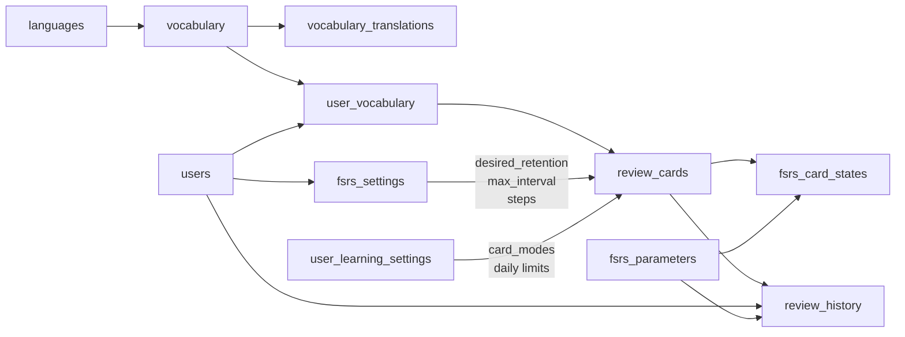
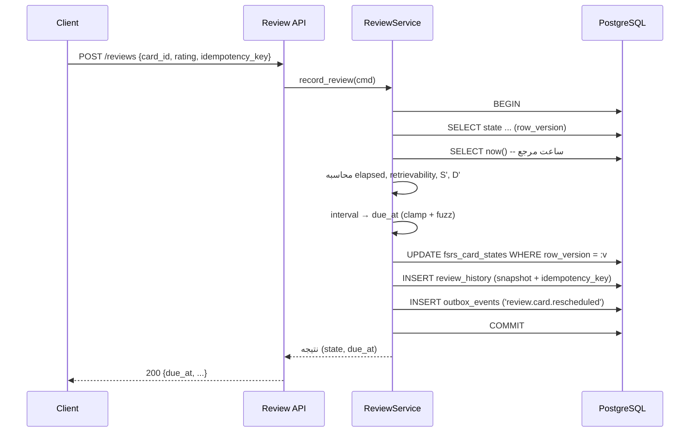

# طراحی دیتابیس Lurnian — Data Model & Domain Boundaries

| Field | Value |
| --- | --- |
| **Status** | Draft — در انتظار تأیید |
| **Date** | 2026-11-08 |
| **Phase** | مرحله طراحی مدل داده (بدون کد، بدون migration) |
| **Scope** | مدل داده، مرز دامنه‌ها، Authorization، مدل FSRS، Integrity و Performance |
| **Related** | [`docs/decisions/0001-database-postgresql.md`](../decisions/0001-database-postgresql.md) |

این سند **طرح پیشنهادی** است، نه تصمیم اجرایی. هر موردی که در ADR 0001 ثبت نشده، در بخش هشتم با وضعیت `Proposed` یا `Undefined` فهرست شده و تا تأیید شما قطعی نیست.

---

## ۰. خلاصه اجرایی

- **۳۸ جدول** در **۸ دامنه** طراحی شده است.
- از ۳۹ جدول فهرست اولیه: **۳ جدول حذف/ادغام** شد، **۲ جدول** اضافه شد، **۱ جدول** تغییر نام داد.
- **۱۲ تصمیم پیشنهادی جدید** (D-19 تا D-30) و **۶ مورد نیازمند تصمیم شما** (U-01 تا U-06) شناسایی شد.
- مهم‌ترین یافته‌ها:
  1. `Access Token` / `Refresh Token` / `Session` سه موجودیت با چرخه عمر متفاوت‌اند و یک جدول کافی نیست.
  2. `permissions` و `role_permissions` در این فاز لازم نیستند؛ RBAC چهارجدولی برای یک اپ مصرف‌کننده با یک تیم کوچک، هزینه نگهداری بدون فایده است.
  3. چهار حالت مرور **باید کارت مستقل باشند**، اما با ساخت **تنبل (lazy)** و سقف قابل تنظیم؛ نه ۴ کارت اجباری برای هر واژه.
  4. `review_history` باید **append-only** و مستقل از بقیه باشد؛ هیچ `ON DELETE CASCADE` نباید تاریخچه یادگیری را از بین ببرد.
  5. ارسال Push هرگز داخل تراکنش FSRS انجام نمی‌شود؛ الگوی **Transactional Outbox** پیشنهاد می‌شود (تصمیم نهایی با شما).
  6. `Permission` (کارمندی/عملیاتی) و `Entitlement` (محصولی/اشتراکی) دو مفهوم متفاوت‌اند و نباید در یک جدول جمع شوند.

### اصول حاکم بر کل طراحی

| اصل | معنا در این طراحی |
| --- | --- |
| **مالکیت تک‌نویسنده** | هر جدول فقط یک ماژول نویسنده دارد؛ خواندن مستقیم برای ماژول‌های دیگر ممنوع است (بخش هفتم). |
| **مالکیت داده در سطح DB** | `user_id` در همه جداول کاربرمحور حاضر است و با FK ترکیبی محافظت می‌شود؛ فیلتر در API کافی نیست. |
| **Content ≠ Progress** | محتوای واژه هرگز اطلاعات یادگیری کاربر را در خود ندارد. |
| **Ledger ≠ State** | تاریخچه (append-only) از وضعیت جاری (قابل update) جدا است. |
| **Clock مرجع** | همه زمان‌ها با ساعت دیتابیس و `TIMESTAMPTZ` در UTC. |
| **بدون Overengineering** | Partitioning، JSONB و Soft Delete فقط با دلیل مستند (بخش ششم). |

---

## ۱. دامنه‌ها و فهرست نهایی جداول

| # | Table | Domain | PK | مسئولیت در یک خط |
| --- | --- | --- | --- | --- |
| 1 | `users` | Identity | `uuid` | ریشه هویت و وضعیت حساب |
| 2 | `user_identities` | Identity | `uuid` | هویت خارجی (Google/Apple) متصل به کاربر |
| 3 | `user_credentials` | Identity | `uuid` | رمز عبور، TOTP و کدهای بازیابی |
| 4 | `verification_challenges` | Identity | `uuid` | OTP/لینک تأیید یک‌بارمصرف |
| 5 | `user_devices` | Security | `uuid` | دستگاه شناخته‌شده و توکن Push آن |
| 6 | `user_sessions` | Security | `uuid` | نشست ورود (login) روی یک دستگاه |
| 7 | `refresh_tokens` | Security | `uuid` | توکن چرخشی با تشخیص استفاده مجدد |
| 8 | `security_events` | Security | `bigint` | رویداد امنیتی قابل هشدار |
| 9 | `user_security_settings` | Security | `uuid` | سیاست امنیتی هر کاربر |
| 10 | `roles` | Security | `smallint` | نقش‌های کارمندی/عملیاتی |
| 11 | `user_roles` | Security | `(uuid, smallint)` | انتساب نقش به کاربر |
| 12 | `user_profiles` | Profile | `uuid` | داده عمومی پروفایل |
| 13 | `user_settings` | Profile | `uuid` | تنظیمات عمومی اپ (زبان، منطقه زمانی، تم) |
| 14 | `user_learning_settings` | Profile | `uuid` | جفت زبان و سقف‌های روزانه |
| 15 | `subscription_plans` | Billing | `smallint` | کاتالوگ پلن‌ها |
| 16 | `plan_features` | Billing | `smallint` | کاتالوگ قابلیت‌ها |
| 17 | `plan_feature_values` | Billing | `(smallint, smallint)` | مقدار هر قابلیت در هر پلن |
| 18 | `user_subscriptions` | Billing | `uuid` | اشتراک کاربر و دوره جاری |
| 19 | `orders` | Billing | `uuid` | قصد خرید |
| 20 | `payments` | Billing | `uuid` | تلاش پرداخت روی یک سفارش |
| 21 | `user_entitlements` | Billing | `uuid` | دسترسی مؤثر کاربر به قابلیت |
| 22 | `languages` | Learning | `smallint` | کاتالوگ زبان‌ها |
| 23 | `vocabulary` | Learning | `uuid` | واژه (عمومی یا شخصی) |
| 24 | `vocabulary_translations` | Learning | `bigint` | معنی/ترجمه واژه در هر زبان |
| 25 | `vocabulary_examples` | Learning | `bigint` | مثال‌های واژه |
| 26 | `learning_decks` | Learning | `uuid` | مجموعه واژه عمومی یا شخصی |
| 27 | `deck_vocabulary` | Learning | `(uuid, uuid)` | عضویت واژه در Deck |
| 28 | `user_vocabulary` | Learning | `uuid` | ثبت واژه در برنامه یادگیری کاربر |
| 29 | `review_cards` | Review | `uuid` | کارت مرور = (واژه کاربر، حالت) |
| 30 | `fsrs_card_states` | Review | `uuid` | وضعیت زمان‌بندی FSRS هر کارت |
| 31 | `review_history` | Review | `bigint` | تاریخچه append-only پاسخ‌ها |
| 32 | `fsrs_settings` | Review | `uuid` | تنظیمات الگوریتم هر کاربر |
| 33 | `fsrs_parameters` | Review | `smallint` | کاتالوگ وزن‌های الگوریتم |
| 34 | `notification_preferences` | Notification | `(uuid, text, text)` | ماتریس کانال × دسته |
| 35 | `scheduled_notifications` | Notification | `uuid` | یادآور زمان‌بندی‌شده |
| 36 | `notification_history` | Notification | `bigint` | لاگ ارسال و دیده‌شدن |
| 37 | `audit_logs` | Platform | `bigint` | ردپای تغییرات اداری/حساس |
| 38 | `outbox_events` | Platform | `bigint` | صف رویداد تراکنشی (پیشنهادی) |

**جمع: ۳۸ جدول.** توزیع: Identity ۴، Security ۷، Profile ۳، Billing ۷، Learning ۷، Review ۵، Notification ۳، Platform ۲.

---

## ۲. تغییرات نسبت به فهرست اولیه (۳۱ + ۴ + ۳ + ۱ = ۳۹)

| اقدام | جدول | دلیل |
| --- | --- | --- |
| **حذف (ادغام)** | `user_phone_numbers` | شماره موبایل یک **شناسه ورود** است، نه یک هویت خارجی. به `users.phone_e164` منتقل شد. جدول جدا فقط با چند شماره تأییدشده per user توجیه دارد که در scope نیست. |
| **حذف** | `permissions` | فهرست Permission در کد نگه داشته می‌شود؛ ماتریس Permission در DB بدون پنل مدیریت و بدون کش، فقط drift تولید می‌کند. |
| **حذف** | `role_permissions` | تابع بالا؛ نقش→Permission در یک نقشه ثابت کد است که با deploy نسخه می‌خورد. |
| **اضافه** | `fsrs_parameters` | بدون کاتالوگ وزن‌ها، «تغییر نسخه الگوریتم» و «تحلیل عملکرد» قابل پیاده‌سازی و بازتولید نیست. |
| **اضافه** | `outbox_events` | برای اتصال مطمئن «ثبت مرور» به «زمان‌بندی یادآور» بدون ارسال Push داخل تراکنش (Proposed). |
| **تغییر نام** | `user_preferences` → `user_settings` | نام جدید با محتوا هم‌خوان است و از `user_learning_settings` به‌خوبی تفکیک می‌شود. |
| **بدون تغییر** | بقیه ۳۳ جدول | با اصلاحات ستونی و constraint در بخش دوم. |

هیچ جدولی حذف نشد چون «احتمالاً لازم نمی‌شود»؛ تنها سه مورد بالا شواهد کافی برای حذف داشتند.

---

## ۳. سیاست‌های مشترک همه جداول

### ۳.۱ نام‌گذاری

- جدول‌ها: `snake_case` و **جمع** (`review_cards`, `user_settings`).
- ستون‌ها: `snake_case`، کلید خارجی `<entity>_id`، زمان‌ها `<event>_at`، پرچم‌ها `is_<state>`.
- Constraintها از `naming_convention` موجود در `core/database.py` پیروی می‌کنند (`pk_`, `fk_`, `uq_`, `ck_`, `ix_`)؛ هیچ نام دستی خارج از این الگو ساخته نمی‌شود.

### ۳.۲ زمان

- همه زمان‌ها `timestamptz`، ذخیره در UTC، `TimeZone` سرور `UTC` (P-01).
- `created_at` / `updated_at` با `DEFAULT now()` **سمت دیتابیس**؛ ساعت اپ مرجع نیست.
- «روز تقویمی» کاربر که برای آمار و سقف روزانه لازم است، به‌صورت `date` محاسبه‌شده از `user_settings.timezone` ذخیره می‌شود (`review_history.reviewed_on`).

### ۳.۳ شناسه‌ها (تکمیل D-12)

| نوع شناسه | جداول | دلیل |
| --- | --- | --- |
| **`uuid` (UUIDv7، تولید در اپ با `uuid.uuid7()`)** | `users`, `user_identities`, `user_credentials`, `verification_challenges`, `user_devices`, `user_sessions`, `refresh_tokens`, `user_security_settings`, `user_profiles`, `user_settings`, `user_learning_settings`, `user_subscriptions`, `orders`, `payments`, `user_entitlements`, `vocabulary`, `learning_decks`, `user_vocabulary`, `review_cards`, `fsrs_card_states`, `fsrs_settings`, `scheduled_notifications` | در URL/توکن دیده می‌شوند یا نباید با شمارش قابل حدس باشند (قاعده D-12). UUIDv7 مرتب‌بودن زمانی و locality ایندکس را حفظ می‌کند. |
| **`bigint identity`** | `security_events`, `vocabulary_translations`, `vocabulary_examples`, `review_history`, `notification_history`, `audit_logs`, `outbox_events` | جداول پرنوشت و بدون افشای عمومی؛ ۸ بایت در برابر ۱۶ بایت و ایندکس باریک‌تر، در حجم میلیونی تفاوت معنادار است. |
| **`smallint identity`** | `languages`, `subscription_plans`, `plan_features`, `roles`, `fsrs_parameters` | کاتالوگ کوچک و پایدار؛ کاربر با `code` کار می‌کند نه با عدد. |

قواعد قطعی: (۱) تولید شناسه **فقط در اپ** انجام می‌شود؛ `DEFAULT uuidv7()` سمت دیتابیس اضافه نمی‌شود تا دو محل تولید نداشته باشیم. (۲) `UUIDv8`/`UUIDv4` استفاده نمی‌شود. (۳) `Python 3.14` تابع `uuid.uuid7()` را در stdlib دارد، پس هیچ dependency جدید لازم نیست.

### ۳.۴ Enum در برابر `text + CHECK`

| الگو | کجا | دلیل |
| --- | --- | --- |
| **PostgreSQL ENUM** | مجموعه‌های بسته و پایدار: `review_card_mode`, `fsrs_state`, `user_status`, `plan_tier`, `billing_period`, `subscription_status`, `order_status`, `payment_status`, `deck_visibility`, `user_vocabulary_status`, `credential_kind`, `device_platform`, `text_direction`, `part_of_speech`, `cefr_level`, `actor_type` | صحت داده در سطح DB، حجم کم، تغییر نادر. افزودن مقدار با `ALTER TYPE ... ADD VALUE` ممکن است (حذف مقدار ممکن نیست). |
| **`text` + `CHECK (col IN (...))` یا بدون CHECK** | مجموعه‌های در حال رشد: `security_events.event_type`, `audit_logs.action`, `outbox_events.event_type`, `notification_preferences.category`/`channel` | هر مقدار جدید در ENUM نیازمند migration و قفل سبک روی نوع است؛ برای event typeها این هزینه بی‌دلیل است. اعتبارسنجی در لایه اپ با enum پایتونی انجام می‌شود. |

نکته Alembic: `ADD VALUE` در PG 12+ داخل تراکنش مجاز است اما مقدار جدید **در همان تراکنش قابل استفاده نیست**؛ در migrationهای آینده باید به این محدودیت توجه شود.

### ۳.۵ رفتار حذف (ON DELETE)

| گروه | رفتار | جداول |
| --- | --- | --- |
| **وضعیت ۱:۱ کاربر** | `CASCADE` | `user_identities`, `user_credentials`, `user_devices`, `user_sessions`, `user_security_settings`, `user_profiles`, `user_settings`, `user_learning_settings`, `user_entitlements`, `notification_preferences`, `scheduled_notifications`, `user_vocabulary`, `review_cards`, `fsrs_settings`, `user_roles` |
| **دفتر کل و تاریخچه** | `RESTRICT` (یا `SET NULL` برای مرجع اختیاری) | `payments`, `orders`, `review_history`, `security_events`, `notification_history`, `audit_logs` |
| **کاتالوگ مشترک** | `RESTRICT` از سمت مصرف‌کننده | `languages`, `subscription_plans`, `plan_features`, `fsrs_parameters`, `vocabulary` |

قاعده: **حذف کاربر حذف فیزیکی نیست**؛ `users.deleted_at` پر می‌شود (Proposed D-19). بنابراین `RESTRICT` هیچ‌وقت مانع عملیات روزمره نمی‌شود، اما مانع پاک‌شدن ناخواسته سابقه مالی و یادگیری است.

### ۳.۶ مالکیت داده در سطح دیتابیس

هر جدول کاربرمحور سه لایه محافظت دارد:

1. ستون `user_id` غیرقابل NULL (به‌جز موارد مستند).
2. FK به `users` با رفتار مشخص (بخش ۳.۵).
3. **FK ترکیبی** برای روابط وابسته به کاربر: مثلاً `user_vocabulary` یک `UNIQUE (id, user_id)` دارد و `review_cards` با FK ترکیبی `(user_vocabulary_id, user_id)` به آن وصل می‌شود. نتیجه: حتی یک باگ در سرویس نمی‌تواند کارت را به واژه کاربر دیگر وصل کند.

### ۳.۷ ایندکس‌گذاری

- هر FK ایندکس دارد (PostgreSQL خودکار نمی‌سازد) — P-08.
- ایندکس‌های صف/زمان‌بندی **partial** هستند (`WHERE status = 'pending'`) تا حجم ایندکس با بزرگ‌شدن تاریخچه رشد نکند.
- ایندکس ترکیبی با ترتیب `(user_id, <time> DESC)` برای لیست‌های per-user.
- هیچ ایندکسی «برای آینده» ساخته نمی‌شود؛ هر ایندکس در بخش دوم به یک کوئری مشخص گره خورده است.

---

## بخش اول: Domain Boundaries

قاعده کلی: در Modular Monolith مالکیت **منطقی** است، نه فیزیکی؛ یک دیتابیس مشترک داریم اما هر جدول یک نویسنده دارد. ارتباط بین دامنه‌ها با **فراخوانی سرویس درون‌پروسه** (interface پایتونی) انجام می‌شود، نه HTTP، نه Broker.

### D1. Identity & SSO

| مورد | محتوا |
| --- | --- |
| **مسئولیت** | ثبت‌نام، ورود، پیوند هویت‌های خارجی، اعتبارسنجی شناسه (ایمیل/موبایل)، مدیریت فاکتورهای احراز هویت. |
| **مالک** | `users`, `user_identities`, `user_credentials`, `verification_challenges` |
| **نباید مالک باشد** | نشست و توکن (D2)، تنظیمات و پروفایل (D3)، نقش و Permission (D2 برای نقش کارمندی)، اشتراک (D4)، پیشرفت یادگیری (D5/D6). |
| **ارتباط** | تنها دامنه‌ای است که «کاربر معتبر» را تعریف می‌کند؛ بقیه دامنه‌ها فقط `user_id` را مصرف می‌کنند. |
| **وابستگی مجاز** | هیچ‌کدام (پایین‌ترین لایه). |
| **وابستگی غیرمجاز** | Billing، Learning، Review، Notification. Identity نباید بداند کاربر Premium است یا چند کارت دارد. |
| **Use Caseها** | ثبت‌نام با ایمیل/موبایل، ورود با Google، پیوند هویت دوم به حساب موجود، ارسال و تأیید OTP، تعیین/تغییر رمز، فعال‌سازی TOTP، بازیابی رمز، حذف نرم حساب. |

قواعد کلیدی:
- ورود با provider که ایمیل تأییدشده‌اش با `users.email` تأییدشده یکسان است، **پیوند خودکار نمی‌شود**؛ نیازمند ورود به حساب موجود و تأیید صریح است (جلوگیری از تصاحب حساب).
- هویت خارجی هرگز رمز یا توکن provider را ذخیره نمی‌کند؛ فقط `provider` + `subject`.
- کاربر بدون رمز (SSO-only) کاملاً معتبر است؛ `user_credentials` خالی می‌ماند.

### D2. Security & Authorization

| مورد | محتوا |
| --- | --- |
| **مسئولیت** | چرخه عمر نشست، دستگاه، Refresh Token، رویداد امنیتی، سیاست‌های امنیتی کاربر و **نقش کارمندی**. |
| **مالک** | `user_devices`, `user_sessions`, `refresh_tokens`, `security_events`, `user_security_settings`, `roles`, `user_roles` |
| **نباید مالک باشد** | رمز و OTP (D1)، قابلیت‌های محصول و اشتراک (D4)، تنظیمات ظاهری (D3). |
| **ارتباط** | از D1 فقط «کاربر معتبر» را می‌گیرد؛ entitlement را از D4 می‌خواند **فقط** برای نمایش، نه برای تصمیم امنیتی. |
| **وابستگی مجاز** | Identity. |
| **وابستگی غیرمجاز** | Learning، Review (تعداد کارت نباید در تصمیم امنیتی دخالت کند). |
| **Use Caseها** | ثبت دستگاه در ورود، لیست نشست‌های فعال، لغو یک نشست/همه نشست‌ها، چرخش Refresh Token، تشخیص استفاده مجدد، ثبت رویداد ورود ناموفق، قفل موقت، انتساب نقش کارمندی. |

سه مفهوم که نباید قاطی شوند:

| مفهوم | ماهیت | ذخیره‌سازی |
| --- | --- | --- |
| **Access Token** | بی‌حالت (JWT)، عمر کوتاه (۱۰–۱۵ دقیقه) | **در دیتابیس ذخیره نمی‌شود**؛ فقط `sid` و `sub` را حمل می‌کند. |
| **Session** | موجودیت منطقی ورود: کاربر + دستگاه + پنجره زمانی | `user_sessions`، دارای `revoked_at` |
| **Refresh Token** | اعتبارنامه چرخشی، یک‌بارمصرف | `refresh_tokens`، فقط hash آن ذخیره می‌شود |

دلیل: لغو نشست باید فوری اثر کند (کاربر «خروج از همه دستگاه‌ها» را انتظار دارد)؛ اگر Access Token در DB باشد هر درخواست یک کوئری اضافه دارد، و اگر Session نداشته باشیم نمی‌توان نشست‌ها را فهرست یا گروهی لغو کرد.

### D3. Profile

| مورد | محتوا |
| --- | --- |
| **مسئولیت** | داده نمایشی پروفایل، تنظیمات عمومی اپ، جفت زبان و سقف‌های یادگیری. |
| **مالک** | `user_profiles`, `user_settings`, `user_learning_settings` |
| **نباید مالک باشد** | هویت/رمز (D1)، نشست (D2)، پارامترهای FSRS (D6)، متن اعلان‌ها (D7)، پلن (D4). |
| **ارتباط** | `languages` را از D5 می‌خواند (فقط کاتالوگ)، `user_id` را از D1 می‌گیرد. |
| **وابستگی مجاز** | Identity، Learning (کاتالوگ زبان). |
| **وابستگی غیرمجاز** | Review با نوشتن؛ Profile نباید `due_at` یا وضعیت کارت را تغییر دهد. |
| **Use Caseها** | تکمیل پروفایل، تغییر نام کاربری، تنظیم منطقه زمانی/زبان/تم، تغییر جفت زبان هدف، تعیین سقف کارت جدید و مرور روزانه، انتخاب حالت‌های مرور فعال. |

نکته مالکیت: **سقف روزانه در Profile است، اجرای آن در Review است.** یعنی `daily_new_cards` اینجا تعریف می‌شود اما شمارش مصرف در D6 انجام می‌شود (بدون نوشتن در D3).

### D4. Subscription & Billing

| مورد | محتوا |
| --- | --- |
| **مسئولیت** | کاتالوگ پلن/قابلیت، اشتراک کاربر، سفارش، پرداخت و **محاسبه دسترسی مؤثر**. |
| **مالک** | `subscription_plans`, `plan_features`, `plan_feature_values`, `user_subscriptions`, `orders`, `payments`, `user_entitlements` |
| **نباید مالک باشد** | «چگونه یک قابلیت اجرا می‌شود» (مثلاً سقف روزانه مرور را Billing تعیین می‌کند اما شمارش و اعمال در D6 است)، نقش کارمندی (D2)، داده یادگیری. |
| **ارتباط** | ارائه‌دهنده `EntitlementResolver` به همه دامنه‌ها؛ مصرف `user_id` از D1. |
| **وابستگی مجاز** | Identity. |
| **وابستگی غیرمجاز** | Review، Learning، Notification (Billing نباید بداند کاربر چند کارت دارد؛ فقط `quota` را اعلام می‌کند). |
| **Use Caseها** | فهرست پلن‌ها، شروع خرید، ثبت پرداخت و تأیید آن، فعال‌سازی/تمدید/لغو اشتراک، اعطای دسترسی دستی (پشتیبانی/پروموشن)، محاسبه دسترسی مؤثر، انقضای اشتراک. |

قواعد کلیدی:
- `is_premium` وجود ندارد. هر تصمیم دسترسی از `EntitlementResolver` می‌آید: `resolve(user_id) -> set[feature_code] + limits`.
- وضعیت **پرداخت** و وضعیت **اشتراک** دو چیزند: یک `payment` می‌تواند `failed` باشد در حالی‌که `user_subscription` هنوز `active` است (retry درگاه).
- `orders` قصد خرید است و `payments` حرکت پول؛ چند تلاش پرداخت برای یک سفارش طبیعی است.

### D5. Learning & Vocabulary

| مورد | محتوا |
| --- | --- |
| **مسئولیت** | محتوای واژگان (عمومی و شخصی)، ترجمه‌ها، مثال‌ها، Deckها و ثبت واژه در برنامه یادگیری کاربر. |
| **مالک** | `languages`, `vocabulary`, `vocabulary_translations`, `vocabulary_examples`, `learning_decks`, `deck_vocabulary`, `user_vocabulary` |
| **نباید مالک باشد** | وضعیت زمان‌بندی و مرور (D6)، تنظیمات یادگیری کاربر (D3)، اشتراک (D4). |
| **ارتباط** | «واژه» را می‌سازد و به D6 می‌دهد؛ `user_vocabulary` تنها دروازه ورود یک واژه به برنامه یادگیری است. |
| **وابستگی مجاز** | Identity (مالک واژه شخصی)، Profile (خواندن سقف‌ها فقط در لایه سرویس). |
| **وابستگی غیرمجاز** | Review برای نوشتن؛ Learning هیچ‌گاه `due_at` نمی‌نویسد. |
| **Use Caseها** | جستجوی واژه، افزودن واژه شخصی، افزودن/حذف ترجمه و مثال (کارمندی)، ساخت Deck، افزودن واژه به Deck، ثبت واژه در برنامه یادگیری، علامت‌گذاری «می‌دانم»/«نادیده بگیر». |

قواعد کلیدی:
- واژه **یک ردیف مشترک** دارد؛ اطلاعات یادگیری هر کاربر جدا است. حذف یک واژه از برنامه کاربر، `user_vocabulary` را حذف می‌کند، نه `vocabulary` را.
- یک واژه می‌تواند در چند Deck باشد؛ عضویت در Deck هیچ اثری روی کارت‌های FSRS ندارد (کارت از `user_vocabulary` ساخته می‌شود، نه از Deck).

### D6. Review & FSRS

| مورد | محتوا |
| --- | --- |
| **مسئولیت** | ساخت کارت، اجرای FSRS، نگهداری وضعیت هر کارت، ثبت پاسخ‌ها، صف مرور امروز. |
| **مالک** | `review_cards`, `fsrs_card_states`, `review_history`, `fsrs_settings`, `fsrs_parameters` |
| **نباید مالک باشد** | محتوای واژه/ترجمه (D5)، سقف‌های یادگیری (D3)، ارسال اعلان (D7)، پلن (D4). |
| **ارتباط** | از D5 واژه/ترجمه را می‌خواند؛ `due_at` را منتشر می‌کند (رویداد) تا D7 یادآور بسازد؛ سقف روزانه را از D3 می‌خواند و اعمال می‌کند. |
| **وابستگی مجاز** | Identity، Learning، Profile (خواندن)، Billing (خواندن quota). |
| **وابستگی غیرمجاز** | Notification برای نوشتن؛ Review نباید ردیف اعلان بسازد (فقط رویداد منتشر می‌کند). |
| **Use Caseها** | ساخت کارت‌های یک واژه جدید، دریافت صف مرور، ثبت پاسخ (Again/Hard/Good/Easy)، تعویق/تعلیق کارت، بازنشانی پیشرفت یک Deck، تغییر Desired Retention، بهینه‌سازی وزن‌ها. |

قاعده: هیچ عملیات خارجی (Push، ایمیل) داخل تراکنش این دامنه انجام نمی‌شود؛ فقط ردیف `outbox_events` در همان تراکنش نوشته می‌شود.

### D7. Notification

| مورد | محتوا |
| --- | --- |
| **مسئولیت** | تبدیل رویدادهای دامنه به یادآور، احترام به تنظیمات کاربر، ارسال و ثبت نتیجه. |
| **مالک** | `notification_preferences`, `scheduled_notifications`, `notification_history` |
| **نباید مالک باشد** | محاسبه `due_at` (D6)، محتوای واژه (D5)، وضعیت اشتراک (D4). |
| **ارتباط** | رویداد D6 را مصرف می‌کند؛ `user_settings.timezone` و دستگاه‌های D2 را برای ارسال می‌خواند. |
| **وابستگی مجاز** | Review (رویداد)، Profile (خواندن)، Security (دستگاه/Push token)، Identity. |
| **وابستگی غیرمجاز** | نوشتن در Review یا Learning؛ Notification هرگز وضعیت یادگیری را تغییر نمی‌دهد. |
| **Use Caseها** | به‌روزرسانی تنظیم کانال/دسته، ساخت/به‌روزرسانی/لغو یادآور مرور، ارسال Push، تلاش مجدد با backoff، ثبت دیده‌شدن. |

### D8. Platform (Audit & Outbox)

| مورد | محتوا |
| --- | --- |
| **مسئولیت** | ردپای تغییرات حساس و انتقال قابل‌اعتماد رویداد بین دامنه‌ها. |
| **مالک** | `audit_logs`, `outbox_events` |
| **نباید مالک باشد** | منطق کسب‌وکار هر دامنه؛ این دو جدول فقط مصرف‌کننده رویدادهای دیگران‌اند. |
| **ارتباط** | `outbox_events` توسط نویسنده هر دامنه در همان تراکنش پر می‌شود و مصرف‌کننده‌ها (Notification) آن را می‌خوانند. |
| **وابستگی مجاز** | همه دامنه‌ها (فقط نوشتن رویداد خودشان). |
| **وابستگی غیرمجاز** | هیچ دامنه‌ای نباید وضعیت کسب‌وکار را از `audit_logs` بازسازی کند. |
| **Use Caseها** | ثبت اقدام اداری، انتشار `review.card.rescheduled`، مصرف و علامت‌گذاری رویداد. |

---

## بخش دوم: Entity Design

راهنمای خواندن: هر جدول یک **مشخصات** (کلید، محدودیت‌ها، ایندکس، حساسیت) و یک **جدول ستون‌ها** دارد. نوع‌ها همان نوع PostgreSQL هستند که SQLAlchemy تولید می‌کند. `NOT NULL` در ستون Nullable با `نه` مشخص شده است.

### D1 — Identity & SSO

#### ۱. `users`

| مشخصه | مقدار |
| --- | --- |
| **Domain** | Identity |
| **Responsibility** | ریشه هویت؛ تنها جدولی که «کاربر وجود دارد» را تعریف می‌کند. |
| **Primary Key** | `id uuid` |
| **Foreign Keys** | ندارد |
| **Unique** | `lower(email)` وقتی `email` پر است؛ `phone_e164` وقتی پر است |
| **Check** | حداقل یکی از `email`/`phone_e164` پر باشد؛ قالب ایمیل و E.164؛ `status = 'pending_deletion'` فقط با `deleted_at` پر |
| **Indexes** | `ix_users_email_lower` (unique, partial)، `ix_users_phone_e164` (unique, partial)، `ix_users_last_active_at` (partial `deleted_at IS NULL`) |
| **Nullable** | `email`، `phone_e164`، `email_verified_at`، `phone_verified_at`، `last_active_at`، `deleted_at` |
| **Default** | `status='active'`، `created_at=now()`، `updated_at=now()` |
| **Sensitive Data** | `email` و `phone_e164` داده شخصی؛ در لاگ ماسک می‌شوند، در پاسخ‌های عمومی برنمی‌گردند. |
| **Relationships** | ۱:۱ با `user_profiles` / `user_settings` / `user_security_settings`؛ ۱:N با بقیه جداول کاربرمحور. |

| Column | Type | Null | Default | توضیح و دلیل |
| --- | --- | --- | --- | --- |
| `id` | `uuid` | نه | — | UUIDv7 تولیدشده در اپ. |
| `email` | `text` | بله | `NULL` | شناسه ورود اصلی؛ کاربر SSO-only ممکن است بعداً پر کند. ذخیره با شکل اصلی، یکتایی با `lower()`. |
| `email_verified_at` | `timestamptz` | بله | `NULL` | اثبات مالکیت ایمیل؛ مبنای مجاز بودن «بازیابی رمز» و «پیوند هویت». |
| `phone_e164` | `text` | بله | `NULL` | شماره موبایل به شکل `+98912...` (جایگزین جدول `user_phone_numbers`). |
| `phone_verified_at` | `timestamptz` | بله | `NULL` | تأیید OTP؛ لازم برای ورود با موبایل. |
| `status` | `user_status` | نه | `'active'` | `active` / `pending` / `suspended` / `deactivated` / `pending_deletion`. |
| `last_active_at` | `timestamptz` | بله | `NULL` | آخرین فعالیت معنادار (نه هر request)؛ برای ایمیل‌های بازگشت و پاک‌سازی. |
| `created_at` | `timestamptz` | نه | `now()` | — |
| `updated_at` | `timestamptz` | نه | `now()` | با trigger یا `onupdate` در لایه مدل. |
| `deleted_at` | `timestamptz` | بله | `NULL` | حذف نرم؛ ردیف برای integrity تاریخی باقی می‌ماند. |

**دلیل طراحی:** حذف فیزیکی کاربر، با `RESTRICT` روی `payments` و `review_history` در تضاد است و سابقه مالی/یادگیری را نابود می‌کند. حذف نرم + پاک‌سازی انتخابی PII در job جداگانه، هم GDPR-پذیر است هم integrity را حفظ می‌کند.

#### ۲. `user_identities`

| مشخصه | مقدار |
| --- | --- |
| **Domain** | Identity |
| **Responsibility** | هویت خارجی (Google/Apple) متصل به کاربر؛ بدون ذخیره هیچ توکنی از provider. |
| **Primary Key** | `id uuid` |
| **Foreign Keys** | `user_id → users.id ON DELETE CASCADE` |
| **Unique** | `(provider, subject)`؛ `(user_id, provider, subject)` تکراری لازم نیست چون اولی کافی است |
| **Check** | `subject` غیرخالی و ≤ ۲۵۵ کاراکتر |
| **Indexes** | `ix_user_identities_user_id`، `ix_user_identities_provider_subject` (unique) |
| **Nullable** | `email_at_provider`، `email_verified` پیش‌فرض `false`، `last_login_at` |
| **Default** | `linked_at=now()` |
| **Sensitive Data** | `subject` و `email_at_provider` داده شخصی و شبه‌ناشناس؛ رمزنگاری لازم نیست، دسترسی محدود و عدم نمایش در لاگ لازم است. |
| **Relationships** | N:۱ با `users`. |

| Column | Type | Null | Default | توضیح |
| --- | --- | --- | --- | --- |
| `id` | `uuid` | نه | — | UUIDv7 |
| `user_id` | `uuid` | نه | — | FK |
| `provider` | `identity_provider` | نه | — | `google` / `apple` (افزودن مقدار در آینده با `ALTER TYPE`). |
| `subject` | `text` | نه | — | شناسه پایدار کاربر در provider (`sub`). |
| `email_at_provider` | `text` | بله | `NULL` | ایمیل اعلام‌شده توسط provider؛ برای تصمیم «پیوند یا حساب جدید». |
| `email_verified` | `boolean` | نه | `false` | claims provider؛ بدون آن پیوند خودکار ممنوع است. |
| `linked_at` | `timestamptz` | نه | `now()` | — |
| `last_login_at` | `timestamptz` | بله | `NULL` | برای نمایش «روش‌های ورود» به کاربر. |

**دلیل طراحی:** `UNIQUE (provider, subject)` دقیقاً همان چیزی است که «حساب تکراری هنگام اتصال هویت» را در سطح DB می‌بندد؛ حتی دو request هم‌زمان نمی‌توانند دو ردیف بسازند.

#### ۳. `user_credentials`

| مشخصه | مقدار |
| --- | --- |
| **Domain** | Identity |
| **Responsibility** | نگهداری فاکتورهای احراز هویت محلی: رمز عبور، TOTP، کدهای بازیابی. |
| **Primary Key** | `id uuid` |
| **Foreign Keys** | `user_id → users.id ON DELETE CASCADE` |
| **Unique** | یک رمز فعال per user: `(user_id) WHERE kind='password' AND revoked_at IS NULL`؛ یک TOTP فعال: `(user_id) WHERE kind='totp' AND revoked_at IS NULL` |
| **Check** | `kind='password'` ⇒ `secret_hash NOT NULL`؛ `kind IN ('totp')` ⇒ `secret_encrypted NOT NULL`؛ `kind='recovery_codes'` ⇒ `secret_hash NOT NULL`؛ `digits BETWEEN 6 AND 8` |
| **Indexes** | `ix_user_credentials_user_id` |
| **Nullable** | `secret_hash`، `secret_encrypted`، `algorithm`، `confirmed_at`، `last_used_at`، `revoked_at` |
| **Default** | `kind='password'`؟ نه — اجباری؛ `digits=6`، `period_seconds=30`، `algorithm='SHA1'` |
| **Sensitive Data** | رمز: Argon2id (`secret_hash`)، TOTP: `secret_encrypted` با AES-256-GCM و کلید خارج از DB (KMS/env secret)، کدهای بازیابی: Argon2id. هیچ مقدار خام نه در DB، نه در لاگ، نه در پاسخ API. |
| **Relationships** | N:۱ با `users`. |

| Column | Type | Null | Default | توضیح |
| --- | --- | --- | --- | --- |
| `id` | `uuid` | نه | — | UUIDv7 |
| `user_id` | `uuid` | نه | — | FK |
| `kind` | `credential_kind` | نه | — | `password` / `totp` / `recovery_codes` |
| `secret_hash` | `text` | بله | `NULL` | Argon2id (رمز یا مجموعه کدهای بازیابی). |
| `secret_encrypted` | `bytea` | بله | `NULL` | TOTP secret، رمزنگاری‌شده در اپ (کلید هرگز در DB نیست). |
| `algorithm` | `text` | بله | `'SHA1'` | الگوریتم TOTP مطابق RFC 6238. |
| `digits` | `smallint` | نه | `6` | — |
| `period_seconds` | `smallint` | نه | `30` | — |
| `confirmed_at` | `timestamptz` | بله | `NULL` | برای TOTP: زمان تأیید اولین کد؛ تا آن لحظه enrolled نیست. |
| `last_used_at` | `timestamptz` | بله | `NULL` | تشخیص فاکتور بی‌استفاده. |
| `created_at` / `updated_at` | `timestamptz` | نه | `now()` | — |
| `revoked_at` | `timestamptz` | بله | `NULL` | غیرفعال‌سازی بدون حذف تاریخچه. |

**دلیل طراحی:** یک جدول با discriminator، به‌جای سه جدول، چون همه «فاکتور احراز هویت» با یک چرخه عمر (ساخت، تأیید، استفاده، ابطال) هستند؛ و اگر رمز داخل `users` باشد، کاربر SSO-only ستون‌های بی‌معنا خواهد داشت.

#### ۴. `verification_challenges`

| مشخصه | مقدار |
| --- | --- |
| **Domain** | Identity |
| **Responsibility** | OTP و لینک تأیید یک‌بارمصرف با محدودیت تلاش و انقضا. |
| **Primary Key** | `id uuid` |
| **Foreign Keys** | `user_id → users.id ON DELETE CASCADE` (nullable) |
| **Unique** | ندارد (چالش‌های متعدد مجاز است؛ محدودیت با نرخ‌محدودی و `invalidated_at` اعمال می‌شود) |
| **Check** | `attempts BETWEEN 0 AND max_attempts`؛ `expires_at > created_at`؛ `consumed_at IS NULL OR consumed_at >= created_at` |
| **Indexes** | `ix_verification_challenges_lookup` روی `(destination, purpose, created_at DESC)`؛ partial `ix_..._pending` روی `(destination, purpose) WHERE consumed_at IS NULL` |
| **Nullable** | `user_id` (ثبت‌نام پیش از ساخت حساب)، `consumed_at`، `invalidated_at`، `request_ip` |
| **Default** | `attempts=0`، `max_attempts=5`، `created_at=now()` |
| **Sensitive Data** | فقط `code_hash` (HMAC-SHA256 با pepper سمت سرور) ذخیره می‌شود؛ کد خام هرگز. `destination` داده شخصی و در لاگ ماسک می‌شود. |
| **Relationships** | N:۱ اختیاری با `users`. |

| Column | Type | Null | Default | توضیح |
| --- | --- | --- | --- | --- |
| `id` | `uuid` | نه | — | شناسه غیرقابل حدس؛ در لینک تأیید استفاده می‌شود. |
| `user_id` | `uuid` | بله | `NULL` | برای چالش‌های پیش از ثبت‌نام خالی است. |
| `channel` | `challenge_channel` | نه | — | `email` / `sms` |
| `destination` | `text` | نه | — | ایمیل lowercase یا E.164. |
| `purpose` | `challenge_purpose` | نه | — | `signup` / `login` / `identifier_verify` / `password_reset` / `identity_link` / `totp_reset` |
| `code_hash` | `bytea` | نه | — | HMAC-SHA256؛ مقایسه constant-time. |
| `attempts` | `smallint` | نه | `0` | با هر تلاش ناموفق `+1`. |
| `max_attempts` | `smallint` | نه | `5` | سقف قابل تنظیم per purpose. |
| `created_at` | `timestamptz` | نه | `now()` | مبنای نرخ‌محدودی. |
| `expires_at` | `timestamptz` | نه | — | ۵–۱۰ دقیقه (سیاست در تنظیمات اپ). |
| `consumed_at` | `timestamptz` | بله | `NULL` | یک‌بارمصرف بودن. |
| `invalidated_at` | `timestamptz` | بله | `NULL` | باطل‌سازی صریح (ارسال کد جدید). |
| `request_ip` | `inet` | بله | `NULL` | تشخیص سوءاستفاده؛ نه تصمیم قطعی. |

**دلیل طراحی:** چالش باید بدون حساب کاربری هم قابل ساخت باشد (ثبت‌نام)، پس `user_id` nullable است؛ و چون OTP فضای کوچکی دارد (۱۰⁶)، امنیت از `max_attempts` + TTL + نرخ‌محدودی می‌آید، نه از KDF سنگین.

### D2 — Security & Authorization

#### ۵. `user_devices`

| مشخصه | مقدار |
| --- | --- |
| **Domain** | Security |
| **Responsibility** | دستگاه شناخته‌شده کاربر، نام نمایشی و توکن Push آن. |
| **Primary Key** | `id uuid` |
| **Foreign Keys** | `user_id → users.id ON DELETE CASCADE` |
| **Unique** | `(user_id, fingerprint_hash)` |
| **Check** | `platform IN ('ios','android','web')`؛ اگر `push_token` پر است، `push_provider` هم پر باشد |
| **Indexes** | `ix_user_devices_user_id`؛ partial `(user_id) WHERE revoked_at IS NULL` |
| **Nullable** | `push_token`، `push_provider`، `display_name`، `app_version`، `trusted_at`، `revoked_at` |
| **Default** | `first_seen_at=now()`، `last_seen_at=now()` |
| **Sensitive Data** | `push_token` یک capability است (هرکس آن را داشته باشد می‌تواند اعلان بفرستد)؛ در لاگ نوشته نمی‌شود و در پاسخ‌های API برنمی‌گردد. |
| **Relationships** | N:۱ با `users`؛ ۱:N با `user_sessions`؛ ۱:N با `scheduled_notifications`. |

| Column | Type | Null | Default | توضیح |
| --- | --- | --- | --- | --- |
| `id` | `uuid` | نه | — | UUIDv7 |
| `user_id` | `uuid` | نه | — | FK |
| `fingerprint_hash` | `text` | نه | — | SHA-256 از (نصب‌id + platform + UA)؛ شناسه خام دستگاه ذخیره نمی‌شود. |
| `platform` | `device_platform` | نه | — | `ios` / `android` / `web` |
| `display_name` | `text` | بله | `NULL` | «iPhone 15 — سارا»؛ قابل ویرایش توسط کاربر. |
| `app_version` | `text` | بله | `NULL` | برای تشخیص نسخه‌های معیوب. |
| `push_token` | `text` | بله | `NULL` | APNs/FCM/WebPush token. |
| `push_provider` | `push_provider` | بله | `NULL` | `apns` / `fcm` / `web_push` |
| `push_token_updated_at` | `timestamptz` | بله | `NULL` | توکن‌ها rotate می‌شوند. |
| `first_seen_at` | `timestamptz` | نه | `now()` | — |
| `last_seen_at` | `timestamptz` | نه | `now()` | — |
| `trusted_at` | `timestamptz` | بله | `NULL` | برای «این دستگاه را به خاطر بسپار» (MFA challenge). |
| `revoked_at` | `timestamptz` | بله | `NULL` | دستگاه حذف نمی‌شود تا نشست‌های تاریخی معنا داشته باشند. |

#### ۶. `user_sessions`

| مشخصه | مقدار |
| --- | --- |
| **Domain** | Security |
| **Responsibility** | هر ورود موفق = یک نشست؛ مرجع فوری برای ابطال دسترسی. |
| **Primary Key** | `id uuid` |
| **Foreign Keys** | `user_id → users.id ON DELETE CASCADE`؛ `device_id → user_devices.id ON DELETE SET NULL` |
| **Unique** | ندارد |
| **Check** | `absolute_expires_at > created_at`؛ `revoked_at IS NULL OR revoked_reason IS NOT NULL` |
| **Indexes** | `ix_user_sessions_user_created` روی `(user_id, created_at DESC)`؛ partial `(user_id) WHERE revoked_at IS NULL` |
| **Nullable** | `device_id`، `revoked_at`، `revoked_reason`، `ip`، `user_agent`، `last_seen_at` |
| **Default** | `created_at=now()`، `last_seen_at=now()` |
| **Sensitive Data** | `ip` و `user_agent` داده شخصی؛ `user_agent` بریده می‌شود (≤ ۵۱۲). |
| **Relationships** | N:۱ با `users` و `user_devices`؛ ۱:N با `refresh_tokens`. |

| Column | Type | Null | Default | توضیح |
| --- | --- | --- | --- | --- |
| `id` | `uuid` | نه | — | همان `sid` در Access Token. |
| `user_id` | `uuid` | نه | — | FK |
| `device_id` | `uuid` | بله | `NULL` | ابزار شناسایی دستگاه؛ نبودش نشست را بی‌اعتبار نمی‌کند. |
| `auth_method` | `auth_method` | نه | — | `password` / `google` / `apple` / `sms_otp` / `email_otp` |
| `ip` | `inet` | بله | `NULL` | برای نمایش در «نشست‌های فعال». |
| `user_agent` | `text` | بله | `NULL` | بریده‌شده. |
| `created_at` | `timestamptz` | نه | `now()` | — |
| `last_seen_at` | `timestamptz` | بله | `NULL` | با هر refresh به‌روز می‌شود (نه با هر request). |
| `absolute_expires_at` | `timestamptz` | نه | — | سقف مطلق عمر نشست (مثلاً ۳۰ روز). |
| `revoked_at` | `timestamptz` | بله | `NULL` | ابطال فوری. |
| `revoked_reason` | `session_revoked_reason` | بله | `NULL` | `logout` / `logout_all` / `reuse_detected` / `password_change` / `admin` / `expired` |

**دلیل طراحی:** نشست هیچ توکنی نگه نمی‌دارد و توکن هیچ منطق نشستی ندارد. با این تفکیک، «لغو همه نشست‌ها» یک `UPDATE` روی یک جدول است، و Access Tokenهای در گردش با بررسی `sid` (و کش کوتاه‌مدت revoked) باطل می‌شوند.

#### ۷. `refresh_tokens`

| مشخصه | مقدار |
| --- | --- |
| **Domain** | Security |
| **Responsibility** | توکن چرخشی یک‌بارمصرف با تشخیص استفاده مجدد در سطح «خانواده» توکن. |
| **Primary Key** | `id uuid` |
| **Foreign Keys** | `session_id → user_sessions.id ON DELETE CASCADE`؛ `parent_id → refresh_tokens.id ON DELETE SET NULL` |
| **Unique** | `token_hash` (unique)؛ یک توکن فعال per session: `(session_id) WHERE used_at IS NULL AND revoked_at IS NULL` |
| **Check** | `expires_at > issued_at`؛ `used_at IS NULL OR used_at >= issued_at` |
| **Indexes** | `ix_refresh_tokens_session_id`، `ix_refresh_tokens_family_id` |
| **Nullable** | `parent_id`، `used_at`، `revoked_at`، `revoked_reason` |
| **Default** | `issued_at=now()` |
| **Sensitive Data** | فقط `token_hash` (SHA-256؛ توکن آنتروپی بالا دارد، پس KDF لازم نیست)؛ توکن خام فقط یک‌بار به کلاینت برگردانده می‌شود. |
| **Relationships** | N:۱ با `user_sessions`؛ self-reference برای زنجیره چرخش. |

| Column | Type | Null | Default | توضیح |
| --- | --- | --- | --- | --- |
| `id` | `uuid` | نه | — | UUIDv7 |
| `session_id` | `uuid` | نه | — | FK |
| `token_hash` | `bytea` | نه | — | SHA-256 توکن؛ lookup با همان hash. |
| `family_id` | `uuid` | نه | — | شناسه اولین توکن زنجیره؛ ابطال خانواده روی استفاده مجدد. |
| `parent_id` | `uuid` | بله | `NULL` | توکنی که این توکن جایگزینش شد. |
| `issued_at` | `timestamptz` | نه | `now()` | — |
| `expires_at` | `timestamptz` | نه | — | عمر refresh (مثلاً ۳۰ روز، ≤ عمر نشست). |
| `used_at` | `timestamptz` | بله | `NULL` | زمان مصرف برای چرخش. |
| `revoked_at` | `timestamptz` | بله | `NULL` | ابطال دستی/خانوادگی. |
| `revoked_reason` | `session_revoked_reason` | بله | `NULL` | همان مجموعه دلیل‌ها. |

**جلوگیری از استفاده مجدد:** اگر توکنی با `used_at IS NOT NULL` ارائه شود ⇒ `security_events` با `refresh_reuse_detected` + ابطال کل `family_id` و نشست. این کارتوکن یک `UPDATE` شرطی است (`WHERE used_at IS NULL`)، پس دو request هم‌زمان نمی‌توانند هر دو موفق شوند.

#### ۸. `security_events`

| مشخصه | مقدار |
| --- | --- |
| **Domain** | Security |
| **Responsibility** | ثبت رویداد امنیتی قابل جست‌وجو و قابل هشدار؛ append-only. |
| **Primary Key** | `id bigint identity` |
| **Foreign Keys** | `user_id → users.id ON DELETE RESTRICT` (nullable) |
| **Unique** | ندارد |
| **Check** | `severity IN ('info','warning','critical')` |
| **Indexes** | `(user_id, created_at DESC)`؛ `(event_type, created_at DESC)`؛ partial `(created_at) WHERE severity='critical'` |
| **Nullable** | `user_id` (رویداد پیش از احراز هویت)، `ip`، `user_agent`، `request_id`، `context` |
| **Default** | `severity='info'`، `created_at=now()` |
| **Sensitive Data** | بدون توکن/رمز؛ `context` فقط شناسه‌ها و کدهای خطا (هیچ PII یا secret). |
| **Relationships** | N:۱ اختیاری با `users`. |

| Column | Type | Null | Default | توضیح |
| --- | --- | --- | --- | --- |
| `id` | `bigint` | نه | identity | حجم بالا؛ ایندکس باریک. |
| `user_id` | `uuid` | بله | `NULL` | برای رویدادهای قبل از ورود خالی است. |
| `event_type` | `text` + `CHECK` | نه | — | `login_succeeded`, `login_failed`, `mfa_failed`, `mfa_enabled`, `password_changed`, `password_reset_requested`, `refresh_reuse_detected`, `session_revoked`, `account_locked`, `identity_linked`, `identity_unlinked`, `device_added`, `device_revoked`, `suspicious_activity`. `text` چون این فهرست رشد می‌کند. |
| `severity` | `security_severity` | نه | `'info'` | — |
| `ip` | `inet` | بله | `NULL` | — |
| `user_agent` | `text` | بله | `NULL` | بریده‌شده. |
| `request_id` | `text` | بله | `NULL` | اتصال به لاگ ساختاریافته. |
| `context` | `jsonb` | بله | `NULL` | جزئیات ناهمگون (مثلاً `{"provider":"google"}`)؛ حداکثر ۲KB و بدون راز. |
| `created_at` | `timestamptz` | نه | `now()` | — |

#### ۹. `user_security_settings`

| مشخصه | مقدار |
| --- | --- |
| **Domain** | Security |
| **Responsibility** | سیاست امنیتی هر کاربر (الزام 2FA، هشدار ورود، سقف نشست). |
| **Primary Key** | `user_id uuid` (۱:۱) |
| **Foreign Keys** | `user_id → users.id ON DELETE CASCADE` |
| **Unique** | PK خودش |
| **Check** | `session_idle_timeout_minutes IS NULL OR BETWEEN 5 AND 43200` |
| **Indexes** | ندارد (دسترسی همیشه با PK) |
| **Nullable** | `session_idle_timeout_minutes` |
| **Default** | `two_factor_required=false`، `login_alerts_enabled=true`، `created_at=now()` |
| **Sensitive Data** | ندارد (فقط سیاست) |
| **Relationships** | ۱:۱ با `users`. |

| Column | Type | Null | Default | توضیح |
| --- | --- | --- | --- | --- |
| `user_id` | `uuid` | نه | — | PK/FK |
| `two_factor_required` | `boolean` | نه | `false` | الزام TOTP برای ورود جدید. |
| `login_alerts_enabled` | `boolean` | نه | `true` | ایمیل/Push هشدار ورود جدید. |
| `session_idle_timeout_minutes` | `smallint` | بله | `NULL` | `NULL` = پیش‌فرض پلتفرم. |
| `created_at` / `updated_at` | `timestamptz` | نه | `now()` | — |

نکته: «آیا TOTP فعال است؟» در این جدول تکرار نمی‌شود؛ منبع حقیقت `user_credentials` است. تکرار وضعیت در دو جدول، منبع کلاسیک drift است.

#### ۱۰. `roles`

| مشخصه | مقدار |
| --- | --- |
| **Domain** | Security |
| **Responsibility** | نقش‌های **کارمندی/عملیاتی** (پشتیبانی، ویرایشگر محتوا، ادمین). |
| **Primary Key** | `id smallint identity` |
| **Foreign Keys** | ندارد |
| **Unique** | `code` |
| **Check** | `code ~ '^[a-z][a-z0-9_]{1,31}$'` |
| **Indexes** | `ix_roles_code` (unique) |
| **Nullable** | `description` |
| **Default** | `is_system=true`، `created_at=now()` |
| **Sensitive Data** | ندارد |
| **Relationships** | ۱:N با `user_roles`. |

| Column | Type | Null | Default | توضیح |
| --- | --- | --- | --- | --- |
| `id` | `smallint` | نه | identity | — |
| `code` | `text` | نه | — | `support` / `content_editor` / `admin` |
| `name` | `text` | نه | — | نام نمایشی. |
| `description` | `text` | بله | `NULL` | — |
| `is_system` | `boolean` | نه | `true` | نقش سیستمی حذف نمی‌شود. |
| `created_at` | `timestamptz` | نه | `now()` | — |

#### ۱۱. `user_roles`

| مشخصه | مقدار |
| --- | --- |
| **Domain** | Security |
| **Responsibility** | انتساب نقش به کاربر با ردپای اعطاکننده. |
| **Primary Key** | `(user_id, role_id)` |
| **Foreign Keys** | `user_id → users.id ON DELETE CASCADE`؛ `role_id → roles.id ON DELETE RESTRICT`؛ `granted_by → users.id ON DELETE SET NULL` |
| **Unique** | PK |
| **Check** | `expires_at IS NULL OR expires_at > granted_at` |
| **Indexes** | `ix_user_roles_role_id` (پیدا کردن همه اعضای یک نقش) |
| **Nullable** | `granted_by`، `expires_at`، `revoked_at` |
| **Default** | `granted_at=now()` |
| **Sensitive Data** | ندارد |
| **Relationships** | N:۱ با `users` و `roles`. |

| Column | Type | Null | Default | توضیح |
| --- | --- | --- | --- | --- |
| `user_id` | `uuid` | نه | — | FK |
| `role_id` | `smallint` | نه | — | FK |
| `granted_by` | `uuid` | بله | `NULL` | ادمینی که اعطا کرد (برای نقش سیستمی خودکار). |
| `granted_at` | `timestamptz` | نه | `now()` | — |
| `expires_at` | `timestamptz` | بله | `NULL` | دسترسی موقت (پشتیبانی). |
| `revoked_at` | `timestamptz` | بله | `NULL` | لغو بدون حذف تاریخچه. |

**دلیل حذف `permissions` و `role_permissions`:** فهرست Permission تابع کد است، نه داده. اگر در DB باشد، هر deploy ممکن است Permission حذف‌شده‌ای را در DB باقی بگذارد (privilege escalation خاموش) و برای هر بررسی دسترسی یک join + cache لازم است. برای Lurnian با تعداد کم نقش و تیم کوچک، `Enum` پایتونی + نقشه `ROLE_PERMISSIONS` در کد، امن‌تر و قابل تست‌تر است. اگر روزی پنل مدیریت Permission ساز لازم شد، در ADR جداگانه بررسی می‌شود.

**دلیل نبود ردیف `user` برای همه:** نقش پایه «کاربر عادی» صفر ردیف دارد؛ دسترسی پایه در کد است. این کار میلیون‌ها ردیف `user_roles` و ایندکس سنگین را حذف می‌کند.

### D3 — Profile

#### ۱۲. `user_profiles`

| مشخصه | مقدار |
| --- | --- |
| **Domain** | Profile |
| **Responsibility** | داده نمایشی پروفایل که ممکن است برای دیگران قابل مشاهده باشد. |
| **Primary Key** | `user_id uuid` (۱:۱) |
| **Foreign Keys** | `user_id → users.id ON DELETE CASCADE` |
| **Unique** | `lower(username)` وقتی پر است |
| **Check** | `char_length(display_name) BETWEEN 1 AND 64` اگر پر باشد؛ `char_length(bio) <= 280` |
| **Indexes** | `ix_user_profiles_username_lower` (unique, partial) |
| **Nullable** | `username`، `display_name`، `avatar_object_key`، `bio`، `country_code` |
| **Default** | `is_public=false`، `created_at=now()` |
| **Sensitive Data** | `display_name`/`bio` داده عمومی؛ هیچ ایمیل/تلفن اینجا تکرار نمی‌شود. |
| **Relationships** | ۱:۱ با `users`. |

| Column | Type | Null | Default | توضیح |
| --- | --- | --- | --- | --- |
| `user_id` | `uuid` | نه | — | PK/FK |
| `username` | `text` | بله | `NULL` | یکتا با `lower()`؛ بدون `citext` (extensions خارج از scope). |
| `display_name` | `text` | بله | `NULL` | — |
| `avatar_object_key` | `text` | بله | `NULL` | کلید فایل در storage، نه URL کامل (امضا/سرو در لایه اپ). |
| `bio` | `text` | بله | `NULL` | — |
| `country_code` | `char(2)` | بله | `NULL` | ISO 3166-1 alpha-2. |
| `is_public` | `boolean` | نه | `false` | اجازه نمایش پروفایل در Deckهای عمومی (فاز آینده). |
| `created_at` / `updated_at` | `timestamptz` | نه | `now()` | — |

#### ۱۳. `user_settings`

| مشخصه | مقدار |
| --- | --- |
| **Domain** | Profile |
| **Responsibility** | تنظیمات عمومی اپ: زبان رابط، منطقه زمانی، تم. |
| **Primary Key** | `user_id uuid` (۱:۱) |
| **Foreign Keys** | `user_id → users.id ON DELETE CASCADE` |
| **Unique** | PK |
| **Check** | `locale ~ '^[a-z]{2}(-[A-Za-z0-9]{2,8})?$'`؛ `timezone` غیرخالی؛ `daily_study_goal_minutes BETWEEN 1 AND 600` اگر پر باشد |
| **Indexes** | ندارد |
| **Nullable** | `daily_study_goal_minutes` |
| **Default** | `locale='fa-IR'`، `timezone='Asia/Tehran'`، `theme='system'`، `created_at=now()` |
| **Sensitive Data** | `timezone` یک شبه‌شناسه است (الگوی خواب)؛ در پاسخ‌های عمومی نمی‌آید. |
| **Relationships** | ۱:۱ با `users`. |

| Column | Type | Null | Default | توضیح |
| --- | --- | --- | --- | --- |
| `user_id` | `uuid` | نه | — | PK/FK |
| `locale` | `text` | نه | `'fa-IR'` | زبان رابط کاربری. |
| `timezone` | `text` | نه | `'Asia/Tehran'` | IANA؛ مبنای محاسبه `reviewed_on` و پنجره ارسال اعلان. اعتبارسنجی در اپ (تابع `AT TIME ZONE` immutable نیست، پس CHECK سمت DB گذاشته نمی‌شود). |
| `theme` | `theme_preference` | نه | `'system'` | `system` / `light` / `dark` |
| `daily_study_goal_minutes` | `smallint` | بله | `NULL` | هدف داوطلبانه کاربر (متفاوت از سقف کارت در `user_learning_settings`). |
| `created_at` / `updated_at` | `timestamptz` | نه | `now()` | — |

**دلیل نبود ستون‌های یادگیری در این جدول:** Profile تنظیمات «چگونه اپ دیده می‌شود» را دارد و Learning تنظیمات «چه چیزی یاد گرفته شود». تفکیک، ایندکس و تراکنش این دو ناحیه را مستقل می‌کند.

#### ۱۴. `user_learning_settings`

| مشخصه | مقدار |
| --- | --- |
| **Domain** | Profile |
| **Responsibility** | جفت زبان فعال، سقف‌های روزانه و حالت‌های مرور فعال برای هر کاربر. |
| **Primary Key** | `id uuid` |
| **Foreign Keys** | `user_id → users.id ON DELETE CASCADE`؛ `source_language_id → languages.id ON DELETE RESTRICT`؛ `target_language_id → languages.id ON DELETE RESTRICT` |
| **Unique** | `(user_id, target_language_id)`؛ یک جفت فعال per user: `(user_id) WHERE is_active` |
| **Check** | `daily_new_cards BETWEEN 0 AND 200`؛ `daily_review_limit BETWEEN 0 AND 2000`؛ `cardinality(card_modes) BETWEEN 1 AND 4`؛ `source_language_id <> target_language_id` |
| **Indexes** | `ix_user_learning_settings_user_id`؛ partial `(user_id) WHERE is_active` |
| **Nullable** | `source_language_id` (اگر مبدأ نامشخص)، `updated_at` |
| **Default** | `daily_new_cards=10`، `daily_review_limit=200`، `card_modes='{word_to_fa,fa_to_word}'`، `is_active=true`، `audio_autoplay=true` |
| **Sensitive Data** | ندارد |
| **Relationships** | N:۱ با `users`؛ N:۱ با `languages`. |

| Column | Type | Null | Default | توضیح |
| --- | --- | --- | --- | --- |
| `id` | `uuid` | نه | — | UUIDv7؛ جدول از ۱:۱ ساده‌تر شروع می‌شود اما کلید مستقل دارد تا افزودن زبان دوم در آینده migration شکستنی نسازد. |
| `user_id` | `uuid` | نه | — | FK |
| `source_language_id` | `smallint` | بله | `NULL` | زبان کاربر (مثلاً `fa`). |
| `target_language_id` | `smallint` | نه | — | زبان در حال یادگیری (مثلاً `en`). |
| `daily_new_cards` | `smallint` | نه | `10` | سقف کارت جدید روزانه؛ **اجرا** در D6. |
| `daily_review_limit` | `smallint` | نه | `200` | سقف مرور روزانه؛ **اجرا** در D6. |
| `card_modes` | `review_card_mode[]` | نه | `'{word_to_fa,fa_to_word}'` | حالت‌های فعال؛ ساخت کارت جدید از این فهرست مشتق می‌شود. |
| `audio_autoplay` | `boolean` | نه | `true` | ترجیح پخش صدا. |
| `is_active` | `boolean` | نه | `true` | جفت زبان جاری کاربر. |
| `created_at` / `updated_at` | `timestamptz` | نه | `now()` | — |

**دلیل استفاده از آرایه به‌جای جدول `user_card_modes`:** حداکثر ۴ مقدار از یک ENUM بسته؛ جدول جدا یک join اضافه برای هر بار ساخت کارت می‌آورد بدون هیچ انعطاف واقعی. `cardinality` و CHECK، صحت را تضمین می‌کنند.

### D4 — Subscription & Billing

#### ۱۵. `subscription_plans`

| مشخصه | مقدار |
| --- | --- |
| **Domain** | Billing |
| **Responsibility** | کاتالوگ پلن‌های قابل خرید و پلن Free. |
| **Primary Key** | `id smallint identity` |
| **Foreign Keys** | ندارد |
| **Unique** | `code` |
| **Check** | `billing_period='none'` ⇔ `price_minor IS NULL`؛ `price_minor >= 0`؛ `trial_days BETWEEN 0 AND 90` |
| **Indexes** | `ix_subscription_plans_code` (unique)؛ `(is_active, sort_order)` |
| **Nullable** | `price_minor`، `currency`، `description`، `trial_days` |
| **Default** | `is_active=true`، `sort_order=0`، `created_at=now()` |
| **Sensitive Data** | ندارد |
| **Relationships** | ۱:N با `plan_feature_values`، `user_subscriptions`، `orders`. |

| Column | Type | Null | Default | توضیح |
| --- | --- | --- | --- | --- |
| `id` | `smallint` | نه | identity | کاتالوگ پایدار. |
| `code` | `text` | نه | — | `free` / `premium_monthly` / `premium_yearly` |
| `name` | `text` | نه | — | نام نمایشی. |
| `description` | `text` | بله | `NULL` | — |
| `tier` | `plan_tier` | نه | — | `free` / `premium`؛ **فقط برای نمایش**، هرگز مبنای دسترسی. |
| `billing_period` | `billing_period` | نه | — | `none` / `monthly` / `yearly` |
| `price_minor` | `bigint` | بله | `NULL` | مبلغ به واحد کوچک (ریال/سنت)؛ هیچ‌گاه `float`. |
| `currency` | `char(3)` | بله | `NULL` | ISO 4217. |
| `trial_days` | `smallint` | نه | `0` | — |
| `is_active` | `boolean` | نه | `true` | پلن بازنشسته حذف نمی‌شود (اشتراک‌های موجود به آن ارجاع دارند). |
| `sort_order` | `smallint` | نه | `0` | ترتیب نمایش. |
| `created_at` / `updated_at` | `timestamptz` | نه | `now()` | — |

#### ۱۶. `plan_features`

| مشخصه | مقدار |
| --- | --- |
| **Domain** | Billing |
| **Responsibility** | کاتالوگ قابلیت‌های محصول که پلن‌ها مقدارشان را تعیین می‌کنند. |
| **Primary Key** | `id smallint identity` |
| **Foreign Keys** | ندارد |
| **Unique** | `code` |
| **Check** | `value_type='quota'` ⇒ `unit IS NOT NULL` |
| **Indexes** | `ix_plan_features_code` (unique) |
| **Nullable** | `unit`، `description` |
| **Default** | `value_type='boolean'`، `is_active=true` |
| **Sensitive Data** | ندارد |
| **Relationships** | ۱:N با `plan_feature_values` و `user_entitlements`. |

| Column | Type | Null | Default | توضیح |
| --- | --- | --- | --- | --- |
| `id` | `smallint` | نه | identity | — |
| `code` | `text` | نه | — | `custom_decks`، `offline_pack`، `daily_review_limit`، `ai_examples`، `deck_cards_max`… |
| `name` | `text` | نه | — | نام نمایشی. |
| `description` | `text` | بله | `NULL` | متن صفحه پرداخت. |
| `value_type` | `feature_value_type` | نه | `'boolean'` | `boolean` / `quota` |
| `unit` | `text` | بله | `NULL` | `decks` / `cards` / `reviews_per_day` |
| `is_active` | `boolean` | نه | `true` | قابلیت بازنشسته. |
| `created_at` | `timestamptz` | نه | `now()` | — |

#### ۱۷. `plan_feature_values`

| مشخصه | مقدار |
| --- | --- |
| **Domain** | Billing |
| **Responsibility** | مقدار هر قابلیت در هر پلن (فعال/غیرفعال و سقف). |
| **Primary Key** | `(plan_id, feature_id)` |
| **Foreign Keys** | `plan_id → subscription_plans.id ON DELETE CASCADE`؛ `feature_id → plan_features.id ON DELETE RESTRICT` |
| **Unique** | PK |
| **Check** | `limit_value IS NULL OR limit_value >= 0` |
| **Indexes** | `ix_plan_feature_values_feature_id` (پیدا کردن پلن‌های دارای یک قابلیت) |
| **Nullable** | `limit_value` (`NULL` = نامحدود وقتی `is_enabled`) |
| **Default** | `is_enabled=false` |
| **Sensitive Data** | ندارد |
| **Relationships** | N:۱ با `subscription_plans` و `plan_features`. |

| Column | Type | Null | Default | توضیح |
| --- | --- | --- | --- | --- |
| `plan_id` | `smallint` | نه | — | FK |
| `feature_id` | `smallint` | نه | — | FK |
| `is_enabled` | `boolean` | نه | `false` | برای قابلیت boolean مرجع است؛ برای quota یعنی «این سقف اعمال شود». |
| `limit_value` | `integer` | بله | `NULL` | `NULL` = نامحدود. |

**دلیل طراحی:** این جدول واسط، پلن جدید را بدون تغییر schema ممکن می‌کند. `is_enabled` + `limit_value` هر دو لازم‌اند چون «غیرفعال» و «فعال با سقف صفر» دو معنای متفاوت دارند.

#### ۱۸. `user_subscriptions`

| مشخصه | مقدار |
| --- | --- |
| **Domain** | Billing |
| **Responsibility** | دوره اشتراک کاربر و وضعیت آن. |
| **Primary Key** | `id uuid` |
| **Foreign Keys** | `user_id → users.id ON DELETE RESTRICT`؛ `plan_id → subscription_plans.id ON DELETE RESTRICT` |
| **Unique** | یک اشتراک جاری per user: `(user_id) WHERE status IN ('trialing','active','past_due')` |
| **Check** | `current_period_end > current_period_start`؛ `cancel_at_period_end=false OR canceled_at IS NOT NULL` |
| **Indexes** | `ix_user_subscriptions_user_status` روی `(user_id, status)`؛ `(status, current_period_end)` برای job انقضا |
| **Nullable** | `canceled_at`، `ended_at`، `trial_ends_at`، `provider`، `provider_subscription_id` |
| **Default** | `status='active'`، `cancel_at_period_end=false`، `created_at=now()` |
| **Sensitive Data** | `provider_subscription_id` شناسه خارجی؛ در لاگ ماسک می‌شود. |
| **Relationships** | N:۱ با `users` و `subscription_plans`؛ ۱:N با `user_entitlements` (منبع). |

| Column | Type | Null | Default | توضیح |
| --- | --- | --- | --- | --- |
| `id` | `uuid` | نه | — | UUIDv7 |
| `user_id` | `uuid` | نه | — | FK |
| `plan_id` | `smallint` | نه | — | FK |
| `status` | `subscription_status` | نه | `'active'` | `trialing` / `active` / `past_due` / `canceled` / `expired` |
| `current_period_start` | `timestamptz` | نه | — | — |
| `current_period_end` | `timestamptz` | نه | — | مبنای انقضا و تمدید. |
| `cancel_at_period_end` | `boolean` | نه | `false` | لغو در پایان دوره (نه فوری). |
| `canceled_at` | `timestamptz` | بله | `NULL` | زمان درخواست لغو. |
| `ended_at` | `timestamptz` | بله | `NULL` | زمان مؤثر پایان. |
| `trial_ends_at` | `timestamptz` | بله | `NULL` | — |
| `provider` | `payment_provider` | بله | `NULL` | `manual` / `zarinpal` / `stripe` (چند درگاه). |
| `provider_subscription_id` | `text` | بله | `NULL` | برای تمدید خودکار درگاه. |
| `created_at` / `updated_at` | `timestamptz` | نه | `now()` | — |

**دلیل unique جزئی:** دو اشتراک فعال هم‌زمان، منبع تضاد entitlement است. این ایندکس آن را در سطح DB غیرممکن می‌کند، حتی با retry یا double-click روی دکمه خرید.

#### ۱۹. `orders`

| مشخصه | مقدار |
| --- | --- |
| **Domain** | Billing |
| **Responsibility** | قصد خرید یک پلن با مبلغ نهایی مشخص. |
| **Primary Key** | `id uuid` |
| **Foreign Keys** | `user_id → users.id ON DELETE RESTRICT`؛ `plan_id → subscription_plans.id ON DELETE RESTRICT` |
| **Unique** | `(user_id, idempotency_key)` |
| **Check** | `amount_minor >= 0`؛ `subtotal_minor >= amount_minor`؛ `expires_at > placed_at` |
| **Indexes** | `ix_orders_user_placed` روی `(user_id, placed_at DESC)`؛ `(status, expires_at)` برای job انقضای سفارش |
| **Nullable** | `paid_at`، `canceled_at`، `expires_at` |
| **Default** | `status='pending'`، `discount_minor=0`، `placed_at=now()` |
| **Sensitive Data** | ندارد (مبلغ و شناسه پلن) |
| **Relationships** | N:۱ با `users` و `subscription_plans`؛ ۱:N با `payments`. |

| Column | Type | Null | Default | توضیح |
| --- | --- | --- | --- | --- |
| `id` | `uuid` | نه | — | UUIDv7 |
| `user_id` | `uuid` | نه | — | FK |
| `plan_id` | `smallint` | نه | — | FK |
| `status` | `order_status` | نه | `'pending'` | `pending` / `paid` / `failed` / `canceled` / `refunded` / `expired` |
| `subtotal_minor` | `bigint` | نه | — | مبلغ پیش از تخفیف. |
| `discount_minor` | `bigint` | نه | `0` | — |
| `amount_minor` | `bigint` | نه | — | مبلغ نهایی قابل پرداخت (snapshot؛ تغییر قیمت پلن سفارش قدیمی را عوض نمی‌کند). |
| `currency` | `char(3)` | نه | — | snapshot ارز. |
| `idempotency_key` | `text` | نه | — | از کلاینت؛ دوباره‌کلیک سفارش دوم نمی‌سازد. |
| `placed_at` | `timestamptz` | نه | `now()` | — |
| `expires_at` | `timestamptz` | بله | `NULL` | انقضای سفارش پرداخت‌نشده. |
| `paid_at` / `canceled_at` | `timestamptz` | بله | `NULL` | — |
| `created_at` / `updated_at` | `timestamptz` | نه | `now()` | — |

#### ۲۰. `payments`

| مشخصه | مقدار |
| --- | --- |
| **Domain** | Billing |
| **Responsibility** | هر تلاش پرداخت روی یک سفارش + نتیجه درگاه. |
| **Primary Key** | `id uuid` |
| **Foreign Keys** | `order_id → orders.id ON DELETE RESTRICT`؛ `user_id → users.id ON DELETE RESTRICT` |
| **Unique** | `(provider, provider_payment_id)` وقتی `provider_payment_id` پر است |
| **Check** | `amount_minor > 0`؛ `status='failed'` ⇒ `failed_at IS NOT NULL` |
| **Indexes** | `ix_payments_order_id`؛ `ix_payments_user_created` روی `(user_id, created_at DESC)` |
| **Nullable** | `provider_payment_id`، `method`، `failure_code`، `failure_message`، `authorized_at`، `captured_at`، `failed_at`، `refunded_at` |
| **Default** | `status='initiated'`، `created_at=now()` |
| **Sensitive Data** | بدون PAN/CVV؛ فقط شناسه و کد خطای درگاه. `failure_message` بریده و بدون داده شخصی. |
| **Relationships** | N:۱ با `orders` و `users`. |

| Column | Type | Null | Default | توضیح |
| --- | --- | --- | --- | --- |
| `id` | `uuid` | نه | — | UUIDv7 |
| `order_id` | `uuid` | نه | — | FK |
| `user_id` | `uuid` | نه | — | تکرار عمدی برای کنترل دسترسی و گزارش per-user بدون join. |
| `provider` | `payment_provider` | نه | — | `zarinpal` / `stripe` |
| `provider_payment_id` | `text` | بله | `NULL` | شناسه تراکنش درگاه. |
| `status` | `payment_status` | نه | `'initiated'` | `initiated` / `authorized` / `captured` / `failed` / `canceled` / `refunded` / `partially_refunded` |
| `amount_minor` | `bigint` | نه | — | — |
| `currency` | `char(3)` | نه | — | — |
| `method` | `payment_method` | بله | `NULL` | `card` / `wallet` / `apple_pay` / `google_pay` |
| `failure_code` / `failure_message` | `text` | بله | `NULL` | کد و پیام درگاه. |
| `created_at` | `timestamptz` | نه | `now()` | — |
| `authorized_at` / `captured_at` / `failed_at` / `refunded_at` | `timestamptz` | بله | `NULL` | خط زمانی پرداخت. |

**تفکیک از `orders`:** یک سفارش ممکن است با کارت رد شود و کاربر با روش دیگری پرداخت کند؛ هر تلاش باید جدا ثبت شود. ادغام این دو، تاریخچه تلاش‌های ناموفق را نابود می‌کند و پشتیبانی را کور می‌کند.

#### ۲۱. `user_entitlements`

| مشخصه | مقدار |
| --- | --- |
| **Domain** | Billing |
| **Responsibility** | ردیف‌های دسترسی مؤثر کاربر؛ منبع واحد تصمیم «آیا این قابلیت فعال است و با چه سقفی». |
| **Primary Key** | `id uuid` |
| **Foreign Keys** | `user_id → users.id ON DELETE CASCADE`؛ `feature_id → plan_features.id ON DELETE RESTRICT` |
| **Unique** | `(user_id, feature_id, source_type, COALESCE(source_id, '00000000-0000-0000-0000-000000000000'))` |
| **Check** | `limit_value IS NULL OR limit_value >= 0`؛ `expires_at IS NULL OR expires_at > granted_at` |
| **Indexes** | `ix_user_entitlements_user_feature` روی `(user_id, feature_id)`؛ partial `(user_id) WHERE revoked_at IS NULL` |
| **Nullable** | `source_id`، `limit_value`، `expires_at`، `revoked_at` |
| **Default** | `is_enabled=false`، `granted_at=now()` |
| **Sensitive Data** | ندارد |
| **Relationships** | N:۱ با `users` و `plan_features`؛ `source_id` منطقی به `user_subscriptions`، `orders` یا یک grant اشاره دارد. |

| Column | Type | Null | Default | توضیح |
| --- | --- | --- | --- | --- |
| `id` | `uuid` | نه | — | UUIDv7 |
| `user_id` | `uuid` | نه | — | FK |
| `feature_id` | `smallint` | نه | — | FK |
| `source_type` | `entitlement_source` | نه | — | `subscription` / `trial` / `promotion` / `grant` |
| `source_id` | `uuid` | بله | `NULL` | اشتراک یا سفارش منبع؛ برای grant دستی خالی است. |
| `is_enabled` | `boolean` | نه | `false` | — |
| `limit_value` | `integer` | بله | `NULL` | `NULL` = نامحدود (در صورت `is_enabled`). |
| `granted_at` | `timestamptz` | نه | `now()` | — |
| `expires_at` | `timestamptz` | بله | `NULL` | هم‌زمان با پایان دوره اشتراک. |
| `revoked_at` | `timestamptz` | بله | `NULL` | ابطال صریح (شارژ‌بک، لغو دستی). |

**قاعده حل دسترسی (در سرویس `EntitlementResolver`):**

1. ردیف‌های معتبر: `revoked_at IS NULL AND (expires_at IS NULL OR expires_at > now())`.
2. `is_enabled` مؤثر = `bool_or(is_enabled)`.
3. `limit_value` مؤثر = بزرگ‌ترین مقدار؛ اگر حداقل یک ردیف `NULL` داشته باشد ⇒ نامحدود.
4. نتیجه با TTL کوتاه (مثلاً ۶۰ ثانیه) در حافظه اپ کش می‌شود، اما منبع حقیقت همین جدول است.
5. تغییر اشتراک و نوشتن `user_entitlements` در **یک تراکنش** انجام می‌شود؛ بنابراین هیچ‌گاه کاربر با اشتراک فعال و بدون entitlement دیده نمی‌شود.

**این جدول «کش» نیست:** اگر فقط کش بود، «اعطای دستی دسترسی» (پشتیبانی/کمپین) جای مشخصی نداشت. با `source_type` هم مسیر مشتق (اشتراک) و هم مسیر دستی در یک مدل جمع می‌شوند و پشتیبانی می‌تواند بدون دست‌زدن به وضعیت اشتراک، دسترسی بدهد.

### D5 — Learning & Vocabulary

#### ۲۲. `languages`

| مشخصه | مقدار |
| --- | --- |
| **Domain** | Learning |
| **Responsibility** | کاتالوگ زبان‌ها (مبدأ و هدف). |
| **Primary Key** | `id smallint identity` |
| **Foreign Keys** | ندارد |
| **Unique** | `code`، `bcp47` |
| **Check** | `direction IN ('ltr','rtl')` |
| **Indexes** | `ix_languages_code` (unique)، `ix_languages_bcp47` (unique) |
| **Nullable** | `name_native` |
| **Default** | `is_active=true`، `sort_order=0` |
| **Sensitive Data** | ندارد |
| **Relationships** | ۱:N با `vocabulary`، `vocabulary_translations`، `vocabulary_examples`، `learning_decks`، `user_learning_settings`. |

| Column | Type | Null | Default | توضیح |
| --- | --- | --- | --- | --- |
| `id` | `smallint` | نه | identity | — |
| `code` | `text` | نه | — | `en` / `fa` / `de` (ISO 639-1). |
| `bcp47` | `text` | نه | — | `en-US` / `fa-IR` |
| `name_en` | `text` | نه | — | — |
| `name_native` | `text` | بله | `NULL` | «فارسی» |
| `direction` | `text_direction` | نه | — | `ltr` / `rtl` |
| `is_active` | `boolean` | نه | `true` | زبان بازنشسته: محتوا می‌ماند، انتخاب جدید ممنوع. |
| `sort_order` | `smallint` | نه | `0` | — |

#### ۲۳. `vocabulary`

| مشخصه | مقدار |
| --- | --- |
| **Domain** | Learning |
| **Responsibility** | ردیف واژه در یک زبان؛ مشترک برای همه کاربران یا شخصی یک کاربر. |
| **Primary Key** | `id uuid` |
| **Foreign Keys** | `target_language_id → languages.id ON DELETE RESTRICT`؛ `owner_user_id → users.id ON DELETE CASCADE` (nullable) |
| **Unique** | عمومی: `(target_language_id, normalized_lemma, part_of_speech) WHERE owner_user_id IS NULL`؛ شخصی: `(owner_user_id, target_language_id, normalized_lemma, part_of_speech) WHERE owner_user_id IS NOT NULL` |
| **Check** | `char_length(lemma) BETWEEN 1 AND 120`؛ `frequency_rank IS NULL OR frequency_rank > 0` |
| **Indexes** | دو unique جزئی بالا؛ `(target_language_id, normalized_lemma text_pattern_ops)` برای جستجوی پیشوندی؛ `ix_vocabulary_owner_user_id` |
| **Nullable** | `owner_user_id`، `cefr_level`، `pronunciation_ipa`، `audio_object_key`، `frequency_rank`، `definition_text` |
| **Default** | `part_of_speech='other'`، `is_active=true`، `created_at=now()` |
| **Sensitive Data** | واژه شخصی محتوای کاربر است؛ در جستجوی عمومی و در پاسخ‌های کاربران دیگر نمایش داده نمی‌شود (فیلتر اجباری `owner_user_id IS NULL`). |
| **Relationships** | N:۱ با `languages` و `users` (اختیاری)؛ ۱:N با `vocabulary_translations`، `vocabulary_examples`، `deck_vocabulary`، `user_vocabulary`. |

| Column | Type | Null | Default | توضیح |
| --- | --- | --- | --- | --- |
| `id` | `uuid` | نه | — | UUIDv7؛ افشای ردیف شخصی نباید قابل شمارش باشد. |
| `target_language_id` | `smallint` | نه | — | زبانی که واژه به آن تعلق دارد. |
| `lemma` | `text` | نه | — | شکل اصلی؛ نمایش به کاربر. |
| `normalized_lemma` | `text` | نه | — | lowercase + حذف اعراب؛ توسط اپ محاسبه می‌شود، مبنای یکتایی و جستجو. |
| `part_of_speech` | `part_of_speech` | نه | `'other'` | بخشی از کلید یکتایی؛ هم‌نگار با POS متفاوت، دو واژه است. |
| `cefr_level` | `cefr_level` | بله | `NULL` | `a1`…`c2`؛ مبنای فیلتر سختی در آینده. |
| `pronunciation_ipa` | `text` | بله | `NULL` | — |
| `audio_object_key` | `text` | بله | `NULL` | فایل تلفظ در storage. |
| `frequency_rank` | `integer` | بله | `NULL` | برای ترتیب کارت جدید. |
| `definition_text` | `text` | بله | `NULL` | تعریف یک‌زبانه (منبع حالت‌های `word_to_en`). |
| `owner_user_id` | `uuid` | بله | `NULL` | `NULL` = محتوای عمومی؛ پر = واژه شخصی. |
| `is_active` | `boolean` | نه | `true` | بازنشستگی بدون حذف (کارت‌ها و تاریخچه به آن ارجاع دارند). |
| `created_at` / `updated_at` | `timestamptz` | نه | `now()` | — |

**دلیل دو ایندکس جزئی به‌جای یک unique سراسری:** یکتایی عمومی و شخصی دو مرز متفاوت دارند؛ با یک ایندکس سراسری، کاربر نمی‌توانست واژه‌ای را که در کاتالوگ عمومی هست به شکل خاص خودش ذخیره کند، و بدون ایندکس شخصی، تکراری‌سازی واژه شخصی آزاد بود.

#### ۲۴. `vocabulary_translations`

| مشخصه | مقدار |
| --- | --- |
| **Domain** | Learning |
| **Responsibility** | معنی/ترجمه واژه در یک زبان مقصد، با چند معنی (sense). |
| **Primary Key** | `id bigint identity` |
| **Foreign Keys** | `vocabulary_id → vocabulary.id ON DELETE CASCADE`؛ `language_id → languages.id ON DELETE RESTRICT` |
| **Unique** | `(vocabulary_id, language_id, sense_index)`؛ `(vocabulary_id, language_id, normalized_translation)` |
| **Check** | `sense_index >= 1`؛ `char_length(translation) BETWEEN 1 AND 400` |
| **Indexes** | uniqueهای بالا؛ `ix_vocabulary_translations_vocabulary_id` |
| **Nullable** | `note` |
| **Default** | `sense_index=1`، `created_at=now()` |
| **Sensitive Data** | ندارد |
| **Relationships** | N:۱ با `vocabulary` و `languages`. |

| Column | Type | Null | Default | توضیح |
| --- | --- | --- | --- | --- |
| `id` | `bigint` | نه | identity | جدول پرحجم؛ هیچ‌گاه در URL نمی‌آید. |
| `vocabulary_id` | `uuid` | نه | — | FK |
| `language_id` | `smallint` | نه | — | زبان **معنی** (مثلاً `fa` یا `en`). |
| `translation` | `text` | نه | — | نمایش به کاربر. |
| `normalized_translation` | `text` | نه | — | برای جلوگیری از تکرار معنای یکسان. |
| `sense_index` | `smallint` | نه | `1` | ترتیب معنی‌ها؛ در UI به‌عنوان «معنی ۱، ۲». |
| `note` | `text` | بله | `NULL` | توضیح ظریف (رسمی/عامیانه). |
| `created_at` | `timestamptz` | نه | `now()` | — |

**اهمیت برای FSRS:** این جدول منبع دو حالت مرور «معنی فارسی → واژه» و «واژه → معنی فارسی» است؛ اگر برای یک واژه معنی فارسی وجود نداشته باشد، این دو کارت ساخته نمی‌شوند (بخش پنجم).

#### ۲۵. `vocabulary_examples`

| مشخصه | مقدار |
| --- | --- |
| **Domain** | Learning |
| **Responsibility** | جمله نمونه برای واژه با ترجمه اختیاری. |
| **Primary Key** | `id bigint identity` |
| **Foreign Keys** | `vocabulary_id → vocabulary.id ON DELETE CASCADE`؛ `language_id → languages.id ON DELETE RESTRICT`؛ `translation_language_id → languages.id ON DELETE RESTRICT` |
| **Unique** | `(vocabulary_id, md5(sentence))` (expression index) |
| **Check** | `char_length(sentence) BETWEEN 1 AND 500` |
| **Indexes** | unique بالا؛ `ix_vocabulary_examples_vocabulary_id` |
| **Nullable** | `translation`، `translation_language_id`، `audio_object_key` |
| **Default** | `source='curated'`، `position=0`، `created_at=now()` |
| **Sensitive Data** | ندارد |
| **Relationships** | N:۱ با `vocabulary` و `languages`. |

| Column | Type | Null | Default | توضیح |
| --- | --- | --- | --- | --- |
| `id` | `bigint` | نه | identity | — |
| `vocabulary_id` | `uuid` | نه | — | FK |
| `language_id` | `smallint` | نه | — | زبان جمله. |
| `sentence` | `text` | نه | — | — |
| `translation` | `text` | بله | `NULL` | ترجمه جمله. |
| `translation_language_id` | `smallint` | بله | `NULL` | زبان ترجمه (کاربر مبدأ). |
| `source` | `example_source` | نه | `'curated'` | `curated` / `generated` / `user` |
| `position` | `smallint` | نه | `0` | ترتیب نمایش. |
| `audio_object_key` | `text` | بله | `NULL` | — |

#### ۲۶. `learning_decks`

| مشخصه | مقدار |
| --- | --- |
| **Domain** | Learning |
| **Responsibility** | مجموعه واژه عمومی (سیستمی) یا شخصی (کاربر)؛ فقط ظرف محتوا، نه وضعیت یادگیری. |
| **Primary Key** | `id uuid` |
| **Foreign Keys** | `owner_user_id → users.id ON DELETE CASCADE` (nullable)؛ `target_language_id → languages.id ON DELETE RESTRICT`؛ `source_language_id → languages.id ON DELETE RESTRICT` |
| **Unique** | `(owner_user_id, lower(title)) WHERE deleted_at IS NULL AND owner_user_id IS NOT NULL` |
| **Check** | `NOT is_system OR owner_user_id IS NULL`؛ `char_length(title) BETWEEN 1 AND 120` |
| **Indexes** | `ix_learning_decks_owner_user_id`؛ `(target_language_id, visibility) WHERE deleted_at IS NULL`؛ unique جزئی عنوان |
| **Nullable** | `owner_user_id`، `source_language_id`، `description`، `cover_object_key`، `deleted_at` |
| **Default** | `visibility='private'`، `is_system=false`، `created_at=now()` |
| **Sensitive Data** | Deck شخصی محتوای کاربر است؛ `visibility='private'` پیش‌فرض است. |
| **Relationships** | N:۱ با `users` و `languages`؛ ۱:N با `deck_vocabulary`. |

| Column | Type | Null | Default | توضیح |
| --- | --- | --- | --- | --- |
| `id` | `uuid` | نه | — | UUIDv7 |
| `owner_user_id` | `uuid` | بله | `NULL` | `NULL` = Deck رسمی/عمومی. |
| `target_language_id` | `smallint` | نه | — | — |
| `source_language_id` | `smallint` | بله | `NULL` | — |
| `title` | `text` | نه | — | — |
| `description` | `text` | بله | `NULL` | — |
| `visibility` | `deck_visibility` | نه | `'private'` | `private` / `unlisted` / `public` |
| `is_system` | `boolean` | نه | `false` | Deck رسمی که فقط ادمین ویرایش می‌کند. |
| `cover_object_key` | `text` | بله | `NULL` | — |
| `created_at` / `updated_at` | `timestamptz` | نه | `now()` | — |
| `deleted_at` | `timestamptz` | بله | `NULL` | حذف نرم؛ بازگردانی ممکن است و عضویت‌ها یکجا ناپدید نمی‌شوند. |

**دلیل Soft Delete فقط اینجا:** Deck تنها ظرفی است که کاربر ممکن است اشتباهی حذف کند و بازگردانی ارزش دارد؛ ضمناً حذف فیزیکی آن با `deck_vocabulary` و کارت‌های ساخته‌شده از آن تلاقی می‌کند. برای بقیه جداول، Soft Delete اضافه نشده.

#### ۲۷. `deck_vocabulary`

| مشخصه | مقدار |
| --- | --- |
| **Domain** | Learning |
| **Responsibility** | عضویت واژه در Deck با ترتیب نمایش. |
| **Primary Key** | `(deck_id, vocabulary_id)` |
| **Foreign Keys** | `deck_id → learning_decks.id ON DELETE CASCADE`؛ `vocabulary_id → vocabulary.id ON DELETE CASCADE` |
| **Unique** | PK |
| **Check** | `position >= 0` |
| **Indexes** | `ix_deck_vocabulary_vocabulary_id` (پیدا کردن Deckهای یک واژه) |
| **Nullable** | ندارد |
| **Default** | `position=0`، `added_at=now()` |
| **Sensitive Data** | ندارد |
| **Relationships** | N:۱ با `learning_decks` و `vocabulary`. |

| Column | Type | Null | Default | توضیح |
| --- | --- | --- | --- | --- |
| `deck_id` | `uuid` | نه | — | FK |
| `vocabulary_id` | `uuid` | نه | — | FK |
| `position` | `integer` | نه | `0` | ترتیب دستی؛ `integer` برای بازچینش بدون بازنویسی دسته‌ای. |
| `added_at` | `timestamptz` | نه | `now()` | — |

#### ۲۸. `user_vocabulary`

| مشخصه | مقدار |
| --- | --- |
| **Domain** | Learning |
| **Responsibility** | ثبت یک واژه در برنامه یادگیری یک کاربر (نقطه شروع همه کارت‌ها). |
| **Primary Key** | `id uuid` |
| **Foreign Keys** | `user_id → users.id ON DELETE CASCADE`؛ `vocabulary_id → vocabulary.id ON DELETE RESTRICT` |
| **Unique** | `(user_id, vocabulary_id)`؛ `(id, user_id)` برای FK ترکیبی از `review_cards` |
| **Check** | `status IN ('learning','known','ignored','suspended')` |
| **Indexes** | uniqueهای بالا؛ `(user_id, status)`؛ `ix_user_vocabulary_vocabulary_id` |
| **Nullable** | `notes`، `last_interacted_at` |
| **Default** | `status='learning'`، `source='manual'`، `added_at=now()` |
| **Sensitive Data** | `notes` یادداشت شخصی کاربر؛ در پاسخ‌های عمومی نمی‌آید. |
| **Relationships** | N:۱ با `users` و `vocabulary`؛ ۱:N با `review_cards`. |

| Column | Type | Null | Default | توضیح |
| --- | --- | --- | --- | --- |
| `id` | `uuid` | نه | — | UUIDv7 |
| `user_id` | `uuid` | نه | — | FK |
| `vocabulary_id` | `uuid` | نه | — | FK با `RESTRICT`: واژه‌ای که کسی در حال یادگیری آن است حذف نمی‌شود، فقط `is_active=false` می‌شود. |
| `status` | `user_vocabulary_status` | نه | `'learning'` | `learning` / `known` / `ignored` / `suspended` |
| `source` | `user_vocabulary_source` | نه | `'manual'` | `manual` / `deck` / `import` |
| `notes` | `text` | بله | `NULL` | یادداشت شخصی. |
| `added_at` | `timestamptz` | نه | `now()` | — |
| `last_interacted_at` | `timestamptz` | بله | `NULL` | آخرین مطالعه/ویرایش (برای مرتب‌سازی لیست شخصی). |

**دلیل نبود `deck_id` اینجا:** یک واژه می‌تواند در چند Deck باشد و عضویت Deck مفهومی محتوایی است؛ اگر `user_vocabulary.deck_id` بود، هم تکرار واژه اجبار می‌شد و هم حذف Deck کارت‌های FSRS را می‌شکست. کارت از `user_vocabulary` ساخته می‌شود، نه از Deck.

**دلیل `UNIQUE (id, user_id)` روی یک PK:** این unique «زائد» به‌نظر می‌رسد اما اجازه می‌دهد `review_cards` یک FK ترکیبی `(user_vocabulary_id, user_id)` بگیرد؛ نتیجه: ناسازگاری مالکیت کارت و واژه در سطح DB غیرممکن می‌شود.

### D6 — Review & FSRS

#### ۲۹. `review_cards`

| مشخصه | مقدار |
| --- | --- |
| **Domain** | Review |
| **Responsibility** | شناسایی یک کارت = (واژه در برنامه کاربر، حالت مرور)؛ حامل وضعیت تعلیق و مالکیت. |
| **Primary Key** | `id uuid` |
| **Foreign Keys** | `(user_vocabulary_id, user_id) → user_vocabulary (id, user_id) ON DELETE CASCADE` |
| **Unique** | `(user_vocabulary_id, mode)`؛ `(id, user_id)` برای FK ترکیبی از `fsrs_card_states` و `scheduled_notifications` |
| **Check** | `is_suspended = (suspended_at IS NOT NULL)` |
| **Indexes** | `(user_id) WHERE is_suspended = false`؛ `ix_review_cards_user_vocabulary_id` |
| **Nullable** | `suspended_at` |
| **Default** | `mode` اجباری؛ `is_suspended=false` |
| **Sensitive Data** | ندارد (فقط شناسه) |
| **Relationships** | N:۱ با `user_vocabulary`؛ ۱:۱ با `fsrs_card_states`؛ ۱:N با `review_history`. |

| Column | Type | Null | Default | توضیح |
| --- | --- | --- | --- | --- |
| `id` | `uuid` | نه | — | UUIDv7 |
| `user_id` | `uuid` | نه | — | FK ترکیبی؛ ضمانت DB برای «کارت هرگز به واژه کاربر دیگر وصل نمی‌شود». |
| `user_vocabulary_id` | `uuid` | نه | — | FK |
| `mode` | `review_card_mode` | نه | — | `word_to_fa` / `word_to_en` / `fa_to_word` / `en_to_word` |
| `is_suspended` | `boolean` | نه | `false` | خروج از صف مرور بدون حذف کارت. |
| `suspended_at` | `timestamptz` | بله | `NULL` | — |
| `created_at` / `updated_at` | `timestamptz` | نه | `now()` | — |

**دلیل جدا بودن کارت از وضعیت FSRS:** کارت **هویت** دارد (کدام واژه، کدام جهت) و وضعیت **محاسباتی** دارد. دو دلیل عملی: (۱) ردیف وضعیت با هر مرور `UPDATE` می‌شود و در صفحه داغ دیتابیس است، در حالی که کارت تقریباً ثابت است؛ جدا کردن، dead tuple و ایندکس‌های پرشده را کم می‌کند. (۲) قفل خوشبینانه و پارامترهای الگوریتم فقط روی ردیف وضعیت اعمال می‌شوند.

#### ۳۰. `fsrs_card_states`

| مشخصه | مقدار |
| --- | --- |
| **Domain** | Review |
| **Responsibility** | وضعیت زمان‌بندی FSRS برای یک کارت (۱:۱). |
| **Primary Key** | `card_id uuid` |
| **Foreign Keys** | `(card_id, user_id) → review_cards (id, user_id) ON DELETE CASCADE`؛ `parameters_id → fsrs_parameters.id ON DELETE RESTRICT` |
| **Unique** | PK |
| **Check** | `stability >= 0`؛ `difficulty BETWEEN 1 AND 10`؛ `reps >= 0`؛ `lapses >= 0`؛ `row_version >= 0` |
| **Indexes** | `(user_id, due_at)` — صف مرور امروز؛ `ix_fsrs_card_states_parameters_id` |
| **Nullable** | `last_reviewed_at`، `parameters_id` |
| **Default** | `state='new'`، `due_at=now()`، `stability=0`، `difficulty=0`، `row_version=0`، `algorithm_version='FSRS-6'` |
| **Sensitive Data** | ندارد |
| **Relationships** | ۱:۱ با `review_cards`؛ N:۱ با `fsrs_parameters`. |

| Column | Type | Null | Default | توضیح |
| --- | --- | --- | --- | --- |
| `card_id` | `uuid` | نه | — | PK/FK |
| `user_id` | `uuid` | نه | — | تکرار عمدی برای ایندکس صف مرور بدون join. |
| `state` | `fsrs_state` | نه | `'new'` | `new` / `learning` / `review` / `relearning` |
| `due_at` | `timestamptz` | نه | `now()` | مرجع صف مرور؛ برابر ساعت دیتابیس. |
| `stability` | `double precision` | نه | `0` | S در FSRS (روز). |
| `difficulty` | `double precision` | نه | `0` | D در FSRS (۱–۱۰). |
| `reps` | `integer` | نه | `0` | تعداد کل مرور. |
| `lapses` | `integer` | نه | `0` | تعداد فراموشی از حالت `review`. |
| `learning_step` | `smallint` | نه | `0` | گام فعلی در `learning`/`relearning`. |
| `elapsed_days` | `integer` | نه | `0` | فاصله واقعی از آخرین مرور (snapshot). |
| `scheduled_days` | `integer` | نه | `0` | فاصله برنامه‌ریزی‌شده قبلی. |
| `last_reviewed_at` | `timestamptz` | بله | `NULL` | — |
| `parameters_id` | `smallint` | بله | `NULL` | وزن‌های مؤثر؛ `NULL` = پیش‌فرض فعلی. |
| `algorithm_version` | `text` | نه | `'FSRS-5'` | نسخه الگوریتمی که این وضعیت را ساخت (پیاده‌سازی فعلی FSRS-5 است؛ نسخه در خود ردیف ذخیره می‌شود). |
| `row_version` | `integer` | نه | `0` | قفل خوشبینانه؛ با هر `UPDATE` یک واحد. |
| `created_at` / `updated_at` | `timestamptz` | نه | `now()` | — |

**نمونه UPDATE اتمیک (قاعده، نه کد):**

```text
UPDATE fsrs_card_states
   SET due_at = :new_due, stability = :s, difficulty = :d,
       reps = reps + 1, row_version = row_version + 1, ...
 WHERE card_id = :card_id AND row_version = :expected_version;
-- 0 ردیف ⇒ 409 Conflict (کلاینت وضعیت تازه را می‌گیرد)
```

#### ۳۱. `review_history`

| مشخصه | مقدار |
| --- | --- |
| **Domain** | Review |
| **Responsibility** | تاریخچه append-only هر پاسخ با عکس وضعیت قبل/بعد؛ منبع تحلیل الگوریتم. |
| **Primary Key** | `id bigint identity` |
| **Foreign Keys** | `user_id → users.id ON DELETE RESTRICT`؛ `card_id → review_cards.id ON DELETE SET NULL`؛ `user_vocabulary_id → user_vocabulary.id ON DELETE SET NULL`؛ `vocabulary_id → vocabulary.id ON DELETE SET NULL`؛ `parameters_id → fsrs_parameters.id ON DELETE RESTRICT` |
| **Unique** | `(user_id, idempotency_key)` |
| **Check** | `rating BETWEEN 1 AND 4`؛ `duration_ms IS NULL OR duration_ms BETWEEN 0 AND 600000` |
| **Indexes** | `(user_id, reviewed_at DESC)`؛ `(card_id, reviewed_at DESC)`؛ `(user_id, reviewed_on)`؛ `ix_review_history_vocabulary_id` |
| **Nullable** | `card_id`، `user_vocabulary_id`، `vocabulary_id`، `card_mode`، `duration_ms`، `idempotency_key`، `request_id`، مقادیر before/after |
| **Default** | `reviewed_at=now()`، `algorithm_version` اجباری |
| **Sensitive Data** | الگوی رفتاری کاربر (زمان و دقت مطالعه)؛ در گزارش‌های عمومی تجمیع می‌شود، نه به‌صورت ردیف خام. |
| **Relationships** | N:۱ با `users`؛ N:۱ اختیاری با `review_cards`، `user_vocabulary`، `vocabulary`. |

| Column | Type | Null | Default | توضیح |
| --- | --- | --- | --- | --- |
| `id` | `bigint` | نه | identity | حجم بالا؛ `bigint` ارزان‌تر از UUID برای ایندکس. |
| `user_id` | `uuid` | نه | — | الزام صریح: مالکیت و جست‌وجوی سوابق بدون join. |
| `card_id` | `uuid` | بله | `NULL` | `SET NULL` تا حذف کارت تاریخچه را نابود نکند. |
| `user_vocabulary_id` | `uuid` | بله | `NULL` | snapshot شناسه برای تحلیل پس از حذف کارت. |
| `vocabulary_id` | `uuid` | بله | `NULL` | snapshot واژه. |
| `card_mode` | `review_card_mode` | بله | `NULL` | snapshot جهت مرور. |
| `rating` | `smallint` | نه | — | ۱=Again، ۲=Hard، ۳=Good، ۴=Easy |
| `reviewed_at` | `timestamptz` | نه | `now()` | ساعت سرور؛ زمان کلاینت اعتماد نمی‌شود. |
| `reviewed_on` | `date` | نه | — | روز تقویمی در timezone کاربر (مبنا سقف روزانه و streak). |
| `state_before` / `state_after` | `fsrs_state` | نه | — | مسیر کارت. |
| `due_before` / `due_after` | `timestamptz` | بله | `NULL` | برای اولین مرور `due_before` = برنامه اولیه. |
| `stability_before` / `stability_after` | `double precision` | بله | `NULL` | عکس محاسباتی. |
| `difficulty_before` / `difficulty_after` | `double precision` | بله | `NULL` | — |
| `elapsed_days` | `integer` | بله | `NULL` | ورودی الگوریتم. |
| `scheduled_days` | `integer` | بله | `NULL` | خروجی الگوریتم قبلی. |
| `duration_ms` | `integer` | بله | `NULL` | زمان پاسخ کاربر؛ برای تحلیل و A/B. |
| `algorithm_version` | `text` | نه | — | نسخه مؤثر در لحظه ثبت. |
| `parameters_id` | `smallint` | بله | `NULL` | وزن‌های مؤثر؛ بازتولید نتیجه در آینده. |
| `idempotency_key` | `text` | بله | `NULL` | کلید کلاینت؛ دوباره‌ارسال، ردیف دوم نمی‌سازد. |
| `request_id` | `text` | بله | `NULL` | اتصال به لاگ. |
| `created_at` | `timestamptz` | نه | `now()` | — |

**append-only:** هیچ `updated_at` ندارد. تغییر یا حذف ردیف با یک trigger محافظ (`RAISE EXCEPTION`) و/یا سلب `UPDATE/DELETE` از نقش runtime (P-04) ممنوع می‌شود؛ تصمیم trigger به تأیید شماست (U-05).

#### ۳۲. `fsrs_settings`

| مشخصه | مقدار |
| --- | --- |
| **Domain** | Review |
| **Responsibility** | سیاست زمان‌بندی هر کاربر: Desired Retention، سقف فاصله، گام‌های یادگیری. |
| **Primary Key** | `user_id uuid` (۱:۱) |
| **Foreign Keys** | `user_id → users.id ON DELETE CASCADE`؛ `parameters_id → fsrs_parameters.id ON DELETE RESTRICT` |
| **Unique** | PK |
| **Check** | `desired_retention BETWEEN 0.700 AND 0.990`؛ `maximum_interval_days BETWEEN 1 AND 36500`؛ `cardinality(learning_steps) BETWEEN 1 AND 8` |
| **Indexes** | ندارد |
| **Nullable** | `parameters_id` |
| **Default** | `desired_retention=0.900`، `maximum_interval_days=36500`، `enable_fuzz=true`، `learning_steps='{1,10}'`، `relearning_steps='{10}'` |
| **Sensitive Data** | ندارد |
| **Relationships** | ۱:۱ با `users`؛ N:۱ با `fsrs_parameters`. |

| Column | Type | Null | Default | توضیح |
| --- | --- | --- | --- | --- |
| `user_id` | `uuid` | نه | — | PK/FK |
| `desired_retention` | `numeric(4,3)` | نه | `0.900` | هدف احتمال یادآوری؛ مستقیم روی فاصله اثر دارد. |
| `maximum_interval_days` | `integer` | نه | `36500` | سقف فاصله (۱۰۰ سال = عملاً بی‌سقف). `integer` و نه `smallint`، چون ۳۶۵۰۰ از سقف `smallint` (۳۲۷۶۷) بیشتر است. |
| `enable_fuzz` | `boolean` | نه | `true` | پخش تصادفی کوچک برای جلوگیری از تلنبار شدن کارت‌ها. |
| `learning_steps` | `smallint[]` | نه | `'{1,10}'` | دقایق گام یادگیری. |
| `relearning_steps` | `smallint[]` | نه | `'{10}'` | دقایق بازآموزی پس از فراموشی. |
| `parameters_id` | `smallint` | بله | `NULL` | وزن‌های سفارشی/بهینه‌شده. |
| `created_at` / `updated_at` | `timestamptz` | نه | `now()` | — |

#### ۳۳. `fsrs_parameters`

| مشخصه | مقدار |
| --- | --- |
| **Domain** | Review |
| **Responsibility** | کاتالوگ وزن‌های الگوریتم به‌تفکیک نسخه (پیش‌فرض سیستمی یا بهینه‌شده برای یک کاربر). |
| **Primary Key** | `id smallint identity` |
| **Foreign Keys** | `created_by_user_id → users.id ON DELETE SET NULL` |
| **Unique** | پیش‌فرض سیستمی هر نسخه: `(algorithm_version) WHERE is_default AND created_by_user_id IS NULL` |
| **Check** | `array_length(weights, 1) BETWEEN 1 AND 64` |
| **Indexes** | unique جزئی بالا؛ `ix_fsrs_parameters_created_by_user_id` |
| **Nullable** | `created_by_user_id` |
| **Default** | `is_default=false`، `source='default'`، `created_at=now()` |
| **Sensitive Data** | ندارد |
| **Relationships** | ۱:N با `fsrs_settings`، `fsrs_card_states`، `review_history`. |

| Column | Type | Null | Default | توضیح |
| --- | --- | --- | --- | --- |
| `id` | `smallint` | نه | identity | — |
| `algorithm_version` | `text` | نه | — | `FSRS-6`؛ نسخه در خود ردیف است تا نسخه‌های مختلف هم‌زمان قابل استفاده باشند. |
| `weights` | `double precision[]` | نه | — | آرایه وزن‌ها؛ اپ طول مجاز هر نسخه را اعتبارسنجی می‌کند (FSRS-6 = ۲۱ مقدار). آرایه native به‌جای JSONB چون همیشه برداری و هم‌نوع است. |
| `is_default` | `boolean` | نه | `false` | وزن پیش‌فرض آن نسخه. |
| `source` | `fsrs_parameter_source` | نه | `'default'` | `default` / `optimized` |
| `created_by_user_id` | `uuid` | بله | `NULL` | برای وزن بهینه‌شده یک کاربر. |
| `created_at` | `timestamptz` | نه | `now()` | — |

**دلیل وجود این جدول:** بدون کاتالوگ، «امکان تحلیل عملکرد الگوریتم» به داده‌ای وصل می‌شد که هنگام تغییر وزن‌ها بازنویسی می‌شد و نتایج گذشته قابل بازتولید نبود. با `parameters_id` در تاریخچه، هر پاسخ با وزن‌های همان لحظه بازپخش‌پذیر است.

### D7 — Notification

#### ۳۴. `notification_preferences`

| مشخصه | مقدار |
| --- | --- |
| **Domain** | Notification |
| **Responsibility** | ماتریس «دسته × کانال» با وضعیت فعال و ساعات سکوت. |
| **Primary Key** | `(user_id, category, channel)` |
| **Foreign Keys** | `user_id → users.id ON DELETE CASCADE` |
| **Unique** | PK |
| **Check** | `NOT (category = 'security' AND is_enabled = false)`؛ `(quiet_hours_start IS NULL) = (quiet_hours_end IS NULL)` |
| **Indexes** | PK کافی است |
| **Nullable** | `quiet_hours_start`، `quiet_hours_end` |
| **Default** | `is_enabled=true` |
| **Sensitive Data** | الگوی ساعات سکوت، شبه‌شناسه رفتاری است. |
| **Relationships** | N:۱ با `users`. |

| Column | Type | Null | Default | توضیح |
| --- | --- | --- | --- | --- |
| `user_id` | `uuid` | نه | — | FK |
| `category` | `text` + `CHECK` | نه | — | `review_reminder` / `streak` / `subscription` / `product_updates` / `security` |
| `channel` | `text` + `CHECK` | نه | — | `push` / `email` / `sms` |
| `is_enabled` | `boolean` | نه | `true` | خاموش کردن یک نوع اعلان از ارسال آن جلوگیری می‌کند. |
| `quiet_hours_start` | `time` | بله | `NULL` | ساعت محلی کاربر. |
| `quiet_hours_end` | `time` | بله | `NULL` | — |
| `updated_at` | `timestamptz` | نه | `now()` | — |

**دلیل PK سه‌ستونی (بدون `id`):** این جدول یک ماتریس است، نه موجودیت. سه ستون، یکتایی و دسترسی مستقیم را هم‌زمان می‌دهند. ردیف برای دسته‌های موجود ساخته می‌شود (پیش‌فرض: برای کاربر جدید هیچ ردیفی وجود ندارد و «فعال بودن» پیش‌فرض در کد است).

#### ۳۵. `scheduled_notifications`

| مشخصه | مقدار |
| --- | --- |
| **Domain** | Notification |
| **Responsibility** | یادآور زمان‌بندی‌شده، قابل به‌روزرسانی/لغو، با وضعیت تحویل. |
| **Primary Key** | `id uuid` |
| **Foreign Keys** | `user_id → users.id ON DELETE CASCADE`؛ `device_id → user_devices.id ON DELETE SET NULL`؛ `review_card_id → review_cards.id ON DELETE CASCADE` |
| **Unique** | `(user_id, dedupe_key)` |
| **Check** | `attempts <= max_attempts`؛ `status <> 'sent' OR sent_at IS NOT NULL`؛ `deliver_after >= trigger_at - interval '1 day'` (محافظ نرم) |
| **Indexes** | partial `(status, deliver_after) WHERE status IN ('pending','queued')` — ایندکس اصلی dispatcher؛ `ix_scheduled_notifications_user_id` |
| **Nullable** | `device_id`، `review_card_id`، `next_attempt_at`، `last_error`، `sent_at`، `canceled_at` |
| **Default** | `status='pending'`، `attempts=0`، `max_attempts=5`، `created_at=now()` |
| **Sensitive Data** | بدون متن محتوا در DB؛ عنوان/متن در زمان ارسال از داده‌های جاری ساخته می‌شود (کمتر داده PII کهنه). |
| **Relationships** | N:۱ با `users`؛ N:۱ اختیاری با `user_devices` و `review_cards`. |

| Column | Type | Null | Default | توضیح |
| --- | --- | --- | --- | --- |
| `id` | `uuid` | نه | — | UUIDv7 |
| `user_id` | `uuid` | نه | — | FK |
| `category` | `text` + `CHECK` | نه | — | `review_reminder` / `streak` / `subscription` / `security` |
| `channel` | `text` + `CHECK` | نه | — | `push` / `email` |
| `device_id` | `uuid` | بله | `NULL` | برای Push؛ چند دستگاه = چند ردیف با `dedupe_key` متفاوت. |
| `review_card_id` | `uuid` | بله | `NULL` | منبع یادآور؛ `CASCADE` یعنی حذف کارت، یادآور را می‌بندد. |
| `trigger_at` | `timestamptz` | نه | — | زمان رخداد دامنه (مثلاً `due_at`). |
| `deliver_after` | `timestamptz` | نه | — | زمان ارسال پس از اعمال ساعات سکوت. |
| `status` | `text` + `CHECK` | نه | `'pending'` | `pending` / `queued` / `sending` / `sent` / `canceled` / `failed` / `dead` |
| `attempts` | `smallint` | نه | `0` | — |
| `max_attempts` | `smallint` | نه | `5` | پس از آن `dead`. |
| `next_attempt_at` | `timestamptz` | بله | `NULL` | backoff نمایی. |
| `last_error` | `text` | بله | `NULL` | کد خطای provider، بریده. |
| `dedupe_key` | `text` | نه | — | مثلاً `review_reminder:2026-11-09`؛ از یادآور تکراری جلوگیری می‌کند. |
| `created_at` / `updated_at` | `timestamptz` | نه | `now()` | — |
| `sent_at` / `canceled_at` | `timestamptz` | بله | `NULL` | — |

**اتصال به FSRS:** پس از هر ثبت مرور یا تعلیق کارت، رویداد `review.card.rescheduled` در `outbox_events` نوشته می‌شود. dispatcher، `MIN(due_at)` کاربر را می‌خواند و ردیف `pending` با `dedupe_key = 'review_reminder:<reviewed_on>'` را می‌سازد/به‌روز می‌کند یا اگر دیگر کارتی نیست `canceled` می‌کند. نتیجه: **یک ردیف پایدار per کاربر per روز**، نه یک ردیف per کارت.

#### ۳۶. `notification_history`

| مشخصه | مقدار |
| --- | --- |
| **Domain** | Notification |
| **Responsibility** | ثبت تلاش تحویل و زمان دیده‌شدن؛ append-only. |
| **Primary Key** | `id bigint identity` |
| **Foreign Keys** | `user_id → users.id ON DELETE RESTRICT`؛ `scheduled_notification_id → scheduled_notifications.id ON DELETE SET NULL` |
| **Unique** | ندارد |
| **Check** | `delivery_status <> 'delivered' OR delivered_at IS NOT NULL` |
| **Indexes** | `(user_id, created_at DESC)`؛ `ix_notification_history_scheduled_notification_id` |
| **Nullable** | `scheduled_notification_id`، `provider_message_id`، `delivered_at`، `seen_at`، `failed_at`، `error_code`، `error_message` |
| **Default** | `created_at=now()` |
| **Sensitive Data** | `provider_message_id` شناسه خارجی؛ `error_message` بریده و بدون داده شخصی. |
| **Relationships** | N:۱ با `users`؛ N:۱ اختیاری با `scheduled_notifications`. |

| Column | Type | Null | Default | توضیح |
| --- | --- | --- | --- | --- |
| `id` | `bigint` | نه | identity | — |
| `user_id` | `uuid` | نه | — | FK |
| `scheduled_notification_id` | `uuid` | بله | `NULL` | `SET NULL` تا حذف/پاک‌سازی یادآور، لاگ ارسال را نبرد. |
| `channel` | `text` + `CHECK` | نه | — | `push` / `email` / `sms` |
| `provider_message_id` | `text` | بله | `NULL` | شناسه در FCM/APNs/ESP. |
| `delivery_status` | `text` + `CHECK` | نه | — | `accepted` / `delivered` / `failed` / `bounced` / `suppressed` |
| `sent_at` | `timestamptz` | بله | `NULL` | زمان پذیرش توسط provider. |
| `delivered_at` | `timestamptz` | بله | `NULL` | تأیید تحویل (وب‌هوک). |
| `seen_at` | `timestamptz` | بله | `NULL` | **جدا از تحویل**؛ کاربر اعلان را باز کرد. |
| `failed_at` | `timestamptz` | بله | `NULL` | — |
| `error_code` / `error_message` | `text` | بله | `NULL` | — |
| `created_at` | `timestamptz` | نه | `now()` | — |

### D8 — Platform

#### ۳۷. `audit_logs`

| مشخصه | مقدار |
| --- | --- |
| **Domain** | Platform |
| **Responsibility** | ردپای تغییرات اداری/حساس روی داده‌ها (چه کسی، چه چیزی، کی، از کجا). |
| **Primary Key** | `id bigint identity` |
| **Foreign Keys** | `actor_user_id → users.id ON DELETE RESTRICT` (nullable) |
| **Unique** | ندارد |
| **Check** | `actor_type IN ('user','admin','system','service')` |
| **Indexes** | `(entity_type, entity_id, created_at DESC)`؛ `(actor_user_id, created_at DESC)`؛ `(created_at)` برای retention |
| **Nullable** | `actor_user_id`، `entity_id`، `before_data`، `after_data`، `ip`، `user_agent`، `request_id` |
| **Default** | `created_at=now()` |
| **Sensitive Data** | `before_data`/`after_data` باید پیش از نوشتن در سرویس redact شوند (بدون رمز، توکن، TOTP secret، شماره کارت). |
| **Relationships** | N:۱ اختیاری با `users` (فاعل). |

| Column | Type | Null | Default | توضیح |
| --- | --- | --- | --- | --- |
| `id` | `bigint` | نه | identity | — |
| `actor_user_id` | `uuid` | بله | `NULL` | برای اقدام سیستمی خالی است. |
| `actor_type` | `actor_type` | نه | — | `user` / `admin` / `system` / `service` |
| `action` | `text` | نه | — | `plan.update`، `vocabulary.archive`، `user.grant_role` … (رشدپذیر) |
| `entity_type` | `text` | نه | — | نام جدول/موجودیت دامنه. |
| `entity_id` | `text` | بله | `NULL` | `text` تا هر دو شناسه UUID و bigint را پوشش دهد. |
| `before_data` / `after_data` | `jsonb` | بله | `NULL` | فقط فیلدهای تغییر‌یافته؛ JSONB چون شکل داده به موجودیت وابسته است. |
| `ip` / `user_agent` / `request_id` | `inet` / `text` / `text` | بله | `NULL` | — |
| `created_at` | `timestamptz` | نه | `now()` | — |

**تفاوت با `security_events`:** هم‌پوشانی سطحی دارند اما نقش متفاوت: `security_events` **منطق امنیتی** را تغذیه می‌کند (نرخ‌محدودی، قفل حساب، هشدار ورود) و ستون‌های typed برای همین دارد؛ `audit_logs` **ردپای تغییرات داده** برای پاسخ‌گویی است. قاعده: رویداد احراز هویت فقط در `security_events`؛ تغییر داده توسط کارمند فقط در `audit_logs`؛ اقدام کارمند روی امنیت، در **هر دو**. ادغام دو جدول باعث می‌شود جدول امنیتی با داده‌های بی‌ربط پر شود و ایندکس/retention آن خراب شود.

#### ۳۸. `outbox_events`

| مشخصه | مقدار |
| --- | --- |
| **Domain** | Platform |
| **Responsibility** | انتشار قابل‌اعتماد رویداد دامنه در همان تراکنش کسب‌وکار (پیشنهادی). |
| **Primary Key** | `id bigint identity` |
| **Foreign Keys** | ندارد (آگاهانه؛ رویداد باید مستقل از حذف موجودیت بماند) |
| **Unique** | `dedupe_key WHERE dedupe_key IS NOT NULL` |
| **Check** | `char_length(event_type) BETWEEN 3 AND 100` |
| **Indexes** | partial `(available_at, id) WHERE processed_at IS NULL` — polling کارآمد |
| **Nullable** | `dedupe_key`، `processed_at`، `last_error` |
| **Default** | `occurred_at=now()`، `available_at=now()`، `attempts=0` |
| **Sensitive Data** | `payload` نباید رمز/توکن/PII حساس داشته باشد؛ فقط شناسه و مقادیر لازم. |
| **Relationships** | منطقی: `aggregate_id` به موجودیت مبدأ. |

| Column | Type | Null | Default | توضیح |
| --- | --- | --- | --- | --- |
| `id` | `bigint` | نه | identity | ترتیب مصرف. |
| `aggregate_type` | `text` | نه | — | `review_card` / `subscription` / `user` |
| `aggregate_id` | `uuid` | نه | — | — |
| `event_type` | `text` | نه | — | `review.card.rescheduled` / `subscription.activated` … |
| `payload` | `jsonb` | نه | — | داده رویداد؛ JSONB چون شکل به نوع رویداد وابسته است. |
| `dedupe_key` | `text` | بله | `NULL` | جلوگیری از انتشار تکراری یک رویداد. |
| `occurred_at` | `timestamptz` | نه | `now()` | — |
| `available_at` | `timestamptz` | نه | `now()` | backoff بدون ستون وضعیت. |
| `processed_at` | `timestamptz` | بله | `NULL` | علامت مصرف. |
| `attempts` | `smallint` | نه | `0` | — |
| `last_error` | `text` | بله | `NULL` | — |

**دلیل پیشنهاد (نه تصمیم):** اگر ارسال Push داخل تراکنش FSRS باشد، یک خطای شبکه در provider باعث می‌شود ثبت مرور rollback شود؛ و اگر بیرون تراکنش باشد، امکان از دست رفتن یادآور هست. Outbox هر دو را حل می‌کند: ثبت + رویداد اتمیک، ارسال جدا. تنها جدولی که حذف دوره‌ای ردیف‌های مصرف‌شده در آن مجاز است (retention مثلاً ۷ روز).

---

## بخش سوم: ERD

### ۳.۱ نمودار کامل موجودیت‌ها

```mermaid
erDiagram
  USERS {
    uuid id PK
    text email
    text phone_e164
    user_status status
    timestamptz deleted_at
  }
  USER_IDENTITIES {
    uuid id PK
    uuid user_id FK
    identity_provider provider
    text subject
  }
  USER_CREDENTIALS {
    uuid id PK
    uuid user_id FK
    credential_kind kind
    text secret_hash
  }
  VERIFICATION_CHALLENGES {
    uuid id PK
    uuid user_id FK
    challenge_channel channel
    challenge_purpose purpose
    bytea code_hash
  }
  USER_DEVICES {
    uuid id PK
    uuid user_id FK
    text fingerprint_hash
    text push_token
  }
  USER_SESSIONS {
    uuid id PK
    uuid user_id FK
    uuid device_id FK
    timestamptz revoked_at
  }
  REFRESH_TOKENS {
    uuid id PK
    uuid session_id FK
    uuid family_id
    bytea token_hash
  }
  SECURITY_EVENTS {
    bigint id PK
    uuid user_id FK
    text event_type
  }
  USER_SECURITY_SETTINGS {
    uuid user_id PK
    boolean two_factor_required
  }
  ROLES {
    smallint id PK
    text code
  }
  USER_ROLES {
    uuid user_id PK
    smallint role_id PK
  }
  USER_PROFILES {
    uuid user_id PK
    text username
    boolean is_public
  }
  USER_SETTINGS {
    uuid user_id PK
    text locale
    text timezone
  }
  USER_LEARNING_SETTINGS {
    uuid id PK
    uuid user_id FK
    smallint target_language_id FK
    smallint daily_new_cards
  }
  SUBSCRIPTION_PLANS {
    smallint id PK
    text code
    bigint price_minor
  }
  PLAN_FEATURES {
    smallint id PK
    text code
    feature_value_type value_type
  }
  PLAN_FEATURE_VALUES {
    smallint plan_id PK
    smallint feature_id PK
    boolean is_enabled
    integer limit_value
  }
  USER_SUBSCRIPTIONS {
    uuid id PK
    uuid user_id FK
    smallint plan_id FK
    subscription_status status
  }
  ORDERS {
    uuid id PK
    uuid user_id FK
    smallint plan_id FK
    bigint amount_minor
  }
  PAYMENTS {
    uuid id PK
    uuid order_id FK
    uuid user_id FK
    payment_status status
  }
  USER_ENTITLEMENTS {
    uuid id PK
    uuid user_id FK
    smallint feature_id FK
    entitlement_source source_type
  }
  LANGUAGES {
    smallint id PK
    text code
    text_direction direction
  }
  VOCABULARY {
    uuid id PK
    smallint target_language_id FK
    uuid owner_user_id FK
    text normalized_lemma
  }
  VOCABULARY_TRANSLATIONS {
    bigint id PK
    uuid vocabulary_id FK
    smallint language_id FK
    text translation
  }
  VOCABULARY_EXAMPLES {
    bigint id PK
    uuid vocabulary_id FK
    smallint language_id FK
    text sentence
  }
  LEARNING_DECKS {
    uuid id PK
    uuid owner_user_id FK
    smallint target_language_id FK
    deck_visibility visibility
  }
  DECK_VOCABULARY {
    uuid deck_id PK
    uuid vocabulary_id PK
    integer position
  }
  USER_VOCABULARY {
    uuid id PK
    uuid user_id FK
    uuid vocabulary_id FK
    user_vocabulary_status status
  }
  REVIEW_CARDS {
    uuid id PK
    uuid user_id FK
    uuid user_vocabulary_id FK
    review_card_mode mode
  }
  FSRS_CARD_STATES {
    uuid card_id PK
    uuid user_id FK
    timestamptz due_at
    fsrs_state state
    integer row_version
  }
  REVIEW_HISTORY {
    bigint id PK
    uuid user_id FK
    uuid card_id FK
    smallint rating
    timestamptz reviewed_at
  }
  FSRS_SETTINGS {
    uuid user_id PK
    numeric desired_retention
    integer maximum_interval_days
  }
  FSRS_PARAMETERS {
    smallint id PK
    text algorithm_version
    array weights
  }
  NOTIFICATION_PREFERENCES {
    uuid user_id PK
    text category PK
    text channel PK
    boolean is_enabled
  }
  SCHEDULED_NOTIFICATIONS {
    uuid id PK
    uuid user_id FK
    uuid review_card_id FK
    timestamptz deliver_after
    text status
  }
  NOTIFICATION_HISTORY {
    bigint id PK
    uuid user_id FK
    uuid scheduled_notification_id FK
    timestamptz seen_at
  }
  AUDIT_LOGS {
    bigint id PK
    uuid actor_user_id FK
    text action
    text entity_type
  }
  OUTBOX_EVENTS {
    bigint id PK
    text event_type
    timestamptz processed_at
  }

  USERS ||--o| USER_PROFILES : "1:1 profile"
  USERS ||--o| USER_SETTINGS : "1:1 settings"
  USERS ||--o| USER_SECURITY_SETTINGS : "1:1 security"
  USERS ||--o| FSRS_SETTINGS : "1:1 fsrs"
  USERS ||--o{ USER_LEARNING_SETTINGS : "lang pairs"
  USERS ||--o{ USER_IDENTITIES : "sso"
  USERS ||--o{ USER_CREDENTIALS : "password/totp"
  USERS ||--o{ VERIFICATION_CHALLENGES : "otp"
  USERS ||--o{ USER_DEVICES : "devices"
  USERS ||--o{ USER_SESSIONS : "sessions"
  USER_DEVICES ||--o{ USER_SESSIONS : "bound to"
  USER_SESSIONS ||--o{ REFRESH_TOKENS : "rotation chain"
  USERS ||--o{ SECURITY_EVENTS : "audit of auth"
  USERS ||--o{ USER_ROLES : "staff roles"
  ROLES ||--o{ USER_ROLES : "assigned to"

  SUBSCRIPTION_PLANS ||--o{ PLAN_FEATURE_VALUES : "grants"
  PLAN_FEATURES ||--o{ PLAN_FEATURE_VALUES : "valued in"
  SUBSCRIPTION_PLANS ||--o{ USER_SUBSCRIPTIONS : "subscribed via"
  USERS ||--o{ USER_SUBSCRIPTIONS : "owns"
  SUBSCRIPTION_PLANS ||--o{ ORDERS : "ordered as"
  USERS ||--o{ ORDERS : "places"
  ORDERS ||--o{ PAYMENTS : "paid by"
  USERS ||--o{ PAYMENTS : "pays"
  USERS ||--o{ USER_ENTITLEMENTS : "receives"
  PLAN_FEATURES ||--o{ USER_ENTITLEMENTS : "resolved into"

  LANGUAGES ||--o{ VOCABULARY : "word language"
  LANGUAGES ||--o{ VOCABULARY_TRANSLATIONS : "meaning language"
  LANGUAGES ||--o{ VOCABULARY_EXAMPLES : "sentence language"
  LANGUAGES ||--o{ LEARNING_DECKS : "deck language"
  LANGUAGES ||--o{ USER_LEARNING_SETTINGS : "pairs"
  USERS ||--o{ LEARNING_DECKS : "owns private"
  VOCABULARY ||--o{ VOCABULARY_TRANSLATIONS : "has senses"
  VOCABULARY ||--o{ VOCABULARY_EXAMPLES : "has examples"
  VOCABULARY ||--o{ DECK_VOCABULARY : "in decks"
  LEARNING_DECKS ||--o{ DECK_VOCABULARY : "contains"
  USERS ||--o{ USER_VOCABULARY : "enrolls"
  VOCABULARY ||--o{ USER_VOCABULARY : "enrolled as"
  USER_VOCABULARY ||--o{ REVIEW_CARDS : "generates"
  REVIEW_CARDS ||--|| FSRS_CARD_STATES : "1:1 state"
  REVIEW_CARDS ||--o{ REVIEW_HISTORY : "answered"
  USERS ||--o{ REVIEW_HISTORY : "owns"
  REVIEW_CARDS ||--o{ SCHEDULED_NOTIFICATIONS : "reminder for"
  FSRS_PARAMETERS ||--o{ FSRS_CARD_STATES : "applied to"
  FSRS_PARAMETERS ||--o{ FSRS_SETTINGS : "defaults"
  FSRS_PARAMETERS ||--o{ REVIEW_HISTORY : "recorded in"
  USERS ||--o{ FSRS_PARAMETERS : "optimizes"

  USERS ||--o{ NOTIFICATION_PREFERENCES : "configures"
  USERS ||--o{ SCHEDULED_NOTIFICATIONS : "queues"
  USER_DEVICES ||--o{ SCHEDULED_NOTIFICATIONS : "delivered to"
  USERS ||--o{ NOTIFICATION_HISTORY : "log"
  SCHEDULED_NOTIFICATIONS ||--o{ NOTIFICATION_HISTORY : "attempts"
  USERS ||--o{ AUDIT_LOGS : "actor"
```



راهنما: `||--o|` یعنی یک-به-صفر یا یک (۱:۱)، `||--o{` یعنی یک-به-چند (۱:N)، `}o--o{` (استفاده نشده) یعنی چند-به-چند که در این طرح همیشه با جدول واسط حل شده است.

### ۳.۲ مرز دامنه‌ها و وابستگی‌های مجاز

> نکته فنی: Mermaid در `erDiagram` از `subgraph` پشتیبانی نمی‌کند. برای همین مرز دامنه‌ها در نمودار `flowchart` با `subgraph` (زیرگراف) و در نمودار قبلی با پیشوند نام جدول‌ها نمایش داده شده است.

```mermaid
flowchart LR
  subgraph D1["D1 Identity & SSO"]
    users[users]
    identities[user_identities]
    credentials[user_credentials]
    challenges[verification_challenges]
  end
  subgraph D2["D2 Security & Authorization"]
    devices[user_devices]
    sessions[user_sessions]
    tokens[refresh_tokens]
    secEvents[security_events]
    secSettings[user_security_settings]
    roles[roles]
    userRoles[user_roles]
  end
  subgraph D3["D3 Profile"]
    profiles[user_profiles]
    settings[user_settings]
    learningSettings[user_learning_settings]
  end
  subgraph D4["D4 Subscription & Billing"]
    plans[subscription_plans]
    features[plan_features]
    featureValues[plan_feature_values]
    subscriptions[user_subscriptions]
    orders[orders]
    payments[payments]
    entitlements[user_entitlements]
  end
  subgraph D5["D5 Learning & Vocabulary"]
    languages[languages]
    vocabulary[vocabulary]
    translations[vocabulary_translations]
    examples[vocabulary_examples]
    decks[learning_decks]
    deckVocab[deck_vocabulary]
    userVocab[user_vocabulary]
  end
  subgraph D6["D6 Review & FSRS"]
    cards[review_cards]
    states[fsrs_card_states]
    history[review_history]
    fsrsSettings[fsrs_settings]
    fsrsParams[fsrs_parameters]
  end
  subgraph D7["D7 Notification"]
    notifPrefs[notification_preferences]
    scheduled[scheduled_notifications]
    notifHistory[notification_history]
  end
  subgraph D8["D8 Platform"]
    audit[audit_logs]
    outbox[outbox_events]
  end

  D1 --> D2
  D1 --> D3
  D1 --> D4
  D5 --> D1
  D3 --> D5
  D6 --> D5
  D6 --> D3
  D6 -.->|"outbox event"| D7
  D7 --> D2
  D7 --> D3
  D4 --> D1
  D8 -.-> D7
```



قواعد جهت وابستگی:

1. `D1` به هیچ دامنه‌ای وابسته نیست (ریشه).
2. `D2`, `D3`, `D4` فقط به `D1` و (در مورد D3) به کاتالوگ زبان `D5` وابسته‌اند.
3. `D6` به `D5` و `D3` وابسته است، اما `D5`/`D3` هرگز به `D6` وابسته نمی‌شوند.
4. `D7` مصرف‌کننده رویداد است؛ هیچ دامنه‌ای برای ارسال، به آن فراخوانی همگام نمی‌کند.
5. چرخه وابستگی وجود ندارد؛ اگر در آینده لازم شد، با interface معکوس (port) حل می‌شود، نه با import دوطرفه.

---

## بخش چهارم: Authorization Design

### ۴.۱ چهار مفهوم که نباید قاطی شوند

| مفهوم | سؤال | منبع حقیقت | مثال |
| --- | --- | --- | --- |
| **Authentication** | تو کیستی؟ | D1 + D2 | ورود با Google |
| **Role** | در سازمان چه نقشی داری؟ | `roles` + `user_roles` | `content_editor` |
| **Permission** | چه عملیاتی مجاز است انجام دهی؟ | کد (Enum + نقشه نقش→Permission) | `vocabulary.archive` |
| **Entitlement** | پلن‌ات چه چیزی را در محصول باز می‌کند؟ | `user_entitlements` | `custom_decks=true`, `daily_review_limit=200` |

تفاوت بنیادی:

- **Permission** مربوط به **عامل** است (کارمند/سرویس) و در سطح API/Use Case بررسی می‌شود. کاربر عادی محصول هیچ Permission اداری ندارد؛ نقش پایه‌اش «هیچ» است.
- **Entitlement** مربوط به **مشتری** است و در سطح داده/سهمیه بررسی می‌شود. داشتن `admin` هیچ دسترسی پلن Premium نمی‌دهد و برعکس.
- **Role ≠ Entitlement**: نقش با `grant` اداری تغییر می‌کند، entitlement با پول/کمپین. اگر این دو در یک ستون جمع شوند (مثل `users.is_admin_or_premium`)، اولین کمپین تخفیف تبدیل به حفره امنیتی می‌شود.
- **Permission ≠ Feature**: Feature قابل خرید است، Permission قابل اعطا. A `feature` با `value_type='quota'` سهمیه مصرف دارد؛ Permission سهمیه ندارد.

### ۴.۲ مقایسه مدل‌ها

| مدل | مزیت | هزینه در Lurnian |
| --- | --- | --- |
| **RBAC چهارجدولی** (Role/Permission/UserRole/RolePermission) | انعطاف کامل، پنل مدیریت Permission ساز | پنل + کش + migration برای هر Permission؛ drift بین DB و کد؛ برای ۳ نقش و ~۲۰ Permission، هزینه‌ای بی‌فایده |
| **RBAC دو‌جدولی + Permission در کد** | امن‌تر (تغییر Permission فقط با deploy)، تست‌پذیر، بدون کش | اعطای Permission جدید به نقش، deploy می‌خواهد (در مقیاس ما PDA است) |
| **ABAC** (attribute-based) | دقیق‌ترین | Overengineering؛ نیازمند policy engine و تست سناریویی سنگین |
| **Entitlement-based (فقط پلن)** | ساده برای محصول مصرف‌کننده | برای عملیات کارمندی کافی نیست (هیچ راهی برای «فقط ویرایش محتوا» ندارد) |

### ۴.۳ مدل پیشنهادی برای Lurnian

**ترکیب دو لایه:** `RBAC سبک (۲ جدول) برای کارمندان` + `Entitlement برای مشتریان`.

```
نقش‌ها (داده): support | content_editor | admin
Permissionها (کد): vocabulary.write, vocabulary.archive, plan.write,
                    user.read, user.grant_role, security.read, ...
نقشه (کد): ROLE_PERMISSIONS = { support: {...}, content_editor: {...}, admin: {...} }
```

**اعمال در سه لایه:**

1. **Router dependency**: یک `require_permission(Permission.X)` که نقش‌های کاربر را از `user_roles` (و کش کوتاه) می‌خواند. بررسی Permission در Adapter انجام می‌شود، نه در Service (تا Serviceها قابل تست بدون HTTP بمانند).
2. **Service**: بررسی‌های مالکیت (`user_id` فعلی == مالک منبع) که هیچ ربطی به Role ندارند و **همیشه** اجرا می‌شوند.
3. **Database**: FK ترکیبی + `user_id` اجباری (بخش ۳.۶). این لایه تضمین می‌کند حتی باگ لایه ۱ و ۲ باعث نشت داده بین کاربران نشود.

**نقش پایه:** کاربر عادی هیچ ردیفی در `user_roles` ندارد. `Permission` پیش‌فرض کاربر عادی فقط شامل عملیات self-service است که در کد هاردکد است (`profile.update_self`, `session.revoke_self`) — نه یک نقش DB.

**Open item (U-03):** اگر پنل مدیریت Permission ساز لازم شد (چند ده ادمین با نقش‌های ترکیبی)، افزودن دو جدول `permissions` و `role_permissions` در یک migration **افزایشی** ممکن است؛ طرح فعلی مانع آن نیست.

---

## بخش پنجم: FSRS Data Model

### ۵.۱ زنجیره مالکیت داده



چهار سطح، چهار مالک متفاوت:

| سطح | جدول | مالک داده | طول عمر |
| --- | --- | --- | --- |
| محتوای مشترک | `vocabulary`, `vocabulary_translations` | محتوا (ادمین) | مستقل از کاربران |
| کارنامه معنایی کاربر | `user_vocabulary` | خود کاربر | تا وقتی کاربر واژه را رها کند |
| هویت کارت | `review_cards` | کاربر | تا واژه در برنامه است |
| وضعیت زمان‌بندی | `fsrs_card_states` | سیستم (کاربر فقط غیرمستقیم) | مثل کارت، ولی قابل بازنشانی |
| دفتر کل پاسخ‌ها | `review_history` | سیستم | دائمی (append-only) |

### ۵.۲ چهار حالت مرور: کارت مستقل یا Presentation Mode؟

**صورت‌مسئله.** چهار حالت محصول داریم: English Meaning → Word، Persian Meaning → Word، Word → Persian Meaning، Word → English Meaning. اگر هر واژه ۴ کارت بسازد، حجم صف ۴ برابر و هر کارت نیازمند حداقل چند مرور مستقل است؛ اگر یک کارت باشد با ۴ ظاهر، FSRS فقط یک «قدرت حافظه» می‌بیند.

| گزینه | مزیت | عیب | حکم |
| --- | --- | --- | --- |
| **A. یک کارت + چهار Presentation Mode** | یک ردیف، صف کوچک، پیاده‌سازی ساده | تشخیص (recognition) و تولید (production) دو مهارت متفاوت با قدرت حافظه متفاوت‌اند؛ کارتی که فقط به‌صورت تشخیص تمرین شده، با ظاهر تولید، فاصله‌ای می‌گیرد که برای تولید کافی نیست ⇒ مرور زودتر از موعد خاموش و کارت زودتر فراموش می‌شود. ضمناً کاربر نمی‌تواند جهتی را تعلیق کند و تحلیل «کدام جهت ضعیف است» ممکن نیست. | رد |
| **B. همیشه چهار کارت برای هر واژه** | تفکیک کامل | ۴ برابر شدن صف، رقیق شدن سقف کارت جدید، افزایش ریزش کاربر؛ اکثر کاربران زبان‌آموز به همه چهار جهت نیاز ندارند (خصوصاً تولید معنی انگلیسی برای کاربر فارسی‌زبان). | رد |
| **C. کارت per (واژه کاربر، جهت) با ساخت تنبل** | تفکیک مهارت‌ها، کنترل حجم، امکان تعلیق جهت، تحلیل دقیق | پیچیدگی بیشتر در سرویس (ساخت کارت هنگام مرور) و یک join اضافه در صفحه مطالعه | **پیشنهادی (D-23)** |

**دلیل انتخاب C:** FSRS یک مدل «قدرت حافظه‌ای» است که با هر بار یادآوری در یک محرک خاص به‌روز می‌شود؛ دو جهت مختلف، دو محرک متفاوت‌اند. تحقیقات و پیاده‌سازی‌های مرجع FSRS نیز حالت‌هایی مثل «recognition» و «production» را جداگانه نگه می‌دارند. از طرف دیگر هیچ دلیلی وجود ندارد برای واژه‌ای که کاربر فقط جهت تشخیص را فعال کرده، سه کارت دیگر بسازیم.

**قواعد پیاده‌سازی (تصمیم D-23):**

1. کارت‌ها **تنبل** ساخته می‌شوند: فقط برای جهت‌هایی که در `user_learning_settings.card_modes` فعال‌اند و **داده لازمشان موجود است** (مثلاً `fa_to_word` نیازمند حداقل یک `vocabulary_translations` با `language_id` فارسى است).
2. سقف ۴ کارت per واژه؛ هیچ مسیر کدی نباید بیش از ۴ بسازد (`UNIQUE (user_vocabulary_id, mode)` + محدودیت آرایه).)
3. غیرفعال کردن یک جهت: کارت `is_suspended = true` می‌شود، **حذف نمی‌شود** (تاریخچه و وضعیت برای فعال‌سازی دوباره حفظ می‌شود).
4. فعال کردن یک جهت: اگر کارت وجود دارد، فقط از حالت تعلیق خارج می‌شود؛ اگر نه، ساخته می‌شود.
5. افزودن ترجمه جدید یا حذف ترجمه موجود، کارت‌ها را به‌صورت خودکار نمی‌سازد/حذف نمی‌کند؛ یک job تطبیقی (idempotent) این کار را انجام می‌دهد (در scope این مرحله نیست).

**نتیجه محصولی (U-01):** پیشنهاد پیش‌فرض `{word_to_fa, fa_to_word}` است (یک جهت تشخیص + یک جهت تولید برای کاربر فارسی‌زبان که انگلیسی یاد می‌گیرد)؛ این یک تنظیم محصولی است و باید شما تأیید کنید.

### ۵.۳ ساختار پارامترها و نسخه الگوریتم

| داده | کجا | چرا |
| --- | --- | --- |
| وزن‌های الگوریتم | `fsrs_parameters.weights` (`double precision[]`) | آرایه بومی، کاملاً هم‌نوع، فشرده و بدون سربار JSONB؛ نه قابل جست‌وجو است نه لازم |
| نسخه الگوریتم | `fsrs_parameters.algorithm_version` + snapshot در `fsrs_card_states` و `review_history` | دانستن «نسخه» بدون وزن‌های آن، بی‌فایده است؛ دانستن وزن‌ها بدون نسخه، تحلیل را مخدوش می‌کند |
| انتخاب وزن توسط کاربر | `fsrs_settings.parameters_id` (nullable = پیش‌فرض فعلی) | بهینه‌سازی per-user در آینده بدون تغییر schema |
| وزن مؤثر در لحظه مرور | `review_history.parameters_id` | بازتولید نتیجه؛ اگر روزی وزن‌ها عوض شوند، تاریخچه دست‌نخورده می‌ماند |

**ارتقای نسخه (FSRS-6 → FSRS-7):** نسخه جدید = ردیف(های) جدید در `fsrs_parameters` با `is_default=true`. کارت‌های موجود نسخه قبلی را تا اولین مرور بعدی حفظ می‌کنند و سپس با نسخه جدید بازمحاسبه می‌شوند؛ هیچ migration داده‌ای لازم نیست. `ALGORITHM_VERSION` در کد یک ثابت است، نه مقدار خوانده‌شده از DB.

### ۵.۴ ذخیره Rating و Review History

- `rating smallint` با مقادیر ۱–۴ (Again/Hard/Good/Easy). عدد و نه ENUM، چون:
  - FSRS به‌صورت ریاضی روی ترتیب رتبه‌ها کار می‌کند (`rating - 3` و مشابه).
  - افزودن رتبه پنجم در آینده به معنی تغییر معنای الگوریتم است، نه فقط یک مقدار جدید؛ CHECK ساده کافی است.
- هر ردیف تاریخچه، **عکس کامل قبل/بعد** را دارد (`state_before/after`, `due_before/after`, `stability_*`, `difficulty_*`). این کار حجم می‌گیرد، اما تحلیل الگوریتم (کالیبراسیون، مقایسه نسخه‌ها، کاوش باگ) بدون آن ممکن نیست.
- `reviewed_on date` جدا ذخیره می‌شود: سقف روزانه و streak باید بر اساس «روز تقویمی کاربر» محاسبه شوند، نه UTC؛ محاسبه مجدد در کوئری گران و خطاپذیر است.
- `duration_ms` اختیاری است؛ نبودش ردیف را بی‌اعتبار نمی‌کند (بعضی کلاینت‌ها ارسال نمی‌کنند).

### ۵.۵ Idempotency

**مشکل:** کاربر روی «Good» دوبار کلیک می‌کند یا شبکه درخواست را تکرار می‌کند؛ نتیجه نباید دو مرور و دو جهش `due_at` باشد.

**طرح:** کلاینت یک `Idempotency-Key` (UUID) per پاسخ تولید می‌کند و در header می‌فرستد.

1. `UNIQUE (user_id, idempotency_key)` روی `review_history` — ضمانت در سطح DB، نه فقط کد.
2. ترتیب تراکنش: `UPDATE fsrs_card_states ... WHERE row_version = :v` → `INSERT review_history` → `INSERT outbox_events` → commit.
3. در صورت `UniqueViolation` روی کلید idempotency: تراکنش rollback می‌شود و همان پاسخ قبلی (از ردیف موجود) برگردانده می‌شود؛ کد پاسخ `200` با همان `due_at`، تا کلاینت رفتار یکسان ببیند.
4. کلید فقط ۲۴ ساعت معتبر شمرده می‌شود (پاک‌سازی ردیف‌ها لازم نیست؛ ولی کلیدهای قدیمی در جدول می‌مانند و جلوی تکرار بسیار دیر را هم می‌گیرند).
5. اگر کلاینت کلید نفرستد، سرور از `(card_id, client_request_id)` استفاده نمی‌کند؛ در این حالت هیچ تضمین idempotency وجود ندارد و API باید کلید را **الزامی** کند.

**چرا idempotency اولویت اول است:** مؤثرترین راه‌حل است و بخش زیادی از نیاز به قفل را حذف می‌کند (ADR D-11)؛ دو درخواست هم‌زمان با یک کلید، یکی برنده است و دیگری نتیجه برنده را می‌گیرد.

### ۵.۶ Optimistic Concurrency

**مشکل:** دو دستگاه هم‌زمان یک کارت را مرور می‌کنند؛ دومی نباید محاسبه اولی را بازنویسی کند.

```text
SELECT card_id, row_version, state, stability, difficulty, due_at, last_reviewed_at
  FROM fsrs_card_states WHERE card_id = :id;          -- خواندن
-- محاسبه FSRS در اپ
UPDATE fsrs_card_states SET ... , row_version = row_version + 1
 WHERE card_id = :id AND row_version = :expected;      -- نوشتن شرطی
-- 0 ردیف ⇒ 409 Conflict + وضعیت تازه برای کلاینت
```

- چرا `row_version` و نه `updated_at`: دقت میکروثانیه‌ای دو تراکنش سریع را تفکیک نمی‌کند و مقایسه مقادیر float/timestamp در چند لایه شکننده است.
- چرا قفل بدبینانه (`SELECT ... FOR UPDATE`) نه: تراکنش مرور کوتاه است و در حالت تعارض، `409` با بازخوانی، هم ساده‌تر است هم کاربر را قفل نمی‌کند. `FOR UPDATE` فقط برای عملیات سطح بالاتر (مثل «بازنشانی کامل یک Deck») در نظر گرفته می‌شود.
- چرا `SERIALIZABLE` نه به‌صورت پیش‌فرض: هزینه abort و retry روی مسیر پرترافیک مرور بی‌دلیل است (D-10/D-11).

### ۵.۷ محاسبه و ذخیره Next Review



مراحل محاسبه (بدون کد):

1. ساعت مرجع = `SELECT now()` در همان تراکنش؛ زمان کلاینت فقط برای نمایش.
2. `elapsed_days` = روزهای گذشته از `last_reviewed_at` (برای `new` = ۰).
3. اگر `state='review'` و `rating=Again` ⇒ `lapses += 1`، `state='relearning'`، `due_at = now + relearning_steps[0]` دقیقه.
4. اگر در `learning/relearning` و رتبه ≥ Good ⇒ گام بعدی یا خروج به `review` بر اساس `learning_steps`.
5. در غیر این صورت: `S'` و `D'` از فرمول FSRS با وزن‌های مؤثر؛ `R = (1 + elapsed/S')^(-1)` (فرمول توانی FSRS).
6. `interval_days = S' × factor(desired_retention)` (فاکتور از جدول/فرمول ثابت؛ `desired_retention` بالاتر ⇒ فاصله کوتاه‌تر).
7. `interval = clamp(round(interval), 1, maximum_interval_days)`؛ اگر `enable_fuzz` و `interval > 2` ⇒ جیتر ±۵٪ (deterministic per card+day برای تست‌پذیری).
8. `due_at = now + interval days`؛ `scheduled_days = interval`.
9. ذخیره در همان `UPDATE` شرطی + `INSERT` تاریخچه + رویداد outbox + commit.

**نکات مهم:**

- `due_at` مادی‌سازی‌شده است: صف مرور یک `SELECT ... WHERE user_id=:u AND due_at <= now()` است، نه محاسبه on-the-fly برای هزاران کارت.
- کارت `new` با `due_at = now()` ساخته می‌شود و در صف «کارت جدید» قرار می‌گیرد؛ سقف روزانه `daily_new_cards` در زمان خواندن صف اعمال می‌شود (شمارش از `review_history` با `reviewed_on` امروز و `state_before='new'`)، نه با شمارنده denormalized (که drift می‌کند).
- Cron لازم نیست: تأخیر، فقط تأخیر است؛ هیچ زمان‌بندی «اجباری» به job وابسته نیست.

### ۵.۸ چرخه عمر کارت

| رخداد | اثر روی `review_cards` | اثر روی `fsrs_card_states` | اثر روی `review_history` |
| --- | --- | --- | --- |
| افزودن واژه به برنامه | ساخت کارت‌های جهت‌های فعال | ساخت ردیف `new` با `due_at=now()` | — |
| غیرفعال‌کردن جهت | `is_suspended=true` | بدون تغییر | حفظ می‌شود |
| تعلیق دستی (کاربر) | `is_suspended=true` | بدون تغییر | حفظ می‌شود |
| «بازنشانی پیشرفت» واژه | بدون تغییر | `state='new'`, `S=D=0`, `reps/lapses=0`, `due_at=now()`, `row_version+1` | حفظ می‌شود (بدون حذف) |
| حذف واژه از برنامه کاربر | حذف کارت‌ها (`CASCADE` از `user_vocabulary`) | حذف (`CASCADE`) | `card_id → NULL`، ردیف می‌ماند |
| حذف Deck | بدون اثر (کارت‌ها از Deck ساخته نمی‌شوند) | بدون اثر | بدون اثر |
| بازنشستگی واژه (`is_active=false`) | بدون تغییر (فقط از صف جدید حذف می‌شود) | بدون تغییر | بدون تغییر |

**دلیل «بازنشانی بدون حذف تاریخچه»:** تحلیل الگوریتم نیازمند دانستن این است که کاربری از صفر شروع کرده؛ اگر تاریخچه پاک شود، `reps` و `lapses` بی‌معنا می‌شوند و امکان تشخیص «تلاش مجدد پس از شکست» از بین می‌رود.

### ۵.۹ تصمیم‌های ردشده در این بخش

| ایده | چرا رد شد |
| --- | --- |
| نگهداری `S/D/due` داخل `review_cards` (بدون جدول دوم) | ردیف داغ مرور با هر پاسخ `UPDATE` می‌شود؛ ادغام با کارت باعث بازنویسی مکرر ردیف حاوی داده ثابت (mode, user) و ایندکس‌های بیشتر می‌شود |
| یک ردیف `fsrs_card_states` per (user, vocabulary) و مخفی‌کردن جهت در app | همان مشکل گزینه A در ۵.۲ |
| ذخیره `next_review_at` هم در `user_vocabulary` | دو منبع حقیقت؛ با اولین race، اختلاف دائمی |
| شمارنده denormalized برای سقف روزانه | drift و نیاز به reconcile؛ `COUNT` روی ایندکس `(user_id, reviewed_on)` کافی است |
| `SERIALIZABLE` پیش‌فرض روی ثبت مرور | abort/retry گران روی مسیر داغ، بدون فایده اضافه نسبت به idempotency + OCC |

---

## بخش ششم: Data Integrity & Performance

### ۶.۱ Unique constraintهای ضروری

| جدول | محدودیت | از چه چیزی جلوگیری می‌کند |
| --- | --- | --- |
| `users` | `lower(email)` جزئی | دو حساب با یک ایمیل |
| `users` | `phone_e164` جزئی | دو حساب با یک موبایل |
| `user_identities` | `(provider, subject)` | دو حساب برای یک هویت Google |
| `user_credentials` | `(user_id) WHERE kind='password' AND revoked_at IS NULL` | دو رمز فعال |
| `user_devices` | `(user_id, fingerprint_hash)` | دستگاه تکراری |
| `refresh_tokens` | `token_hash` | توکن جعلی/تکراری |
| `refresh_tokens` | `(session_id) WHERE used_at IS NULL AND revoked_at IS NULL` | دو توکن فعال در یک نشست |
| `user_profiles` | `lower(username)` جزئی | نام کاربری تکراری |
| `user_learning_settings` | `(user_id, target_language_id)`؛ `(user_id) WHERE is_active` | دو تنظیم برای یک زبان؛ دو جفت فعال |
| `subscription_plans` / `plan_features` | `code` | پلن/قابلیت تکراری |
| `plan_feature_values` | `(plan_id, feature_id)` | مقدار دوگانه |
| `user_subscriptions` | `(user_id) WHERE status IN ('trialing','active','past_due')` | دو اشتراک فعال |
| `orders` | `(user_id, idempotency_key)` | سفارش تکراری با دوبار کلیک |
| `payments` | `(provider, provider_payment_id)` جزئی | ثبت دوگانه یک تراکنش درگاه |
| `user_entitlements` | `(user_id, feature_id, source_type, coalesce(source_id, zero))` | ردیف تکراری برای یک منبع |
| `vocabulary` | دو unique جزئی (عمومی/شخصی) | واژه تکراری در یک زبان و POS |
| `vocabulary_translations` | `(vocabulary_id, language_id, sense_index)`؛ `(vocabulary_id, language_id, normalized_translation)` | معنی تکراری |
| `vocabulary_examples` | `(vocabulary_id, md5(sentence))` | مثال تکراری |
| `learning_decks` | `(owner_user_id, lower(title)) WHERE deleted_at IS NULL` | Deck هم‌نام برای یک کاربر |
| `deck_vocabulary` | PK | عضویت تکراری |
| `user_vocabulary` | `(user_id, vocabulary_id)` | ثبت دوباره یک واژه |
| `review_cards` | `(user_vocabulary_id, mode)` | کارت تکراری — الزام صریح مسئله |
| `review_history` | `(user_id, idempotency_key)` | مرور تکراری در اثر retry |
| `notification_preferences` | PK سه‌ستونی | تنظیم تکراری |
| `scheduled_notifications` | `(user_id, dedupe_key)` | یادآور تکراری |
| `outbox_events` | `dedupe_key` جزئی | انتشار تکراری رویداد |

### ۶.۲ Foreign Key و رفتار ON DELETE

| رابطه | رفتار | دلیل |
| --- | --- | --- |
| تمام وضعیت‌های ۱:۱ کاربر (profile, settings, security, fsrs, entitlements, prefs) | `CASCADE` | داده ثانویه است؛ بدون کاربر معنا ندارد |
| `user_sessions` / `user_devices` / `refresh_tokens` | `CASCADE` | بی‌معنا پس از حذف کاربر |
| `user_vocabulary` → `review_cards` → `fsrs_card_states` | `CASCADE` | سلسله‌مراتب وضعیت |
| `orders` / `payments` / `user_subscriptions` → `users` | `RESTRICT` | سابقه مالی نباید ناپدید شود؛ کاربر حذف نرم می‌شود |
| `review_history` → `users` | `RESTRICT` | دفتر کل یادگیری |
| `review_history.card_id` / `user_vocabulary_id` / `vocabulary_id` | `SET NULL` | ردیف زنده می‌ماند، مرجع از دست می‌رود |
| `security_events` / `notification_history` / `audit_logs` → `users` | `RESTRICT` | ردپا |
| `scheduled_notifications.review_card_id` | `CASCADE` | یادآور کارت حذف‌شده بی‌معناست |
| `notification_history.scheduled_notification_id` | `SET NULL` | لاگ نباید با پاک‌سازی صف پاک شود |
| `fsrs_*` → `fsrs_parameters` | `RESTRICT` | وزن‌های مرجع نباید حذف شوند |
| `languages` / `vocabulary` از سمت مصرف‌کننده | `RESTRICT` | کاتالوگ با بازنشستگی مدیریت می‌شود، نه حذف |

### ۶.۳ ایندکس‌های کلیدی و توجیه

| ایندکس | کوئری هدف |
| --- | --- |
| `fsrs_card_states (user_id, due_at)` | «کارت‌های امروز»: `WHERE user_id=:u AND due_at <= now()` |
| `review_history (user_id, reviewed_at DESC)` | آخرین مرورها، تحلیل per-user |
| `review_history (user_id, reviewed_on)` | سقف روزانه، streak، آمار روزانه |
| `scheduled_notifications (status, deliver_after) WHERE status IN ('pending','queued')` | صف dispatcher؛ partial چون ۹۹٪ ردیف‌ها نهایی‌اند |
| `refresh_tokens (token_hash)` | lookup در هر refresh |
| `user_sessions (user_id, created_at DESC)` | صفحه «نشست‌های فعال» |
| `security_events (event_type, created_at DESC)` | تشخیص حمله/الگوی ورود |
| `vocabulary (target_language_id, normalized_lemma text_pattern_ops)` | جستجوی پیشوندی بدون `pg_trgm` |
| `user_entitlements (user_id, feature_id)` | حل دسترسی در هر درخواست |
| `outbox_events (available_at, id) WHERE processed_at IS NULL` | polling با هزینه ثابت |

هیچ ایندکس روی `review_history (reviewed_at)` تنها ساخته نمی‌شود؛ کوئری‌های عمومی per-user هستند یا تجمیعی با فیلتر زمان که ایندکس ترکیبی پوشش می‌دهد.

### ۶.۴ جلوگیری از داده تکراری (لایه‌ها)

1. **DB**: unique constraint (بخش ۶.۱) — تنها لایه‌ای که در برابر race مقاوم است.
2. **Service**: `INSERT ... ON CONFLICT DO NOTHING` یا `SELECT` پیش from insert، فقط برای پیام خطای بهتر.
3. **Client**: idempotency key — تجربه کاربری یکسان در retry.

قاعده: هیچ‌کدام از لایه ۲ و ۳ جای لایه ۱ را نمی‌گیرد.

### ۶.۵ Soft Delete

| جدول | Soft Delete؟ | دلیل |
| --- | --- | --- |
| `users` | **بله** (`deleted_at`) | حفظ یکپارچگی مالی/یادگیری + امکان بازیابی حساب |
| `learning_decks` | **بله** (`deleted_at`) | اشتباه رایج کاربر؛ بازگردانی ارزان |
| `vocabulary` | **نه** — `is_active` | واژگان عمومی نباید حذف شوند؛ بازنشستگی کافی است |
| `user_vocabulary` | **نه** — `status='ignored'` | کاربر «نادیده گرفتن» می‌خواهد؛ اگر حذف واقعی می‌خواهد، `CASCADE` صریح است و تاریخچه با `SET NULL` می‌ماند |
| بقیه | **نه** | Soft Delete بی‌دلیل، هر کوئری را به «یادت نرود `deleted_at IS NULL`» وابسته می‌کند و ایندکس‌های unique را خراب می‌کند |

### ۶.۶ داده‌های حساس

| داده | حفاظت |
| --- | --- |
| رمز عبور | Argon2id؛ پارامترها در کد pin می‌شوند تا rehash قابل برنامه‌ریزی باشد |
| TOTP secret | AES-256-GCM؛ کلید در secret store، نه DB؛ AAD = `user_id` |
| OTP | HMAC-SHA256 با pepper + TTL + سقف تلاش |
| Refresh token | فقط SHA-256 hash |
| Push token | در لاگ و پاسخ API نوشته نمی‌شود |
| Email/Phone | ماسک در لاگ؛ در گزارش‌ها تجمیعی |
| `audit_logs.before/after` | redact اجباری؛ فهرست فیلدهای ممنوع در یک util مشترک |
| `outbox_events.payload` | فقط شناسه و مقادیر لازم؛ بدون راز |
| `payments` | بدون PAN/CVV؛ فقط شناسه درگاه |

نقش runtime اپ `SELECT/INSERT/UPDATE/DELETE` دارد اما `DELETE` روی `review_history`, `audit_logs`, `security_events` به آن داده نمی‌شود (تفکیک نقش، P-04).

### ۶.۷ مقیاس `review_history` و تصمیم Partitioning

تخمین: `rows/day = DAU × reviews per user per day`.

| سناریو | DAU | مرور/کاربر/روز | ردیف در ماه | ردیف در سال |
| --- | --- | --- | --- | --- |
| رشد اولیه | ۱٬۰۰۰ | ۱۰۰ | ~۳M | ~۳۶M |
| رشد متوسط | ۱۰٬۰۰۰ | ۱۵۰ | ~۴۵M | ~۵۵۰M |
| مقیاس بزرگ | ۱۰۰٬۰۰۰ | ۱۵۰ | ~۴۵۰M | ~۵.۵B |

**تصمیم (D-30): امروز Partitioning انجام نمی‌شود.** دلایل: (۱) با `bigint` و دو ایندکس ترکیبی، یک جدول تا چند ده میلیون ردیف بدون مشکل سرویس می‌دهد؛ (۲) partitioning هزینه واقعی دارد: PK باید ستون پارتیشن را شامل شود، ایندکس‌های یکتا باید شامل آن باشند و کوئری‌های cross-partition کندتر می‌شوند.

**شرط بازبینی (U-04):** وقتی یکی از این آستانه‌ها رد شد، بازبینی اجباری است:

- `review_history` > ۵۰ میلیون ردیف یا > ۲۰GB، یا
- p95 زمان «ثبت مرور» یا «آمار ماهانه» > ۵۰ms.

مسیر آماده: پارتیشن ماهانه `RANGE (reviewed_at)` + تغییر PK به `(id, reviewed_at)` + انتقال ردیف‌های قدیمی به aggregate. چون هیچ FK به `review_history` اشاره نمی‌کند، این migration بدون شکستن ارجاع ممکن است.

### ۶.۸ JSONB و N+1

**JSONB فقط در سه جای مشخص:** `outbox_events.payload` (شکل به نوع رویداد وابسته)، `audit_logs.before/after` (شکل به موجودیت وابسته)، `security_events.context` (جزئیات ناهمگون). هیچ JSONB برای «تنظیمات» یا «داده‌ای که باید کوئری شود» استفاده نمی‌شود.

**قواعد ضد N+1:**

- `lazy="raise"` سراسری برای relationshipها (منطبق با ADR)؛ هر بارگذاری باید صریح باشد.
- صف مرور: یک کوئری روی `fsrs_card_states` + `selectinload` روی کارت/واژه/ترجمه **در یک batch**، نه per card.
- لیست Deckها: `selectinload(deck_vocabulary)` یا `COUNT` جدا؛ هرگز `len(deck.vocabulary)` در حلقه.
- تاریخچه هرگز از طریق relationship بارگذاری نمی‌شود؛ کوئری مستقیم با limit/offset.
- `review_history` هرگز به لیست کارت‌ها join نمی‌شود؛ دو کوئری مستقل ارزان‌تر از join با تکرار است.

---

## بخش هفتم: Domain Ownership

### ۷.۱ جدول مالکیت

ستون **دسترسی مستقیم** یعنی: آیا ماژول دیگر می‌تواند خودش روی جدول `SELECT`/`INSERT` بزند؟

| Table | Owner | Read by | Write by | دسترسی مستقیم از دامنه دیگر | Interface |
| --- | --- | --- | --- | --- | --- |
| `users` | identity | همه (فقط شناسه و وضعیت) | identity | ممنوع | `UserDirectory.get(user_id)` |
| `user_identities` | identity | identity | identity | ممنوع | — |
| `user_credentials` | identity | identity | identity | ممنوع | `Authenticator.verify_password()`, `TotpService` |
| `verification_challenges` | identity | identity | identity | ممنوع | `ChallengeService.issue/consume` |
| `user_devices` | security | notification (فقط Push token) | security | ممنوع | `DeviceService.push_targets(user_id)` |
| `user_sessions` | security | security، audit | security | ممنوع | `SessionService.revoke/revoke_all` |
| `refresh_tokens` | security | security | security | ممنوع | `TokenService.rotate()` |
| `security_events` | security | security، admin | security | ممنوع (نوشتن فقط از طریق سرویس) | `SecurityService.record(event)` |
| `user_security_settings` | security | security | security | ممنوع | `SecurityPolicy.for(user_id)` |
| `roles` | security | security، admin | security | ممنوع | `AuthorizationService.roles_of(user)` |
| `user_roles` | security | security، admin | security | ممنوع | `AuthorizationService.has_permission()` |
| `user_profiles` | profile | identity (نمایش)، review (نمایش) | profile | ممنوع | `ProfileQuery.public_view(user_id)` |
| `user_settings` | profile | notification (timezone)، review (زبان) | profile | ممنوع | `SettingsQuery.get(user_id)` |
| `user_learning_settings` | profile | review (خواندن)، learning | profile | ممنوع | `LearningPlan.of(user_id)` |
| `subscription_plans` | billing | همه (نمایش) | billing | ممنوع | `Catalog.plans()` |
| `plan_features` | billing | همه (نمایش) | billing | ممنوع | `Catalog.features()` |
| `plan_feature_values` | billing | billing | billing | ممنوع | — |
| `user_subscriptions` | billing | billing، review (فقط quota) | billing | ممنوع | `EntitlementResolver` |
| `orders` | billing | billing، support | billing | ممنوع | `CheckoutService` |
| `payments` | billing | billing، support | billing | ممنوع | `PaymentService` |
| `user_entitlements` | billing | همه از طریق resolver | billing | ممنوع | `EntitlementResolver.resolve(user_id)` |
| `languages` | learning | profile، review، notification | learning (admin) | ممنوع | `LanguageCatalog.get(code)` |
| `vocabulary` | learning | review | learning | ممنوع | `VocabularyQuery.for_study(user, ids)` |
| `vocabulary_translations` | learning | review | learning | ممنوع | همان سرویس |
| `vocabulary_examples` | learning | review | learning | ممنوع | همان سرویس |
| `learning_decks` | learning | learning، profile | learning | ممنوع | `DeckService` |
| `deck_vocabulary` | learning | learning | learning | ممنوع | `DeckService` |
| `user_vocabulary` | learning | review (خواندن) | learning | ممنوع | `EnrollmentService` |
| `review_cards` | review | notification (منبع یادآور) | review | ممنوع | `ReviewQueueDigest` |
| `fsrs_card_states` | review | review | review | ممنوع | `ReviewScheduler` |
| `review_history` | review | review، analytics (read-only) | review | ممنوع (append-only) | `ReviewStats` |
| `fsrs_settings` | review | review | review | ممنوع | `SchedulerPolicy.of(user)` |
| `fsrs_parameters` | review | review، analytics | review (admin) | ممنوع | `ParameterCatalog.default(version)` |
| `notification_preferences` | notification | notification، profile (نمایش) | notification | ممنوع | `NotificationPolicy.allows()` |
| `scheduled_notifications` | notification | notification | notification | ممنوع | `ReminderScheduler` |
| `notification_history` | notification | notification، support | notification | ممنوع | `DeliveryLog` |
| `audit_logs` | platform | platform، admin | همه (از طریق سرویس) | ممنوع | `AuditWriter.write()` |
| `outbox_events` | platform | notification، billing | هر دامنه، **فقط رویداد خودی** | ممنوع | `Outbox.publish()` |

### ۷.۲ قواعد اجرایی

1. **بدون import مدل دیگر**: ماژول‌های دامنه فقط `service`های عمومی ماژول دیگر را import می‌کنند، نه `models` آن را.
2. **بدون join مستقیم بین دامنه‌ها در کوئری اصلی**: استفاده از `user_id`/`id` و فراخوانی سرویس.
3. **FK بین دامنه‌ها مجاز است** (یکپارچگی داده لازم است)، اما **نوشتن** فقط از مالک.
4. **رویداد به‌جای فراخوانی همگام** جایی که واکنش به تغییر است (مثلاً تغییر `due_at` → یادآور).
5. **بدون microservice، broker یا schema جدا**: یک دیتابیس، مرز منطقی، اجبار در code review.
6. **چک خودکار (پیشنهاد برای مرحله CI):** تست ساده‌ای که importهای بین `modules/*/models` را ممنوع کند، مرز را از تبدیل شدن به تحلیل‌نظر بیرون می‌آورد.

---

## بخش هشتم: تصمیمات نهایی و موارد نیازمند تأیید

### ۸.۱ تأییدشده (از ADR 0001 — بدون تغییر)

| موضوع | تصمیم | مرجع |
| --- | --- | --- |
| DBMS و نسخه | PostgreSQL 18 (آخرین minor) | D-01..D-03 |
| ORM / Driver / Migration | SQLAlchemy 2.1 async / psycopg 3 / Alembic | D-04..D-06 |
| Pool | فقط pool داخلی SQLAlchemy | D-07 |
| Session / Transaction | AsyncSession در request، commit در service | D-08, D-09 |
| Isolation | READ COMMITTED | D-10 |
| Concurrency | Idempotency → OCC → Locking → SERIALIZABLE | D-11 |
| زمان | همه `TIMESTAMPTZ` و UTC | P-01 |
| Health | `/health` بدون DB، `/ready` با DB | D-13 |
| خارج از scope | PgBouncer، `pg_trgm`، `pgvector`، `psycopg_pool` | D-07, D-16 |

### ۸.۲ پیشنهادی (جدید — نیازمند تأیید شما)

| ID | موضوع | پیشنهاد | دلیل | وضعیت |
| --- | --- | --- | --- | --- |
| **D-19** | حذف و مالکیت کاربر | کاربران حذف نرم؛ `CASCADE` فقط برای وضعیت ۱:۱ و `RESTRICT` برای دفترهای کل | سابقه مالی/یادگیری نباید با حذف حساب از بین برود | Proposed |
| **D-20** | شماره موبایل | ادغام در `users.phone_e164`؛ حذف `user_phone_numbers` | شماره یک شناسه ورود است، نه هویت خارجی | Proposed |
| **D-21** | RBAC | `roles` + `user_roles`؛ Permission در کد؛ حذف `permissions` و `role_permissions` | ماتریس Permission در DB بدون پنل و کش، drift و خطر امنیتی است | Proposed |
| **D-22** | توکن و نشست | تفکیک Access (بدون DB)، Session و Refresh Token + تشخیص reuse | نسخه‌های متفاوت چرخه عمر؛ لغو فوری لازم است | Proposed |
| **D-23** | کارت مرور | کارت = (واژه کاربر، جهت)، ساخت تنبل، سقف ۴، تعلیق به‌جای حذف | دو جهت = دو مهارت؛ ۴ کارت اجباری صف را نابود می‌کند | Proposed |
| **D-24** | وضعیت FSRS | جدایی `review_cards` از `fsrs_card_states` + `row_version` + idempotency روی تاریخچه | ردیف داغ جدا، قفل خوشبینانه ارزان، مرور تکراری ممکن نیست | Proposed |
| **D-25** | پارامترهای الگوریتم | `fsrs_parameters` + snapshot نسخه/پارامتر در وضعیت و تاریخچه | بازتولید و تحلیل A/B بدون بازنویسی گذشته | Proposed |
| **D-26** | ارسال یادآور | outbox تراکنشی + تجمیع در `scheduled_notifications` با `dedupe_key` | Push بیرون از تراکنش FSRS و بدون از دست رفتن یادآور | Proposed |
| **D-27** | دسترسی محصولی | `user_entitlements` به‌عنوان مدل حل‌شده با `source_type` | نه `is_premium`، نه جدول فقط-کش؛ مسیر «اعطای دستی» هم دارد | Proposed |
| **D-28** | Audit | جدایی `audit_logs` از `security_events` با قاعده تملک مشخص | نقش و retention متفاوت؛ ادغام هر دو را خراب می‌کند | Proposed |
| **D-29** | سیاست داده | بدون JSONB تنظیمات و بدون Soft Delete عمومی (فقط `users` و `learning_decks`) | هر دو بی‌دلیل، کوئری و unique را خراب می‌کنند | Proposed |
| **D-30** | Partitioning | امروز پارتیشن نمی‌کنیم؛ آستانه و مسیر مشخص (۵۰M ردیف / ۲۰GB) | پیش از نیاز واقعی، هزینه PK و ایندکس بدون فایده | Proposed |

### ۸.۳ نیازمند تصمیم شما

| ID | موضوع | گزینه‌ها | پیشنهاد من |
| --- | --- | --- | --- |
| **U-01** | حالت‌های پیش‌فرض مرور | فقط تشخیص / تشخیص+تولید برای یک زبان / هر چهار حالت | `{word_to_fa, fa_to_word}` (کاربر بقیه را فعال کند) |
| **U-02** | سیاست نگهداشت | `security_events` ۱۸۰ روز؟ `review_history` دائمی؟ `audit_logs` ۱ سال؟ outbox ۷ روز؟ | security ۱۸۰ روز، audit ۱ سال، outbox ۷ روز، تاریخچه مرور دائمی |
| **U-03** | پنل Permission | RBAC دو‌جدولی تا کی کافی است؟ | تا زمانی که تعداد نقش‌ها < ۱۰ و Permission‌ها فقط با deploy تغییر کنند |
| **U-04** | آستانه partitioning | ۵۰M ردیف / ۲۰GB / p95 > 50ms | همین آستانه‌ها؛ بازبینی در مرحله scaling |
| **U-05** | محافظ append-only | trigger مسدودکننده / فقط سلب grant / هر دو | هر دو (trigger برای اطمینان، grant برای defense in depth) |
| **U-06** | کانال SMS | فاز ۱ فقط Push و Email؟ | فقط Push و Email؛ SMS به فاز بعد |

### ۸.۴ اختلاف با تصمیمات قبلی

- **هیچ تصمیم ADR 0001 تغییر نکرد و نقض نشد.**
- **D-12 (شناسه‌ها)** با انتخاب‌های بخش ۳.۳ «اجرا» شد، نه تغییر: هنوز UUIDv7 اجباری سراسری نیست و برای هر گروه دلیل جداگانه ذکر شده است.
- **D-10/D-11 (هم‌زمانی)** صرفاً به سطح جدول و ستون ترجمه شد (`row_version`, unique idempotency)؛ ترتیب راهکارها همان است.
- **D-16 (خارج از scope)** رعایت شد: هیچ extension، pooler یا `pg_trgm` در طراحی نیامده؛ جستجوی پیشوندی با `text_pattern_ops` انجام می‌شود.
- **P-01** رعایت شد: هیچ `timestamp` بدون timezone و هیچ ستون تاریخ/زمان محلی بدون `date` صریح وجود ندارد.

---

## پیوست A — کاتالوگ ENUMها

| ENUM | مقادیر |
| --- | --- |
| `user_status` | `active`, `pending`, `suspended`, `deactivated`, `pending_deletion` |
| `identity_provider` | `google`, `apple` |
| `credential_kind` | `password`, `totp`, `recovery_codes` |
| `challenge_channel` | `email`, `sms` |
| `challenge_purpose` | `signup`, `login`, `identifier_verify`, `password_reset`, `identity_link`, `totp_reset` |
| `device_platform` | `ios`, `android`, `web` |
| `push_provider` | `apns`, `fcm`, `web_push` |
| `auth_method` | `password`, `google`, `apple`, `sms_otp`, `email_otp` |
| `session_revoked_reason` | `logout`, `logout_all`, `reuse_detected`, `password_change`, `admin`, `expired` |
| `security_severity` | `info`, `warning`, `critical` |
| `actor_type` | `user`, `admin`, `system`, `service` |
| `theme_preference` | `system`, `light`, `dark` |
| `plan_tier` | `free`, `premium` |
| `billing_period` | `none`, `monthly`, `yearly` |
| `feature_value_type` | `boolean`, `quota` |
| `subscription_status` | `trialing`, `active`, `past_due`, `canceled`, `expired` |
| `order_status` | `pending`, `paid`, `failed`, `canceled`, `refunded`, `expired` |
| `payment_status` | `initiated`, `authorized`, `captured`, `failed`, `canceled`, `refunded`, `partially_refunded` |
| `payment_provider` | `manual`, `zarinpal`, `stripe` |
| `payment_method` | `card`, `wallet`, `apple_pay`, `google_pay` |
| `entitlement_source` | `subscription`, `trial`, `promotion`, `grant` |
| `text_direction` | `ltr`, `rtl` |
| `part_of_speech` | `noun`, `verb`, `adjective`, `adverb`, `phrase`, `preposition`, `pronoun`, `conjunction`, `interjection`, `determiner`, `other` |
| `cefr_level` | `a1`, `a2`, `b1`, `b2`, `c1`, `c2` |
| `example_source` | `curated`, `generated`, `user` |
| `deck_visibility` | `private`, `unlisted`, `public` |
| `user_vocabulary_status` | `learning`, `known`, `ignored`, `suspended` |
| `user_vocabulary_source` | `manual`, `deck`, `import` |
| `review_card_mode` | `word_to_fa`, `word_to_en`, `fa_to_word`, `en_to_word` |
| `fsrs_state` | `new`, `learning`, `review`, `relearning` |
| `fsrs_parameter_source` | `default`, `optimized` |

**مجموع: ۳۱ نوع ENUM.** جداول با `text + CHECK` (بدون ENUM): `security_events.event_type`, `audit_logs.action`, `outbox_events.event_type`, `notification_preferences.category/channel`, `scheduled_notifications.category/channel/status`, `notification_history.channel/delivery_status`.

---

## پیوست B — موارد صریحاً خارج از این مرحله

- پیاده‌سازی مدل‌های SQLAlchemy، migrationهای Alembic و هر فایل اجرایی.
- طراحی API (ورودی/خروجی endpointها) و قرارداد دقیق `POST /reviews`.
- بهینه‌سازی وزن‌ها per-user (پردازش离线) و داشبورد تحلیل.
- پیچیدگی‌های چند‌زبانه در UI (RTL/فونت/تلفظ) — فقط ستون‌های لازم دیده شده‌اند.
- انتخاب provider پرداخت، Push و ذخیره فایل.
- سیاست backup/retention در production (وابسته به provider — D-17).

---

## جمع‌بندی

- **۳۸ جدول** در **۸ دامنه**، با ۳۱ ENUM و ۱۰ تصمیم پیشنهادی جدید.
- مسیر پیاده‌سازی آماده است: هر جدول کلید، ایندکس، رفتار حذف و مالکیت مشخص دارد و هیچ جدولی بدون Use Case در طرح نیست.
- **تا تأیید شما هیچ کد، مدل یا migration ساخته نمی‌شود.**
