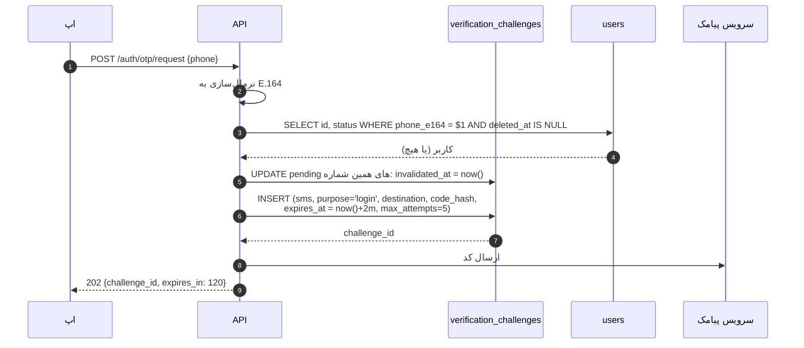
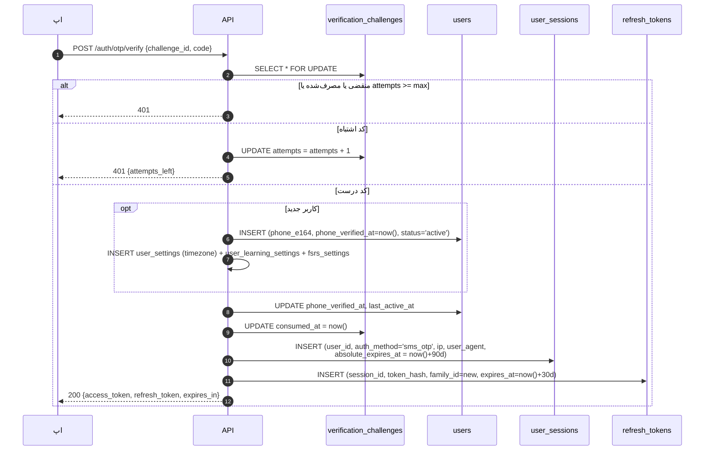
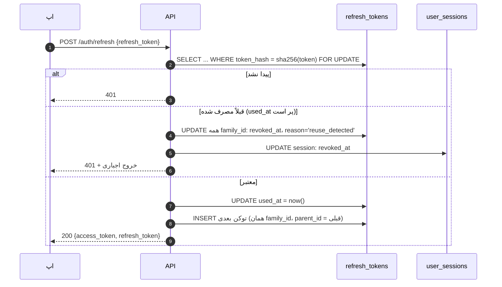
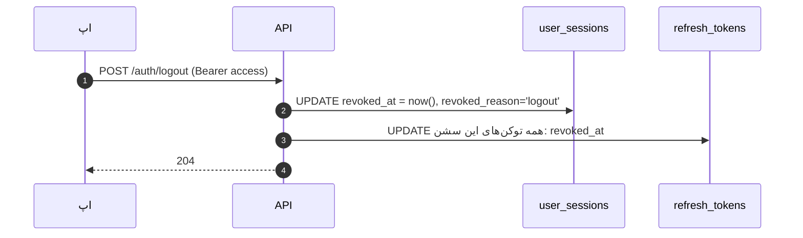
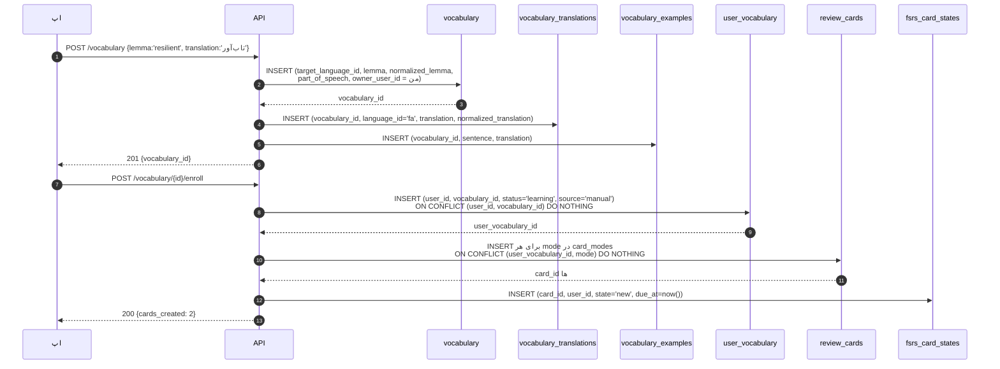
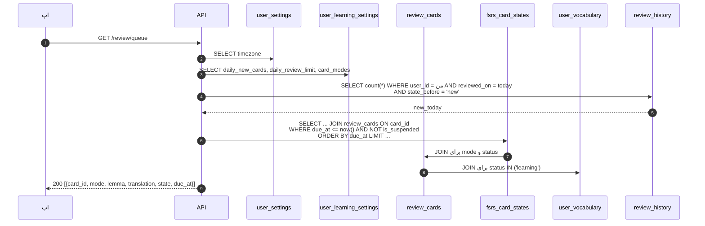
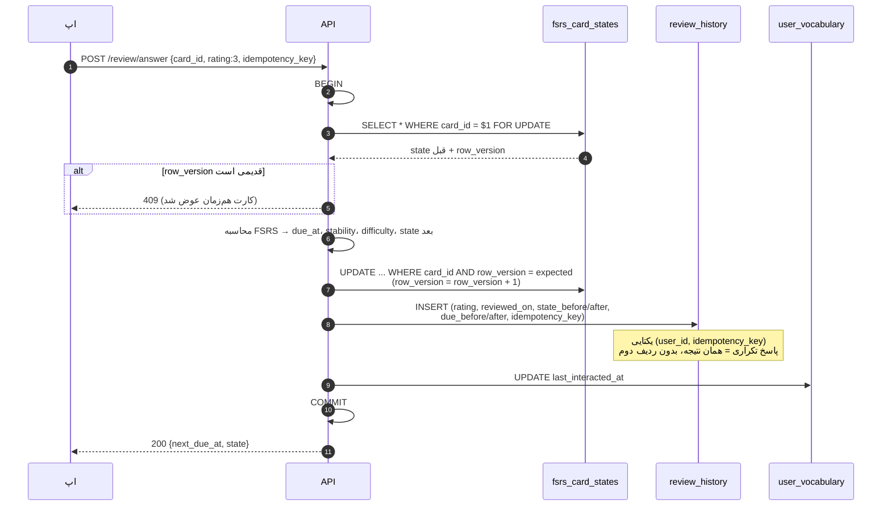
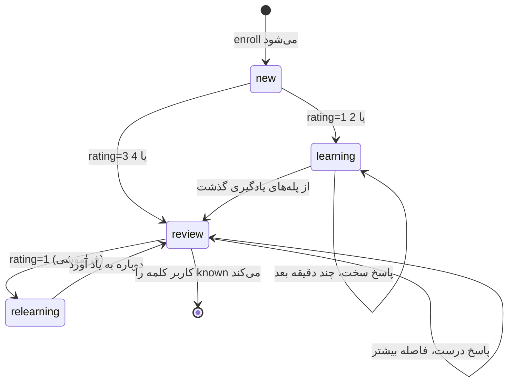
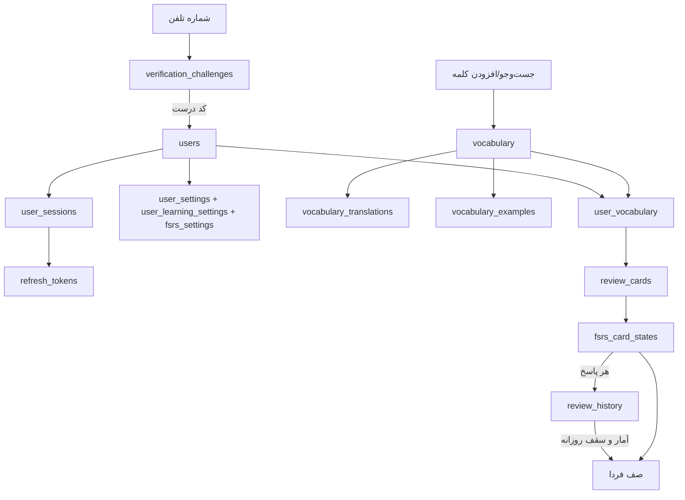

# Lurnian — نسخه اول (MVP v1)

این سند جواب یک سؤال است: **از ۳۸ جدول طراحی‌شده، برای نسخه اول کدام‌ها لازم‌اند و کاربر از کدام جدول به کدام جدول می‌رود؟**

طراحی کامل (`database-design.md`) برای «هیچ‌وقت گیر نکنیم» است، نه برای «همه را از روز اول بسازیم». v1 فقط ۱۵ جدول را لمس می‌کند؛ ۲۳ جدول بقیه بعداً و بدون تغییر ساختار اضافه می‌شوند.

---

## ۱. دامنه v1

**داخل v1:**

- ورود فقط با **شماره تلفن + کد پیامکی** (بدون رمز، بدون ایمیل).
- یک **سشن** با access token کوتاه + refresh token چرخشی.
- افزودن کلمه (از کاتالوگ یا کلمه شخصی)، معنی، مثال.
- ورود کلمه به برنامه مرور و ساخت کارت‌های تمرین.
- صف مرور امروز، ثبت پاسخ ۱..۴، زمان‌بندی FSRS.
- سقف روزانه و وضعیت known/ignored.

**بیرون v1:** پرداخت و اشتراک، نقش و پنل ادمین، OAuth، رمز/TOTP، اعلان push، دک و اشتراک‌گذاری دک، آپلود صدا، import، آمار پیشرفته.

---

## ۲. جدول‌هایی که v1 استفاده می‌کند

### احراز هویت (۴ جدول)

| جدول | چرا لازم است | در v1 چه چیزی داخلش می‌رود |
| --- | --- | --- |
| `users` | تنها جدولی که «کاربر وجود دارد» را تعریف می‌کند | یک ردیف با `phone_e164`، `phone_verified_at`، `status='active'` |
| `verification_challenges` | کد پیامکی یکبارمصرف، قبل از اینکه کاربر وجود داشته باشد | `channel='sms'`, `purpose='login'`, `destination=+98…`, `code_hash`, `expires_at`, `attempts` |
| `user_sessions` | واحد «خروج از حساب»؛ access token بی‌حالت است و جای ذخیره ندارد | `auth_method='sms_otp'`, `absolute_expires_at`, `last_seen_at`, `revoked_at` |
| `refresh_tokens` | توکن چرخشی؛ فقط هش ذخیره می‌شود | `session_id`, `token_hash`, `family_id`, `expires_at`, `used_at` |

سه جدول احراز هویت که **لازم نیست**: `user_credentials` (رمزی وجود ندارد)، `user_identities` (OAuth نداریم)، `user_devices` (بدون push و بدون «دستگاه‌های من» کار می‌کند؛ `user_sessions.device_id` خالی می‌ماند).

### تنظیمات (۲ جدول)

| جدول | چرا | داخلش |
| --- | --- | --- |
| `user_settings` | `timezone` مرجع محاسبه «امروزِ کاربر» است | `timezone='Asia/Tehran'`, `locale='fa-IR'` |
| `user_learning_settings` | سقف روزانه و جهت‌های کارت از اینجا خوانده می‌شود | `target_language_id`, `daily_new_cards=10`, `daily_review_limit=200`, `card_modes` |

### محتوای آموزشی (۴ جدول)

| جدول | چرا | داخلش |
| --- | --- | --- |
| `languages` | فقط یک‌بار seed می‌شود | `en`, `fa` |
| `vocabulary` | خود کلمه؛ ردیف کاتالوگ (`owner_user_id IS NULL`) یا کلمه شخصی کاربر | `lemma`, `normalized_lemma`, `part_of_speech`, `owner_user_id` |
| `vocabulary_translations` | معنی کلمه به فارسی | `translation`, `language_id` |
| `vocabulary_examples` | یک یا دو جمله نمونه | `sentence`, `translation` |

بدون `learning_decks` و `deck_vocabulary`: v1 «همه کلمه‌های من» یک لیست است، دک لازم ندارد.

### پیشرفت و مرور (۵ جدول)

| جدول | چرا | داخلش |
| --- | --- | --- |
| `user_vocabulary` | تنها دروازه‌ای که کلمه را وارد برنامه مطالعه کاربر می‌کند | `user_id`, `vocabulary_id`, `status`, `source='manual'` |
| `review_cards` | هویت کارت = (کلمه ثبت‌شده، جهت تمرین) | `mode='word_to_fa'`, `is_suspended=false` |
| `fsrs_card_states` | تنها ردیفی که با هر پاسخ عوض می‌شود + `row_version` | `due_at`, `state`, `stability`, `difficulty`, `reps`, `lapses` |
| `fsrs_settings` | سیاست زمان‌بندی هر کاربر | `desired_retention=0.9`, `maximum_interval_days` |
| `review_history` | دفتر فقط‌افزودنی؛ آمار و سقف روزانه از اینجا می‌آید | `rating`, `reviewed_on`, `state_before/after`, `idempotency_key` |

`fsrs_parameters` در v1 لازم نیست: کارت‌ها با پارامترهای پیش‌فرض کد کار می‌کنند (`parameters_id` خالی می‌ماند).

---

## ۳. جدول‌هایی که v1 نمی‌خواهد

| گروه | جدول‌ها | چرا بعداً |
| --- | --- | --- |
| امنیت پیشرفته | `user_security_settings`, `security_events`, `roles`, `user_roles` | بدون 2FA و پنل ادمین، هیچ‌کس این‌ها را نمی‌نویسد |
| پرداخت | `subscription_plans`, `plan_features`, `plan_feature_values`, `user_subscriptions`, `orders`, `payments`, `entitlements` | v1 رایگان است؛ دسترسی کاربر فقط «وضعیت حساب» است |
| اعلان | `notification_preferences`, `notification_deliveries`, `notification_templates` | یادآور مرور بعد از پایدار شدن چرخه مرور |
| زیرساخت | `outbox_events`, `idempotency_keys`, `platform_jobs` | v1 همه‌چیز را در همان تراکنش انجام می‌دهد |
| محتوا | `learning_decks`, `deck_vocabulary`, `audit_logs` | دک و لاگ تغییرات، بعد از تثبیت مدل کلمه |

نکته: این جدول‌ها در migration هستند و خالی می‌مانند؛ خالی بودنشان هزینه‌ای ندارد و لازم نیست حذف شوند.

---

## ۴. سناریوی ورود با شماره تلفن

### گام‌ها

1. کاربر شماره را می‌فرستد. اگر شماره در `users` نباشد، **همین‌جا کاربر ساخته نمی‌شود**؛ فقط کد صادر می‌شود.
2. کد قبلیِ همان شماره باطل می‌شود، کد جدید هش شده در `verification_challenges` می‌نشیند (۲ دقیقه اعتبار، ۵ تلاش).
3. کاربر کد را می‌فرستد. کد با هش مقایسه می‌شود و شمارنده `attempts` بالا می‌رود.
4. اگر کد درست بود: کاربر موجود پیدا/ساخته می‌شود، `phone_verified_at` پر می‌شود، چالش `consumed_at` می‌گیرد، سپس **یک** `user_sessions` و **یک** `refresh_tokens` ساخته می‌شود.
5. access token (۱۵ دقیقه، بی‌حالت) و refresh token (۳۰ روز، فقط یک‌بار قابل استفاده) به کلاینت برمی‌گردد.
6. هر بار access منقضی شد، refresh مصرف و با توکن جدید جایگزین می‌شود. اگر توکن **قبلاً مصرف‌شده** دوباره بیاید، کل خانواده توکن و سشن باطل می‌شود.
7. خروج = `revoked_at` روی سشن + توکن‌های همان سشن.

### دیاگرام ۱ — درخواست کد

### دیاگرام ۲ — تأیید کد و ساخت سشن

### دیاگرام ۳ — چرخش refresh و تشخیص استفاده مجدد

### دیاگرام ۴ — خروج

---

## ۵. وکب در v1 — چه ویژگی‌هایی

**باید باشد:**

1. جست‌وجوی کلمه در کاتالوگ عمومی (`vocabulary` با `owner_user_id IS NULL`).
2. افزودن کلمه شخصی اگر در کاتالوگ نبود (همان جدول، `owner_user_id` پر).
3. معنی (یک یا چند sense) و یک جمله نمونه.
4. «یاد می‌گیرم» → ردیف `user_vocabulary` + ساخت کارت برای هر جهت فعال.
5. صف امروز: کارت‌های `due_at <= now()` با احترام به سقف جدید/مرور.
6. پاسخ دادن با ۱..۴ و ذخیره `review_history` + آپدیت `fsrs_card_states`.
7. علامت known / ignored برای کلمه‌هایی که نباید مرور شوند.
8. آمار ساده: تعداد مرور امروز، تعداد کلمه در حال یادگیری.

**نباید باشد (v1):** آپلود صدا، ایمپورت فایل، دک اشتراکی، تصویر، تولید محتوا با AI، جست‌وجوی پیشرفته/فازی، undo.

| ویژگی | جدول‌های درگیر |
| --- | --- |
| جست‌وجوی کلمه | `vocabulary`, `vocabulary_translations` |
| افزودن کلمه شخصی | `vocabulary`, `vocabulary_translations`, `vocabulary_examples` |
| ورود به برنامه مرور | `user_vocabulary`, `review_cards`, `fsrs_card_states` |
| صف امروز | `review_cards`, `fsrs_card_states`, `user_learning_settings`, `user_settings`, `review_history` |
| ثبت پاسخ | `fsrs_card_states`, `review_history`, `user_vocabulary` |
| آمار | `review_history`, `user_vocabulary` |

---

## ۶. دیاگرام‌های مسیر کاربر

### دیاگرام ۵ — از «کلمه جدید» تا «کارت آماده مرور»

### دیاگرام ۶ — گرفتن صف امروز

### دیاگرام ۷ — ثبت پاسخ و حرکت کارت در زمان

### دیاگرام ۸ — چرخه عمر یک کارت

### دیاگرام ۹ — نقشه «از کجا به کجا»

---

## ۷. ترتیب ساختن

1. seed زبان‌ها + جدول‌های محتوا (بدون endpoint عمومی).
2. OTP: درخواست کد، تأیید، ساخت کاربر و تنظیمات پیش‌فرض.
3. سشن: صدور توکن، refresh چرخشی، logout (سرویس سشن از قبل هست؛ فقط مسیر OTP اضافه می‌شود).
4. وکب: جست‌وجو، افزودن کلمه شخصی، enroll.
5. مرور: صف، پاسخ، FSRS، سقف روزانه.
6. آمار ساده.

## ۸. وضعیت کد فعلی

- احراز هویت v1 پیاده شده است: `POST /auth/otp/request`, `/otp/verify`, `/refresh`, `/logout` و همچنین `/me`، `/sessions`، `/sessions/{id}` و `/sessions/revoke-all`.
- ورود فقط با شماره تلفن است؛ مسیرهای ایمیل/رمز حذف شده‌اند و رمزی ذخیره نمی‌شود.
- عمر توکن‌ها: access ۳۰ دقیقه، refresh ۳۶۵ روز، سقف سشن ۳۶۵ روز. refresh یک‌بارمصرف است و استفاده دوباره، خانواده توکن و سشن را می‌بندد.
- کد یکبارمصرف در همان تراکنش تأیید مصرف می‌شود و کاربر (چه جدید چه قدیم) در پاسخ همان درخواست برمی‌گردد.
- ارائه‌دهنده پیامک هنوز وصل نشده است؛ در توسعه کد در لاگ و در صورت `OTP_EXPOSE_IN_RESPONSE=true` در پاسخ می‌آید.
- مستند مسیرها و کدهای خطا: `docs/api/auth-v1.md`.

ساختار پوشه‌ها: `modules/auth/{domain,application,infrastructure,presentation}` و لایه مشترک `api/` (روتر v1 و هندلر خطای سراسری).
